# 🌾 Diagramas Técnicos del Sistema — De los Montes de María

Colección integral de diagramas arquitectónicos, flujos de secuencia, modelos de datos y procesos de la plataforma **De los Montes de María**. Todos los diagramas están especificados en formato nativo **Mermaid** para su renderizado directo en GitHub.

---

## 1. Alcance Funcional del Sistema

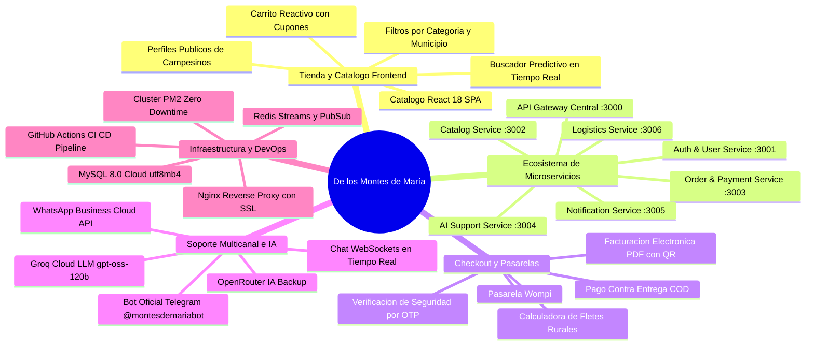

---

## 2. Topología de Infraestructura y Microservicios

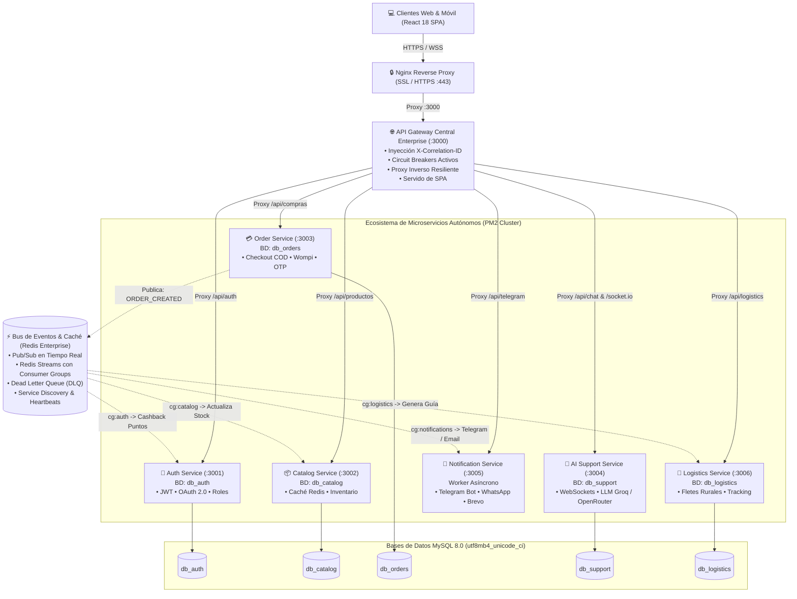

---

## 3. Arquitectura Hexagonal (Ports & Adapters / DDD)

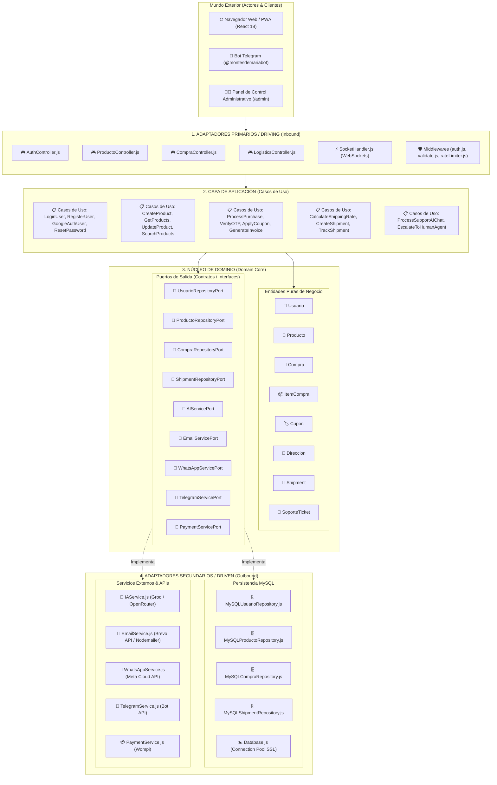

---

## 4. Diagrama de Secuencia: Inversión de Control y Flujo Interno (DIP)

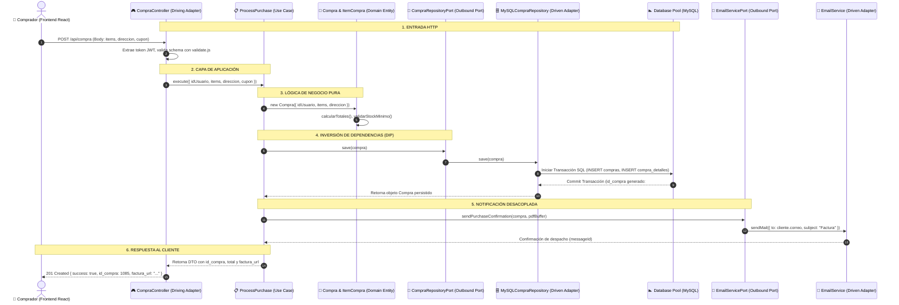

---

## 5. Diagrama de Secuencia: Checkout Asíncrono con Redis Streams y OTP

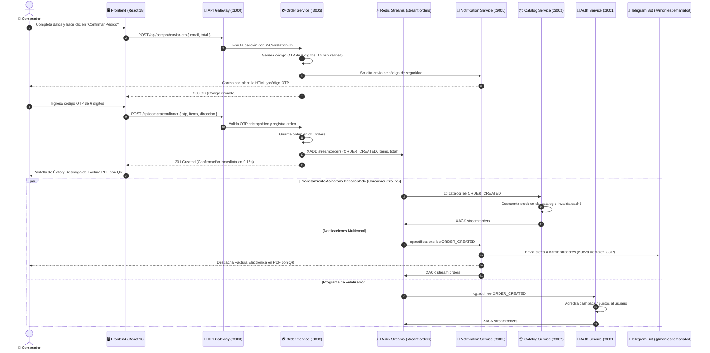

---

## 6. Diagrama de Secuencia: Soporte Multicanal en Tiempo Real (IA -> Humano -> Telegram)

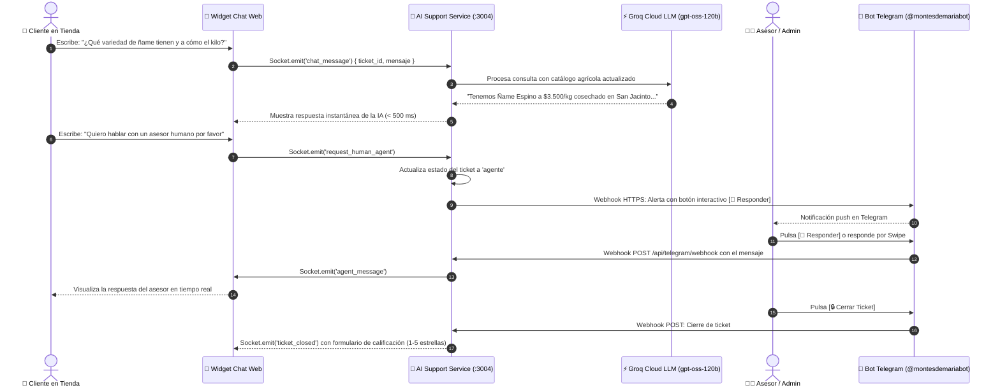

---

## 7. Diagrama de Flujo: Tolerancia a Fallos y Dead Letter Queue (DLQ)

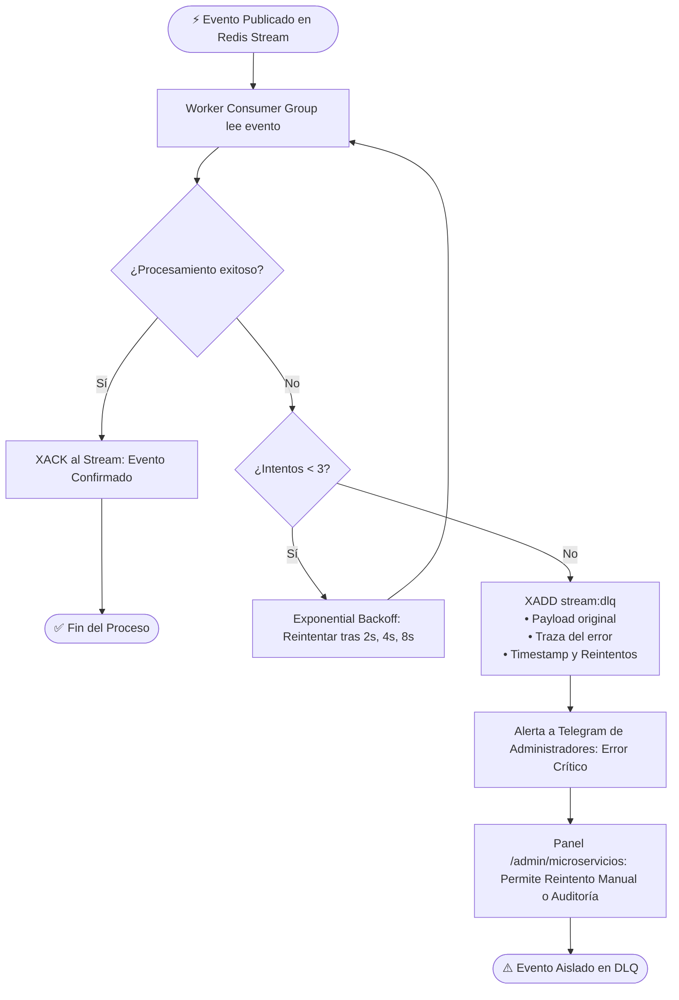

---

## 8. Diagrama de Estados: Ciclo de Vida de una Orden de Compra

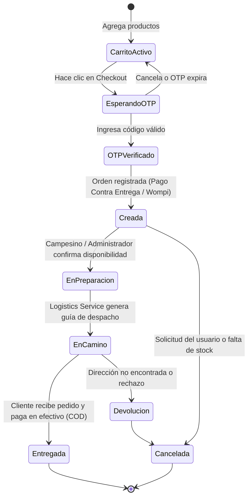

---

## 9. Diagrama de Estados: Ciclo de Vida de un Ticket de Soporte

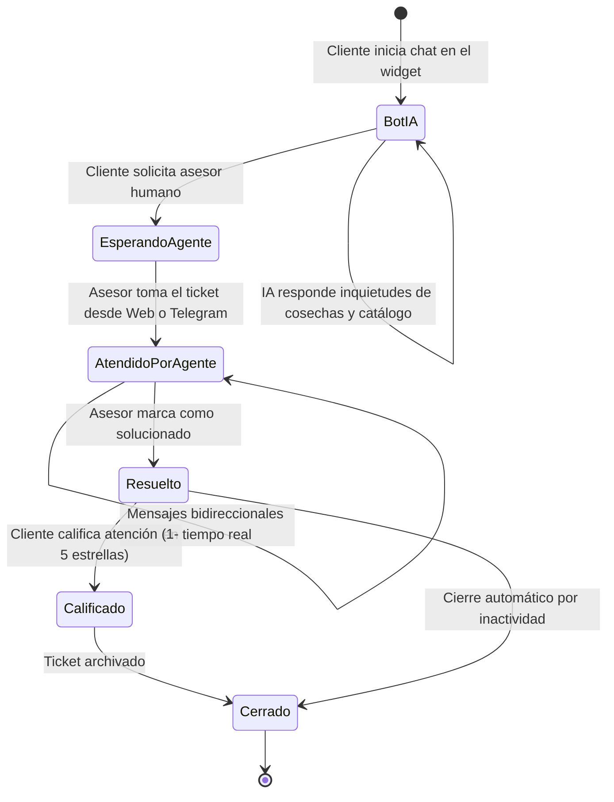

---

## 10. Diagrama de Clases: Modelo de Dominio y Roles del Sistema

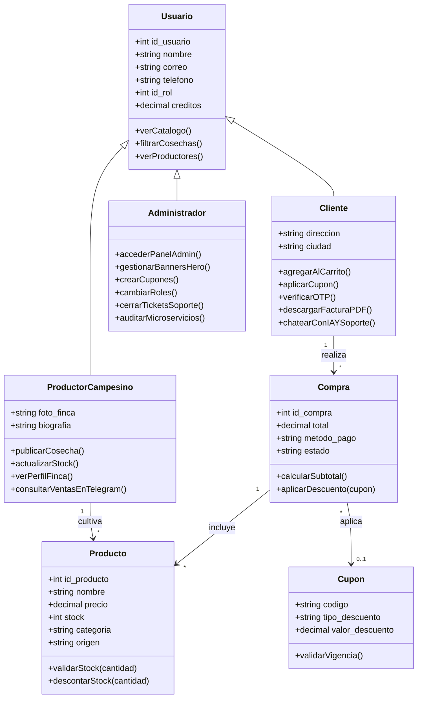

---

## 11. Diagrama Entidad-Relación (ERD) Completo de Base de Datos MySQL

---

## 12. Diagrama de Flujo: Pipeline CI/CD y Despliegue Automatizado

```mermaid
flowchart LR
    Dev([👨‍💻 Desarrollador]) -->|git push origin main| GH[🐙 Repositorio GitHub]

    subgraph GHA ["GitHub Actions Pipeline (.github/workflows/deploy.yml)"]
        direction TB
        LintTest["🧪 Tests & Linters\n• npm audit\n• Node.js 18.x Tests"]
        BuildFrontend["📦 Build Frontend SPA\n• Vite 5 Build\n• Asset Optimization"]
        DeployTrigger["🚀 SSH Deploy Script\n• Conexión segura SSH con claves"]
        LintTest --> BuildFrontend --> DeployTrigger
    end

    GH --> GHA

    subgraph Server ["Servidor de Producción (Oracle Cloud Ubuntu)"]
        direction TB
        GitPull["📥 git pull origin main"]
        BuildClient["🔨 npm run build (client)"]
        ReloadPM2["🔄 pm2 reload all --update-env\n• Zero-Downtime Reload"]
        NginxReload["🛡️ Nginx Reverse Proxy\n• SSL Let's Encrypt\n• Servido de Assets"]
        GitPull --> BuildClient --> ReloadPM2 --> NginxReload
    end

    DeployTrigger -->|SSH Command| Server
    NginxReload --> ProdWeb([🌐 delosmontesdemaria.dev Online])
```

---

## 13. Diagrama de Seguridad y Autenticación (JWT + Google OAuth 2.0)

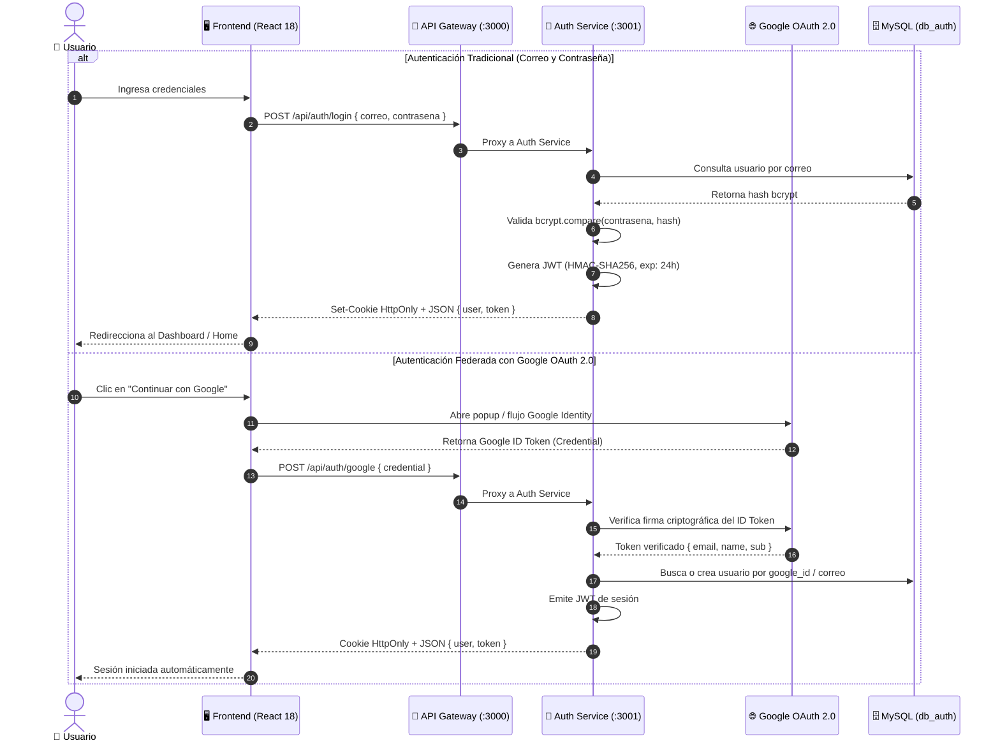
