# 🌾 Diagramas Técnicos del Sistema — De los Montes de María

Colección oficial de especificaciones arquitectónicas, modelos de interacción, topología de componentes y flujos de secuencia transaccionales de la plataforma **De los Montes de María**. Todos los diagramas han sido elaborados en formato nativo **Mermaid** y validados contra la implementación real del código fuente del backend y frontend.

---

## 📑 Índice de Diagramas
1. [Diagrama de Casos de Uso del Sistema](#1-diagrama-de-casos-de-uso-del-sistema)
2. [Diagrama de Componentes e Integraciones](#2-diagrama-de-componentes-e-integraciones)
3. [Diagrama de Secuencia del Proceso de Compra con Validación OTP](#3-diagrama-de-secuencia-del-proceso-de-compra-con-validación-otp)
4. [Topología de Infraestructura y Microservicios](#4-topología-de-infraestructura-y-microservicios)
5. [Arquitectura Hexagonal (Ports & Adapters)](#5-arquitectura-hexagonal-ports--adapters)
6. [Diagrama de Secuencia: Inversión de Control (DIP)](#6-diagrama-de-secuencia-inversión-de-control-dip)
7. [Diagrama de Secuencia: Soporte Multicanal en Tiempo Real](#7-diagrama-de-secuencia-soporte-multicanal-en-tiempo-real)
8. [Diagrama de Flujo: Tolerancia a Fallos y Dead Letter Queue (DLQ)](#8-diagrama-de-flujo-tolerancia-a-fallos-y-dead-letter-queue-dlq)
9. [Diagrama de Estados: Ciclo de Vida de una Orden](#9-diagrama-de-estados-ciclo-de-vida-de-una-orden)
10. [Diagrama de Estados: Ciclo de Vida de un Ticket de Soporte](#10-diagrama-de-estados-ciclo-de-vida-de-un-ticket-de-soporte)
11. [Diagrama de Clases y Roles del Sistema](#11-diagrama-de-clases-y-roles-del-sistema)
12. [Diagrama Entidad-Relación (ERD) Completo de Base de Datos MySQL](#12-diagrama-entidad-relación-erd-completo-de-base-de-datos-mysql)
13. [Diagrama de Flujo: Pipeline CI/CD y Despliegue](#13-diagrama-de-flujo-pipeline-cicd-y-despliegue)
14. [Diagrama de Seguridad y Autenticación (JWT + Google OAuth 2.0)](#14-diagrama-de-seguridad-y-autenticación-jwt--google-oauth-20)

---

## 1. Diagrama de Casos de Uso del Sistema

Este diagrama formaliza las interacciones principales entre los actores del ecosistema (**Cliente/Comprador**, **Productor Campesino/Vendedor**, **Asesor de Soporte**, **Administrador** y los **Sistemas Externos**) y los diferentes subsistemas de la plataforma.

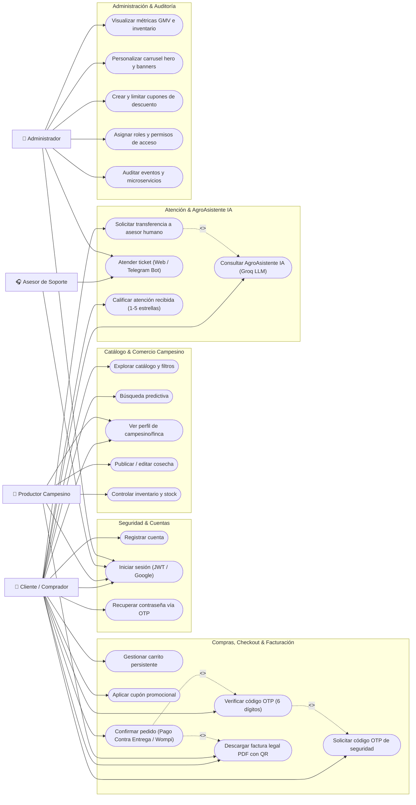

---

## 2. Diagrama de Componentes e Integraciones

Representa la estructura modular física y lógica del software ajustada estrictamente a los mecanismos reales de integración presentes en el código (Axios REST, Context Providers, Express Routers, Controllers, Use Cases, Repositories, MySQL Pool, Redis Streams y servicios externos).

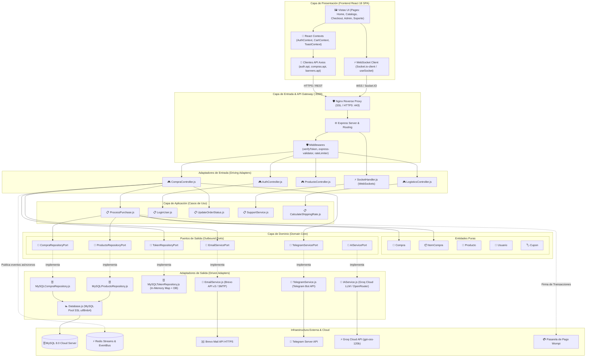

---

## 3. Diagrama de Secuencia del Proceso de Compra con Validación OTP

Detalla el flujo lógico del proceso de compra implementado en [`CompraController.js`](file:///c:/Users/danil/Downloads/De%20los%20montesdemaria/src/infrastructure/adapters/driving/http/controllers/CompraController.js), [`ProcessPurchase.js`](file:///c:/Users/danil/Downloads/De%20los%20montesdemaria/src/application/use-cases/purchase/ProcessPurchase.js), [`MySQLCompraRepository.js`](file:///c:/Users/danil/Downloads/De%20los%20montesdemaria/src/infrastructure/adapters/driven/persistence/MySQLCompraRepository.js) y [`EmailService.js`](file:///c:/Users/danil/Downloads/De%20los%20montesdemaria/src/infrastructure/external-services/EmailService.js).

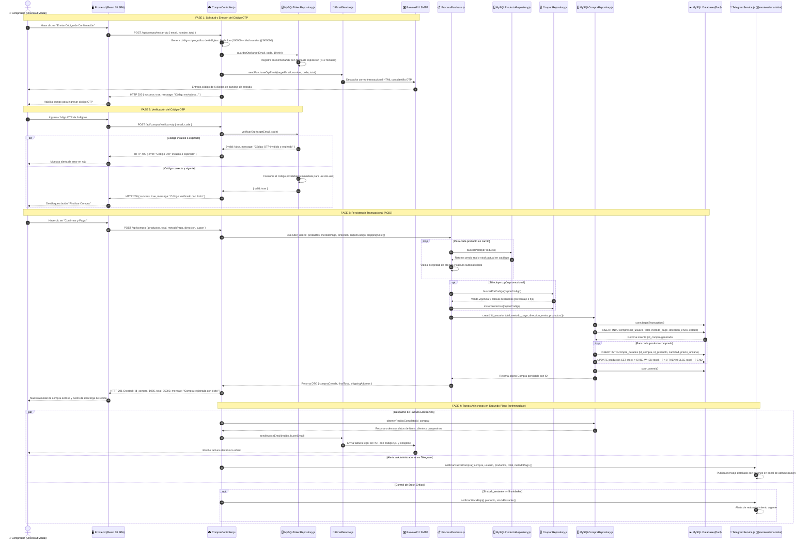

---

## 4. Topología de Infraestructura y Microservicios

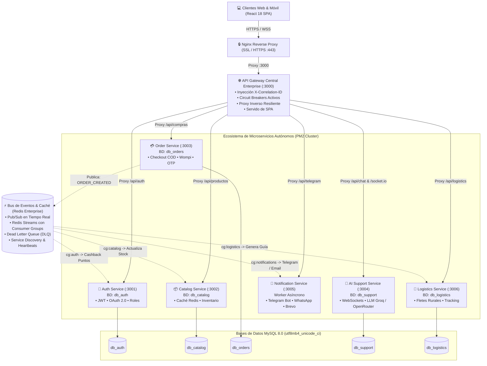

---

## 5. Arquitectura Hexagonal (Ports & Adapters)
 

  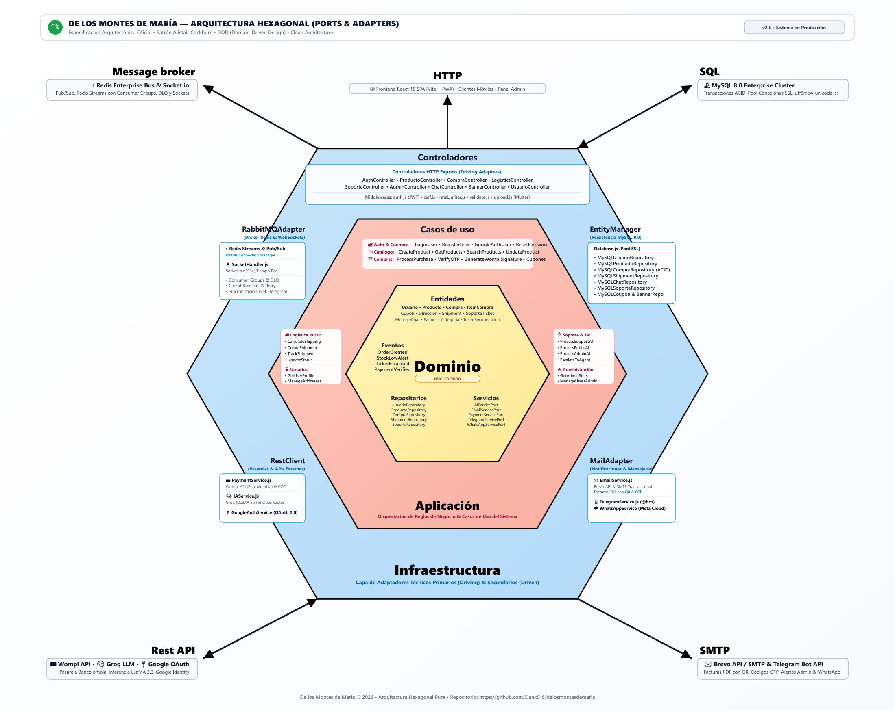

<em>Topología hexagonal concéntrica: Núcleo de Dominio (Amarillo), Capa de Aplicación / Casos de Uso (Salmón), e Infraestructura de Adaptadores (Azul) con protocolos externos (HTTP, SQL, SMTP, Rest API, Message Broker).</em>

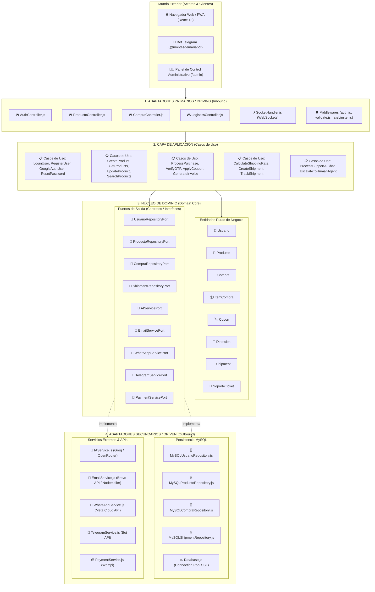

---

## 6. Diagrama de Secuencia: Inversión de Control (DIP)

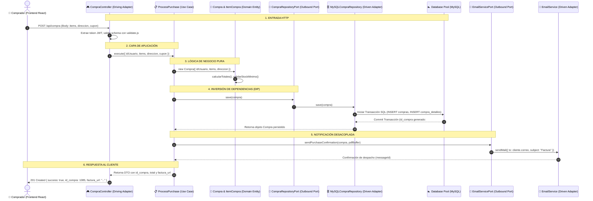

---

## 7. Diagrama de Secuencia: Soporte Multicanal en Tiempo Real

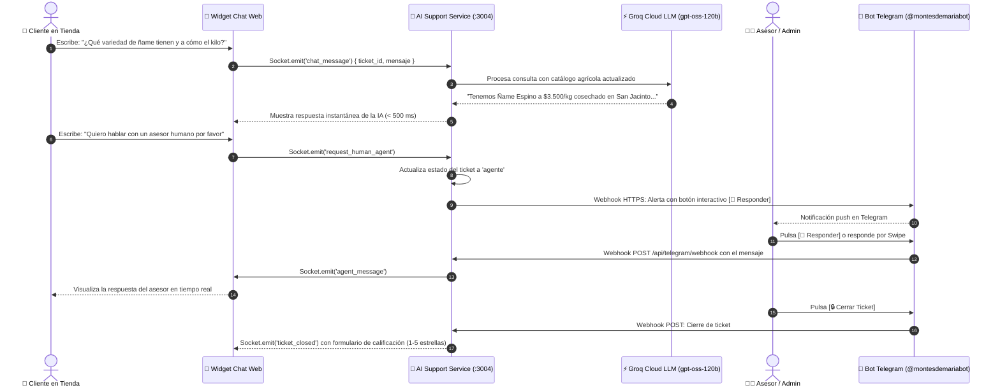

---

## 8. Diagrama de Flujo: Tolerancia a Fallos y Dead Letter Queue (DLQ)

---

## 9. Diagrama de Estados: Ciclo de Vida de una Orden

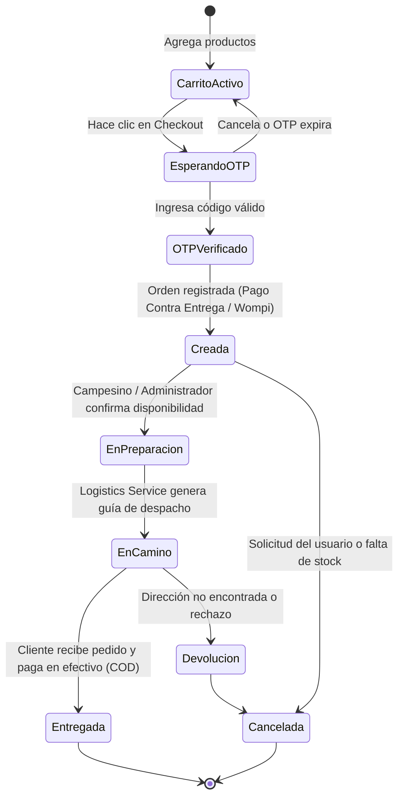

---

## 10. Diagrama de Estados: Ciclo de Vida de un Ticket de Soporte

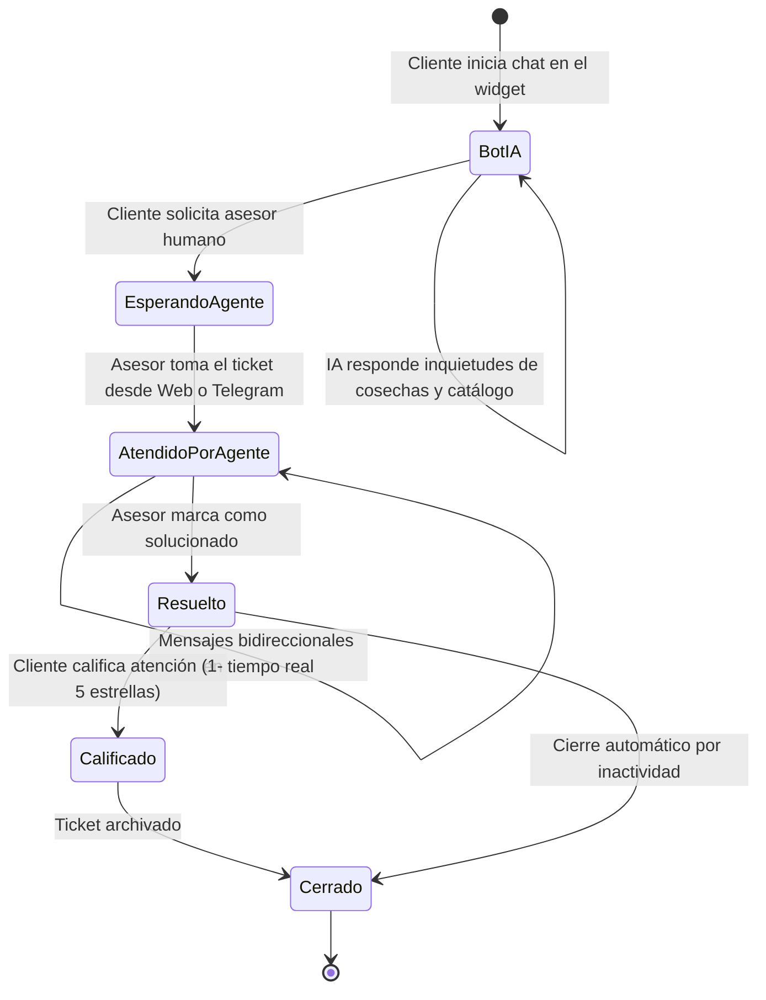

---

## 11. Diagrama de Clases y Roles del Sistema

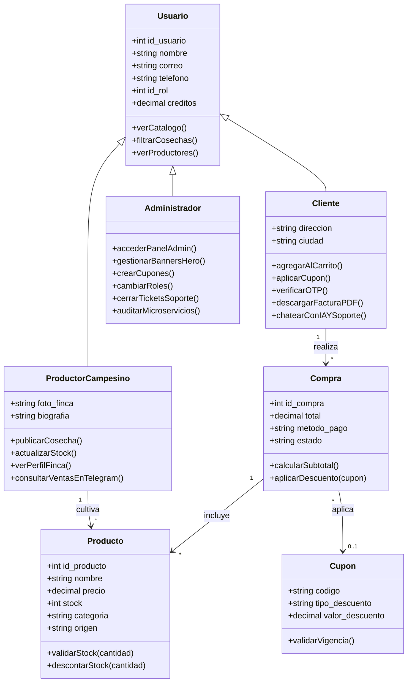

---

## 12. Diagrama Entidad-Relación (ERD) Completo de Base de Datos MySQL

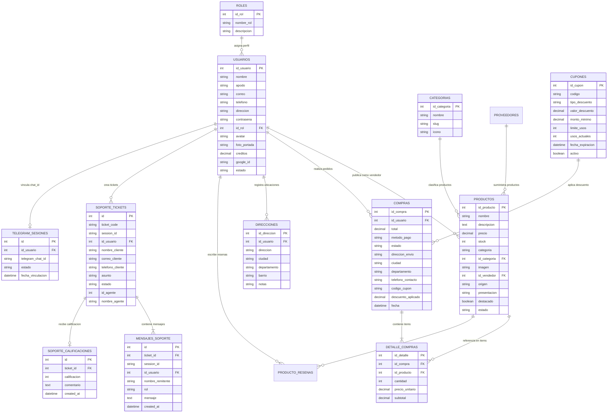

---

## 13. Diagrama de Flujo: Pipeline CI/CD y Despliegue

---

## 14. Diagrama de Seguridad y Autenticación (JWT + Google OAuth 2.0)

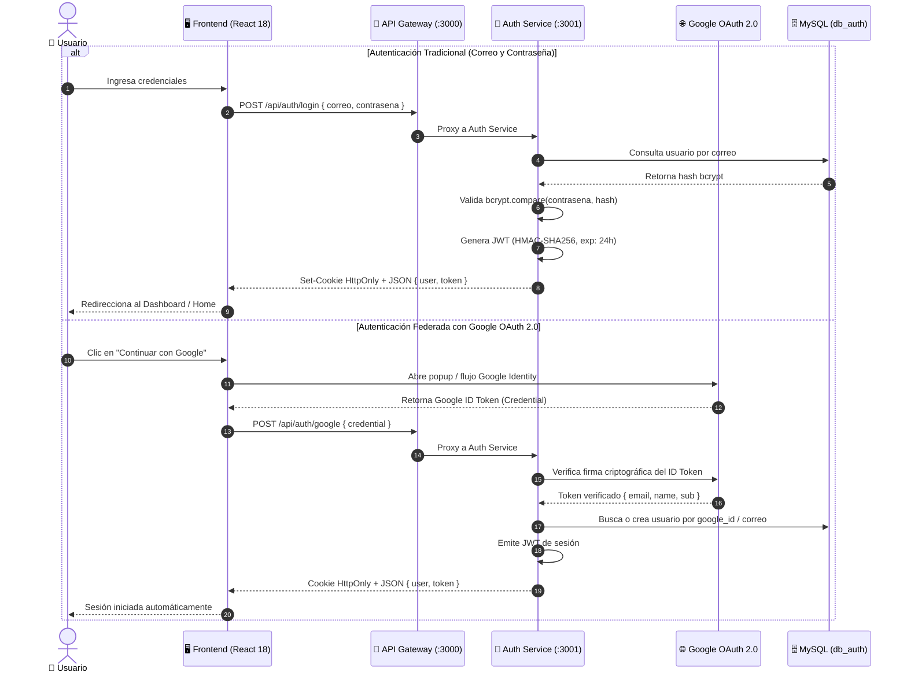
