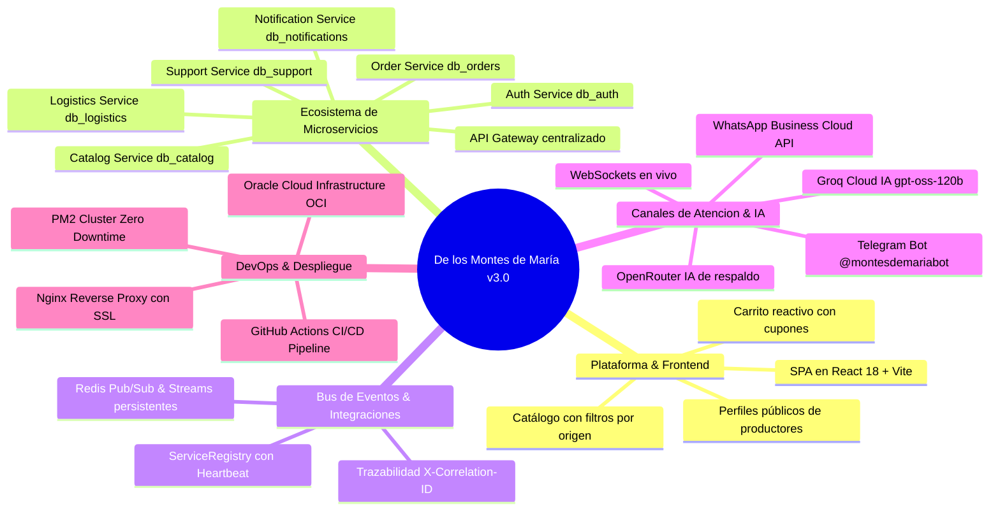
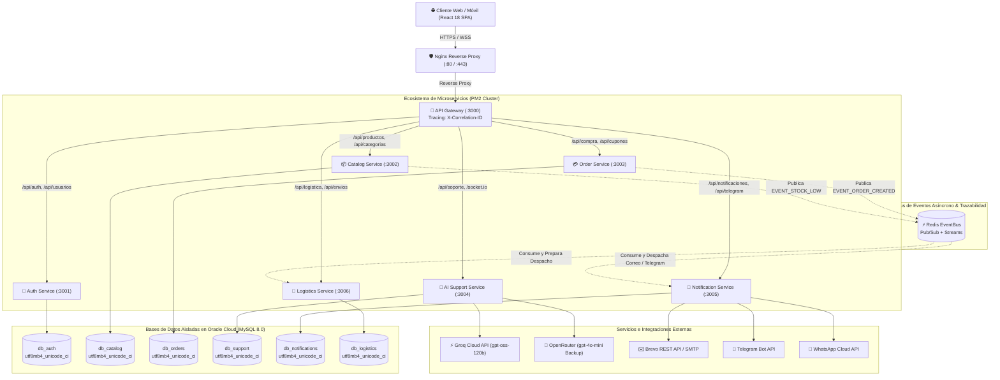
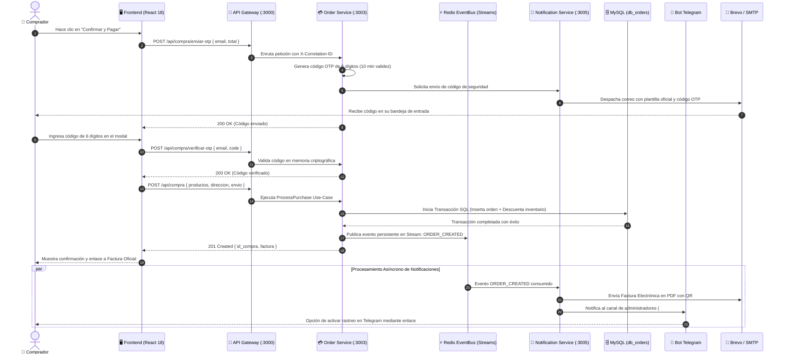

# 🌾 DOCUMENTO DE ESPECIFICACIÓN Y GESTIÓN DE PROYECTO
## PLATAFORMA AGROPECUARIA & COMERCIO CAMPESINO DIRECTO: DE LOS MONTES DE MARÍA

---

# 1. INFORMACIÓN GENERAL Y ALCANCE

## 1.1 Portada y Control de Versiones

| Parámetro | Detalle |
| :--- | :--- |
| **Nombre del Proyecto** | De los Montes de María — Plataforma Agropecuaria & Comercio Campesino Directo |
| **Código del Proyecto** | AGRO-MDM-2026 |
| **Autor / Líder Técnico** | Danilo Rodelo & Equipo de Desarrollo De los Montes de María |
| **Organización** | De los Montes de María S.A.S. |
| **Fecha de Creación** | 15 de Febrero de 2026 |
| **Última Actualización** | 15 de Octubre de 2026 |
| **Versión del Documento** | 3.0.0 Enterprise |
| **Estado del Proyecto** | Producción / Operación en Servidor Dedicado Oracle Cloud (OCI) |
| **Repositorio Oficial** | [GitHub - Danx016/delosmontesdemaria](https://github.com/Danx016/delosmontesdemaria) |
| **URL Producción** | [https://delosmontesdemaria.dev](https://delosmontesdemaria.dev) |
| **Servidor Host (VPS)** | Oracle Cloud Infrastructure (Ubuntu Linux 22.04 LTS — IP: `157.137.233.119`) |
| **Servidor Base de Datos** | MySQL 8.0 Dedicado OCI (IP: `149.130.189.158` — Patrón Database-per-Service) |

### Registro de Cambios (Changelog)

| Versión | Fecha | Autor | Descripción de Cambios |
| :--- | :--- | :--- | :--- |
| **1.0.0** | 15/02/2026 | D. Rodelo | Creación de la arquitectura base monolítica inicial con Express y vistas EJS. |
| **1.5.0** | 22/03/2026 | D. Rodelo | Migración a SPA con React 18 + Vite, desacoplamiento de API REST y Context API. |
| **2.0.0** | 10/05/2026 | D. Rodelo | Refactorización a Clean Architecture (DDD) y módulo de compras con pasarela contra entrega. |
| **2.2.0** | 18/06/2026 | D. Rodelo | Integración de WebSockets (Socket.IO) para soporte en vivo y pasarela de correo Brevo/SMTP. |
| **2.4.0** | 25/07/2026 | D. Rodelo | Implementación del bot oficial de Telegram (`@montesdemariabot`) y AgroAsistente con IA (OpenRouter). |
| **2.5.0** | 19/08/2026 | D. Rodelo | Migración a Servidor Propio en Oracle Cloud (Ubuntu Linux + Nginx + PM2) con scripts de despliegue. |
| **3.0.0** | 15/10/2026 | D. Rodelo | **Transición a Arquitectura Empresarial de Microservicios:** Desacoplamiento en 7 servicios independientes + API Gateway, patrón *Database-per-Service* en MySQL (Oracle Cloud), Bus de Eventos Asíncrono con Redis (Pub/Sub y Streams persistentes), trazabilidad distribuida (`X-Correlation-ID`), motor dual de IA con Groq Cloud (`gpt-oss-120b`) + OpenRouter de respaldo, integración oficial de Meta WhatsApp Cloud API, estandarización de collations a `utf8mb4_unicode_ci` y Pipeline CI/CD automatizado en GitHub Actions con cero tiempo de inactividad (Zero Downtime). |

---

## 1.2 Resumen Ejecutivo

### El Problema
La subregión de los **Montes de María** (comprendida entre los departamentos de Bolívar y Sucre en el Caribe colombiano) es una de las despensas agrícolas más ricas y resilientes del país. No obstante, los pequeños y medianos productores campesinos enfrentan barreras estructurales críticas:
1. **Intermediación Abusiva:** Los intermediarios tradicionales capturan entre el 50% y 70% del valor final de la cosecha, dejando al campesino márgenes mínimos de rentabilidad.
2. **Pérdida Poscosecha:** Dificultad para encontrar compradores directos antes del deterioro de productos perecederos (ñame, yuca, plátano, aguacate, lácteos).
3. **Brecha Digital y de Canales:** Falta de herramientas tecnológicas accesibles y adaptadas a las realidades de conectividad rural para exhibir productos, gestionar inventarios y recibir pedidos confiables.

### La Solución Propuesta
**De los Montes de María** es un ecosistema digital integral de comercio justo agropecuario que conecta directamente a los campesinos y artesanos con consumidores particulares, restaurantes y mayoristas en todo el territorio colombiano. 

La plataforma combina:
* Una aplicación web moderna (SPA en React 18 + Vite) responsiva, accesible y de alta velocidad.
* Una arquitectura backend distribuida en **7 Microservicios independientes + API Gateway** bajo Arquitectura Hexagonal y DDD.
* **Bus de Eventos Asíncrono con Redis Pub/Sub y Redis Streams** para sincronización desacoplada de inventarios, órdenes y notificaciones.
* Patrón **Database-per-Service** en MySQL sobre Oracle Cloud Infrastructure, garantizando aislamiento de datos y alta tolerancia a fallos.
* Un sistema de verificación de transacciones mediante códigos de un solo uso (**OTP**) por correo electrónico antes de la confirmación del pedido.
* **Facturación electrónica automática** en PDF con código QR y cálculo dinámico de fletes por municipio.
* **Soporte multicanal híbrido en tiempo real:** WebSockets en vivo, Asistente con Inteligencia Artificial ultrarrápida (Groq Cloud LLM `gpt-oss-120b` + OpenRouter de respaldo), **Bot oficial de Telegram** (`@montesdemariabot`) y notificaciones transaccionales vía **Meta WhatsApp Business Cloud API**.

### Impacto Esperado
* **Económico:** Aumento del 35% al 60% en los ingresos netos percibidos por los campesinos al vender a precios justos directos.
* **Social:** Visibilización y dignificación del campesinado de municipios como El Carmen de Bolívar, San Jacinto, San Juan Nepomuceno, Ovejas, Chalán y María La Baja.
* **Operativo:** Tiempos de respuesta de soporte inferiores a 3 segundos mediante IA, resolución con agentes en menos de 3 minutos vía Telegram/WhatsApp, y formalización de transacciones con facturación digital inmediata.

---

## 1.3 Objetivos del Proyecto

```
                   ┌────────────────────────────────────────────────────────┐
                   │                   OBJETIVO GENERAL                     │
                   │  Conectar campesinos con compradores sin intermediación│
                   └───────────────────────────┬────────────────────────────┘
                                               │
        ┌──────────────────────────────┬───────┴──────────────────────┬──────────────────────────────┐
        ▼                              ▼                              ▼                              ▼
 ┌──────────────┐               ┌──────────────┐               ┌──────────────┐               ┌──────────────┐
 │  ESPECÍFICO 1│               │  ESPECÍFICO 2│               │  ESPECÍFICO 3│               │  ESPECÍFICO 4│
 │  E-Commerce  │               │ Transaccional│               │ Soporte & IA │               │  Operaciones │
 │ Microservicios│              │  OTP + Fact  │               │ + Telegram/WA│               │  CI/CD & KPI │
 └──────────────┘               └──────────────┘               └──────────────┘               └──────────────┘
```

### Objetivo General
Desarrollar, desplegar y operar una plataforma tecnológica integral de comercio electrónico y gestión agropecuaria basada en microservicios que suprima intermediarios comerciales, digitalice el catálogo de cosechas de los Montes de María y asegure transacciones transparentes y verificables entre el campo y la ciudad.

### Objetivos Específicos (Criterios SMART)

| ID | Objetivo Específico | Indicador / Criterio SMART |
| :--- | :--- | :--- |
| **OE-01** | **Digitalización del Catálogo Campesino:** Operar un catálogo dinámico con microservicio dedicado (`catalog-service`), caché en memoria y búsqueda predictiva con tiempos de respuesta menores a 80 ms. | *Específico, Medible, Alcanzable (< 80 ms).* |
| **OE-02** | **Seguridad en Checkout y Formalización:** Procesar órdenes contra entrega con validación de código de seguridad OTP vía email, cálculo automático de fletes y emisión de factura PDF oficial con QR en menos de 2 segundos. | *Medible (100% órdenes verificadas con OTP), Confiable.* |
| **OE-03** | **Atención Multicanal Inteligente:** Integrar soporte omnicanal mediante WebSockets, Groq Cloud IA (LPU ultrarrápida), Telegram Bot y WhatsApp Business Cloud API, automatizando más del 75% de inquietudes frecuentes. | *Específico, Medible (>75% resolución IA, <500 ms latencia).* |
| **OE-04** | **Resiliencia Operativa y CI/CD:** Implementar arquitectura de microservicios con aislamiento de bases de datos, bus de eventos Redis, despliegue continuo en GitHub Actions y disponibilidad superior al 99.8%. | *Temporal, Medible (Zero Downtime, SLA 99.8%).* |

---

## 1.4 Alcance del Proyecto



### Qué Incluye (Entregables y Funcionalidades Clave)

1. **Frontend SPA React 18 (Client):**
   * Catálogo con filtros avanzados por municipio de origen, categoría, disponibilidad y rango de precios.
   * Perfil del productor campesino con historia de la finca, galería fotográfica y reseñas de compradores.
   * Carrito reactivo con persistencia, cotización de envío en vivo y soporte para cupones promocionales.
   * Modo visual Claro / Oscuro con variables CSS HSL nativas y diseño 100% adaptable a teléfonos móviles.

2. **Capa de Microservicios Backend (Node.js & Express):**
   * **API Gateway (`:3000`):** Enrutamiento centralizado, balanceo, validación de cabeceras, límites de tasa (*Rate Limiting*) y propagación del encabezado de correlación (`X-Correlation-ID`).
   * **Auth & User Service (`:3001`):** Autenticación local con Bcrypt, Google OAuth 2.0, emisión de tokens JWT seguros en cookies `HttpOnly`, recuperación de contraseña y gestión de direcciones del usuario (`db_auth`).
   * **Catalog Service (`:3002`):** Gestión de cosechas, categorías agrícolas, control de inventario en bodega y cálculo de calificaciones/reseñas (`db_catalog`).
   * **Order & Payment Service (`:3003`):** Procesamiento de compras contra entrega, validación criptográfica de códigos OTP, facturación en PDF con QR y cálculo de descuentos por cupones (`db_orders`).
   * **AI Support Service (`:3004`):** Chat en vivo vía Socket.IO, asistente virtual con Groq Cloud y OpenRouter, escalamiento a agentes humanos y registro de tickets (`db_support`).
   * **Notification Service (`:3005`):** Despacho de correos transaccionales (Brevo API REST + SMTP Gmail), integración bidireccional con Bot de Telegram (`@montesdemariabot`) y mensajes por WhatsApp Business Cloud API (`db_notifications`).
   * **Logistics Service (`:3006`):** Matriz de tarifas de flete municipal por peso/volumen, geocodificación de entregas y rastreo de despachos (`db_logistics`).

3. **Bus de Eventos y Mensajería Asíncrona (Redis):**
   * Publicación/Suscripción volátil (Pub/Sub) para eventos en tiempo real.
   * **Redis Streams persistentes** (`orders:stream`, `notifications:stream`) con confirmación de entrega y garantía de ejecución ante caídas temporales de red.

4. **DevOps y Automatización:**
   * **Pipeline CI/CD en GitHub Actions** que compila la SPA, ejecuta validación sintáctica de todos los microservicios y despliega automáticamente vía SSH en Oracle Cloud con recarga en caliente de PM2 (`pm2 reload all --update-env`).

---

# 2. ARQUITECTURA Y DISEÑO DEL SISTEMA

## 2.1 Topología de Microservicios y Patrón Database-per-Service

El sistema adopta una arquitectura orientada a microservicios donde cada dominio posee su propio ciclo de vida, puerto de red y base de datos privada en MySQL, comunicándose entre sí a través de HTTP síncrono (vía Gateway) y eventos asíncronos mediante Redis:



---

## 2.2 Especificación de Microservicios y Responsabilidades

| Microservicio | Puerto | Base de Datos | Responsabilidades Principales | Endpoints Clave |
| :--- | :---: | :--- | :--- | :--- |
| **API Gateway** | `3000` | N/A (Proxy) | Proxy inverso centralizado, CORS, validación de origen, Rate Limiting distribuido, inyección de `X-Correlation-ID` para trazabilidad y terminación de peticiones anómalas. | `/api/*`, `/health` |
| **Auth & User** | `3001` | `db_auth` | Registro, login, hash Bcrypt, verificación JWT en cookies HttpOnly, Google OAuth 2.0, restablecimiento de contraseña, perfiles de usuario y libreta de direcciones. | `/api/auth/login`, `/api/auth/registro`, `/api/auth/google`, `/api/usuarios/me` |
| **Catalog** | `3002` | `db_catalog` | Catálogo de cosechas agrícolas, control de stock, filtros avanzados por municipio y categoría, sistema de valoración y comentarios de productos. | `/api/productos`, `/api/categorias`, `/api/productos/:id/resenas` |
| **Order & Payment** | `3003` | `db_orders` | Gestión del ciclo de vida de compras, validación de stock antes del pago, generación y verificación de código OTP por correo, cálculo de descuentos con cupones, emisión de recibos oficiales en PDF y orquestación de pagos contra entrega. | `/api/compra`, `/api/compra/enviar-otp`, `/api/compra/verificar-otp`, `/api/cupones` |
| **AI Support** | `3004` | `db_support` | Chat en vivo bidireccional cliente-agente mediante WebSockets (Socket.IO), motor de razonamiento con IA agronómica (Groq Cloud + OpenRouter), escalamiento hacia agentes humanos y registro de auditoría de tickets. | `/api/soporte/tickets`, `/api/soporte/calificar`, `/socket.io` |
| **Notification** | `3005` | `db_notifications` | Motor multicanal de mensajería: despacho de correos HTML mediante Brevo API REST con fallback a Gmail SMTP, Webhooks bidireccionales de Telegram (`@montesdemariabot`) y notificaciones transaccionales mediante WhatsApp Business Cloud API. | `/api/notificaciones/enviar`, `/api/telegram/webhook`, `/api/whatsapp/webhook` |
| **Logistics** | `3006` | `db_logistics` | Cálculo de costos de envío y flete según origen y destino municipal en Bolívar/Sucre, generación de números de guía de despacho y actualización del estado del pedido (*En preparación, En camino, Entregado*). | `/api/logistica/flete`, `/api/logistica/envios/:id/estado` |

---

## 2.3 Proceso Transaccional Event-Driven (Checkout con OTP y Notificaciones)

El flujo de compras combina sincronización síncrona para la validación del comprador con eventos asíncronos persistentes para notificar a los diferentes canales:



---

## 2.4 Estandarización de Base de Datos y Prevención de Errores de Intercalación

### Unificación de Collations (`utf8mb4_unicode_ci`)
Para garantizar compatibilidad total entre MySQL 8.0 y comparaciones entre tablas relacionadas (`JOIN`, subconsultas y filtros `LOWER()` o `UPPER()`), toda la infraestructura de base de datos se encuentra estrictamente unificada:

1. **Juego de Caracteres Predeterminado:** `utf8mb4` (soporte completo para caracteres multilingües, tildes y emojis).
2. **Collation Uniforme:** `utf8mb4_unicode_ci` aplicada a nivel de:
   * Servidor y bases de datos (`ALTER DATABASE db_name CHARACTER SET utf8mb4 COLLATE utf8mb4_unicode_ci`).
   * Tablas individuales (`ENGINE=InnoDB DEFAULT CHARSET=utf8mb4 COLLATE=utf8mb4_unicode_ci`).
   * Todas las columnas textuales (`VARCHAR`, `TEXT`, `MEDIUMTEXT`).
   * Configuración de los pools de conexión de Node.js (`mysql2` con `charset: 'utf8mb4'`).
3. **Blindaje en Repositorios:** Todas las consultas SQL que realizan comparaciones de texto en cláusulas `JOIN` incorporan `COLLATE utf8mb4_unicode_ci` explícito para prevenir cualquier error de *Illegal mix of collations*.

---

# 3. STACK TECNOLÓGICO Y HERRAMIENTAS

| Capa | Tecnología | Versión | Propósito / Justificación Técnica |
| :--- | :--- | :--- | :--- |
| **Frontend Framework** | React | `18.3.1` | Renderizado reactivo modular, Virtual DOM de alto desempeño y gestión eficiente de estado con Context API. |
| **Tooling & Bundler** | Vite | `5.4.x` | Compilación ultrarrápida mediante ES Modules nativos y Hot Module Replacement (HMR). |
| **Estilos & Diseño** | Vanilla CSS + Tokens | CSS3 Moderno | Cero dependencias pesadas; paleta HSL optimizada con soporte nativo de modo claro y oscuro. |
| **Enrutamiento Web** | React Router DOM | `6.26.x` | Navegación SPA fluida del lado del cliente sin recargas de página. |
| **Servidor Host (VPS)** | Oracle Cloud Infrastructure (OCI) | `Ubuntu 22.04 LTS` | Máquina virtual dedicada en la nube (IP: `157.137.233.119`) con alto rendimiento y conectividad global. |
| **Reverse Proxy** | Nginx | `1.18+` | Balanceo de carga, terminación SSL/TLS, compresión gzip y soporte nativo de WebSockets. |
| **Gestor de Procesos** | PM2 Enterprise | `5.x` | Orquestación en modo cluster de los 7 microservicios, reinicio automático y monitoreo de memoria/CPU. |
| **Backend Runtime** | Node.js | `>= 20.0.0` | Entorno asíncrono no bloqueante basado en eventos para microservicios. |
| **Framework HTTP** | Express.js | `5.1.0` | Enrutamiento modular, middlewares de seguridad y arquitectura de microservicios RESTful. |
| **Base de Datos** | MySQL Server Dedicado | `8.0` | Servidor MySQL en OCI (`149.130.189.158`) con soporte ACID, claves foráneas y patrón Database-per-Service. |
| **Bus de Eventos** | Redis (ioredis) | `6.0.0` | Mensajería asíncrona mediante Pub/Sub en memoria y Redis Streams persistentes para eventos críticos. |
| **Comunicación en Vivo** | Socket.IO | `4.8.3` | Protocolo WebSocket bidireccional de baja latencia para el chat de soporte al cliente. |
| **Seguridad Web** | Bcrypt / JWT / Helmet | `6.0 / 9.0 / 8.1` | Hash criptográfico de contraseñas, tokens de sesión HttpOnly y endurecimiento de cabeceras HTTP. |
| **Emails Transaccionales** | Brevo REST API / Nodemailer | `v3 / 8.0.7` | Envío confiable de códigos OTP y facturas electrónicas en PDF con arquitectura de respaldo dual. |
| **Motor de IA Principal** | Groq Cloud API | LPU Inference | Modelo `openai/gpt-oss-120b` con inferencia ultrarrápida (14.400 solicitudes gratuitas diarias). |
| **Motor de IA Respaldo** | OpenRouter API | REST | Modelo `openai/gpt-4o-mini` para garantizar continuidad de servicio si la API principal se satura. |
| **Mensajería Telegram** | Telegram Bot API | Webhook HTTPS | Operación remota para administradores y rastreo de envíos para compradores (`@montesdemariabot`). |
| **Mensajería WhatsApp** | WhatsApp Business Cloud API | Graph API v19.0 | Canal oficial de notificaciones transaccionales y confirmación de pedidos a través de Meta. |
| **Integración Continua** | GitHub Actions | `v4` | Pipeline automatizado de validación, compilación de frontend y despliegue continuo vía SSH. |

---

# 4. CICLO DE VIDA, DEVOPS Y DESPLIEGUE

## 4.1 Pipeline de Integración y Despliegue Continuo (CI/CD)

El repositorio cuenta con un pipeline automatizado en **GitHub Actions** (`.github/workflows/deploy.yml`) que se activa automáticamente con cada `git push` hacia la rama `main`:

```mermaid
flowchart LR
    A[👨‍💻 Push a main] --> B[📥 GitHub Actions Checkout]
    B --> C[⚙️ Setup Node.js 20]
    C --> D[📦 npm install]
    D --> E[🔍 Validar Sintaxis Microservicios]
    E --> F[🎨 Compilar Frontend React Vite]
    F --> G{¿Build OK?}
    G -- No --> H[❌ Notificar Error y Cancelar]
    G -- Sí --> I[🚀 Despliegue SSH a Oracle Cloud]
    I --> J[📂 cd /home/ubuntu/montesdemaria]
    J --> K[🔄 git pull origin main]
    K --> L[🏗️ npm run build]
    L --> M[♻️ pm2 reload all --update-env]
    M --> N[💾 pm2 save]
    N --> O[✅ Despliegue Zero Downtime Completado]
```



### Fases del Pipeline:
1. **Validación y Compilación (`validate-and-build`):**
   * Verificación sintáctica con `node -c` sobre los servidores de todos los microservicios:
     `gateway`, `auth-service`, `catalog-service`, `order-service`, `ai-support-service`, `notification-service`, `logistics-service`.
   * Compilación de la SPA de React mediante Vite (`npm --prefix client run build`).
2. **Despliegue Remoto en Oracle Cloud (`deploy`):**
   * Conexión SSH segura mediante llave privada hacia el servidor de producción (`157.137.233.119`).
   * Actualización del código fuente con `git pull origin main`.
   * Recarga en caliente sin interrupción de tráfico con `pm2 reload all --update-env`.
   * Persistencia del estado con `pm2 save`.

---

## 4.2 Manual de Ejecución Local y Comandos de Producción

### 1. Ejecución en Entorno Local (Desarrollo)

```bash
# 1. Clonar el repositorio oficial
git clone https://github.com/Danx016/delosmontesdemaria.git
cd "De los montesdemaria"

# 2. Instalar dependencias del Backend y del Cliente
npm install
npm --prefix client install

# 3. Configurar variables de entorno
cp .env.example .env

# 4. Iniciar todos los microservicios mediante el orquestador
npm start
# (O alternativamente: npm run dev)

# 5. Iniciar el cliente Frontend en modo desarrollo (en otra terminal)
npm run dev:client
```

### 2. Comandos Operativos en el Servidor de Producción (Oracle Cloud)

```bash
# Conexión SSH al servidor de producción
ssh -i "ssh-key-2026-08-20.key" ubuntu@157.137.233.119

# Directorio de la aplicación
cd /home/ubuntu/montesdemaria

# Ver el estado y consumo de todos los microservicios
pm2 list

# Ver registros en tiempo real de un servicio específico
pm2 logs order-service
pm2 logs gateway

# Reiniciar todos los microservicios aplicando cambios de variables de entorno
pm2 reload all --update-env

# Guardar la lista activa de procesos para que inicien automáticamente si el servidor reinicia
pm2 save
```

---

# 5. MATRIZ DE RIESGOS Y ESTRATEGIAS DE MITIGACIÓN

| ID | Riesgo Identificado | Prob. | Imp. | Nivel | Estrategia de Mitigación / Plan de Contingencia |
| :--- | :--- | :---: | :---: | :---: | :--- |
| **R-01** | **Interrupción temporal de un microservicio.** | Media | Alto | **Mitigado** | **Aislamiento por Procesos:** La caída de un servicio secundario (ej. logística o soporte) no interrumpe el funcionamiento del catálogo o la autenticación. PM2 reinicia el proceso fallido en menos de 1 segundo de manera automática. |
| **R-02** | **Saturación o límite de peticiones de IA (LLM).** | Alta | Medio | **Mitigado** | **Arquitectura Dual de IA:** El sistema utiliza Groq Cloud (`gpt-oss-120b`) como motor principal por su alta tasa de cuota gratuita (14.400 req/día); si la API presenta demoras, el sistema conmuta automáticamente a OpenRouter (`gpt-4o-mini`). |
| **R-03** | **Incompatibilidad de collations en base de datos.** | Baja | Alto | **Mitigado** | **Estandarización Total:** Todas las bases de datos y tablas operan bajo `utf8mb4_unicode_ci` y las consultas complejas de repositorio incorporan cláusulas `COLLATE` explícitas para blindar cualquier comparación. |
| **R-04** | **Fallo en la entrega de correos con código OTP.** | Media | Alto | **Mitigado** | **Fallback de Transporte:** `EmailService` intenta el despacho mediante la API REST HTTPS de Brevo; si no responde o es bloqueada, conmuta instantáneamente al servidor SMTP de Gmail. |
| **R-05** | **Baja conectividad en fincas campesinas.** | Alta | Medio | **Mitigado** | **Canales Ligeros:** Operación completa para campesinos a través del Bot de Telegram y notificaciones por WhatsApp, que consumen una fracción mínima de ancho de banda y operan sobre redes 3G/4G rurales. |

---

# 6. ANEXOS Y DIRECTORIO DE RECURSOS

### Anexo A: Glosario de Conceptos de la Plataforma
* **Database-per-Service:** Patrón de arquitectura donde cada microservicio gestiona exclusivamente su propio almacén de datos relacional, impidiendo el acoplamiento directo entre esquemas de diferentes dominios.
* **API Gateway:** Punto de entrada único que actúa como fachada inversa, encargado de la seguridad perimetral, agregación de rutas y propagación de trazas de correlación hacia los microservicios internos.
* **X-Correlation-ID:** Identificador UUID único inyectado en cada solicitud HTTP entrante que se propaga a través de todos los microservicios y logs, permitiendo rastrear el ciclo de vida completo de una transacción distribuida.
* **Redis Streams:** Estructura de datos de registro en cola (*log append-only*) que permite almacenar eventos de forma persistente y distribuirlos a grupos de consumidores con garantía de entrega.
* **OTP (One-Time Password):** Código de seguridad de un solo uso generado criptográficamente para validar la autenticidad del comprador y el consentimiento de pago contra entrega.
* **Montes de María:** Subregión del Caribe colombiano conformada por municipios de Bolívar y Sucre, reconocida por su riqueza agrícola en cultivos de ñame espino, yuca, plátano, aguacate, maíz y miel artesanal.

### Anexo B: Directorio de Enlaces del Proyecto
* **Plataforma Web en Producción:** [https://delosmontesdemaria.dev](https://delosmontesdemaria.dev)
* **Repositorio de Código Fuente:** [https://github.com/Danx016/delosmontesdemaria](https://github.com/Danx016/delosmontesdemaria)
* **Bot Oficial de Telegram:** `@montesdemariabot` en Telegram
* **Servidor de Producción (VPS):** Oracle Cloud Infrastructure (Ubuntu Linux 22.04 LTS — IP: `157.137.233.119`)
* **Servidor MySQL Remoto:** Oracle Cloud Dedicated MySQL Server (IP: `149.130.189.158`)
* **Canal de Notificaciones WhatsApp:** Meta WhatsApp Business Cloud API (ID de App y Webhook configurados)

---

🌾 **De los Montes de María S.A.S.** — *Tecnología empresarial de punta al servicio del campo colombiano.* 🇨🇴
