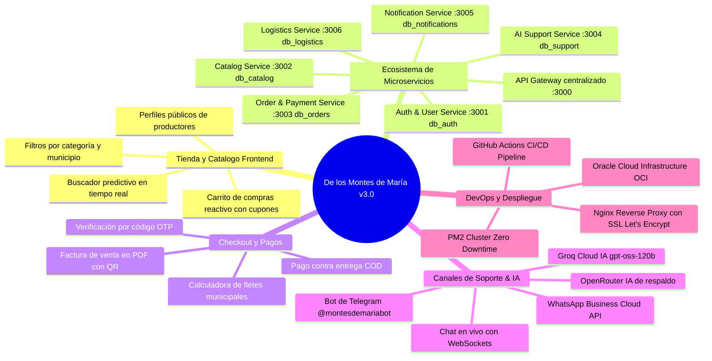
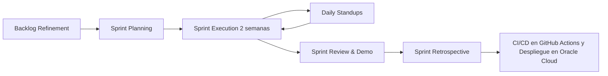
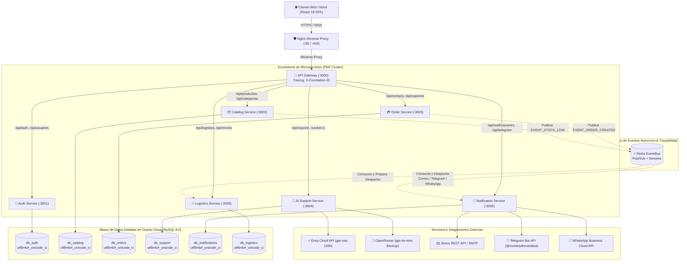
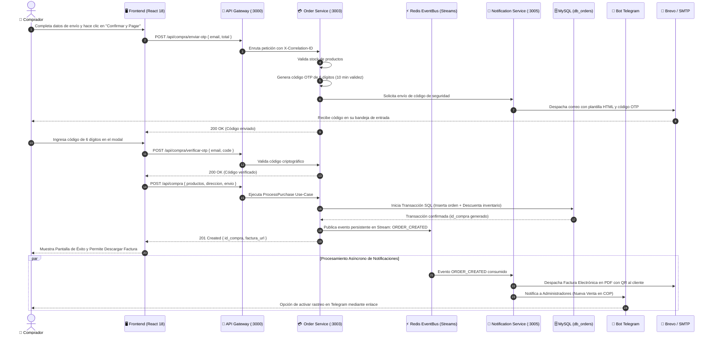
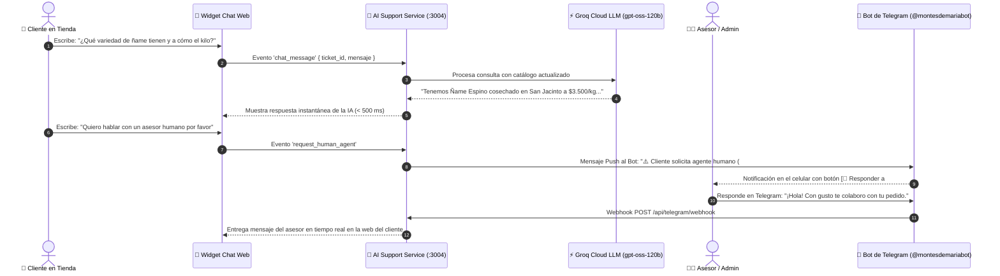
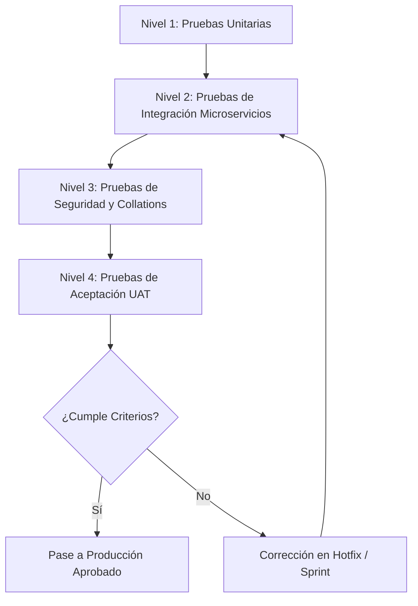
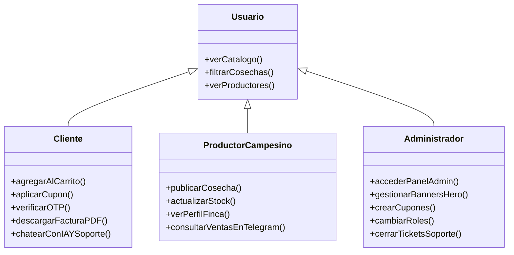

# 🌾 DOCUMENTO DE ESPECIFICACIÓN Y GESTIÓN DE PROYECTO
## PLATAFORMA AGROPECUARIA & COMERCIO CAMPESINO DIRECTO: DE LOS MONTES DE MARÍA

---

# 1. INFORMACIÓN GENERAL Y ALCANCE

## 1.1 Portada y Control de Versiones

| Parámetro | Detalle |
| :--- | :--- |
| **Nombre del Proyecto** | De los Montes de María — Plataforma Agropecuaria & Comercio Campesino Directo |
| **Código del Proyecto** | AGRO-MDM-2026 |
| **Autor / Líder Técnico** | Danilo Rodelo & Equipo de Desarrollo De los Montes de María |
| **Organización** | De los Montes de María S.A.S. |
| **Fecha de Creación** | 15 de Febrero de 2026 |
| **Última Actualización** | 15 de Octubre de 2026 |
| **Versión del Documento** | 3.0.0 Enterprise |
| **Estado del Proyecto** | Producción / Operación en Servidor Propio Dedicado en Oracle Cloud (OCI) |
| **Repositorio Oficial** | [GitHub - Danx016/delosmontesdemaria](https://github.com/Danx016/delosmontesdemaria) |
| **URL Producción Oficial** | [https://delosmontesdemaria.dev](https://delosmontesdemaria.dev) |
| **Servidor Host (VPS)** | Oracle Cloud Infrastructure (Ubuntu Linux 22.04 LTS — IP: `157.137.233.119`) |
| **Servidor Base de Datos** | MySQL 8.0 Dedicado OCI (IP: `149.130.189.158` — Patrón Database-per-Service) |

### Registro de Cambios (Changelog)

| Versión | Fecha | Autor | Descripción de Cambios |
| :--- | :--- | :--- | :--- |
| **1.0.0** | 15/02/2026 | D. Rodelo | Creación de la arquitectura base monolítica inicial con Express y vistas EJS. |
| **1.5.0** | 22/03/2026 | D. Rodelo | Migración a SPA con React 18 + Vite, desacoplamiento de API REST y Context API. |
| **2.0.0** | 10/05/2026 | D. Rodelo | Refactorización a Clean Architecture (DDD), estructuración modular de entidades y casos de uso. |
| **2.2.0** | 18/06/2026 | D. Rodelo | Integración de WebSockets (Socket.IO) para soporte en vivo y pasarela de correo Brevo/SMTP. |
| **2.4.0** | 25/07/2026 | D. Rodelo | Implementación del bot oficial de Telegram (`@montesdemariabot`) y AgroAsistente con IA (OpenRouter). |
| **2.5.0** | 19/08/2026 | D. Rodelo | Migración a Servidor Propio en Oracle Cloud (Ubuntu Linux + Nginx Reverse Proxy + PM2) y scripts de despliegue. |
| **3.0.0** | 15/10/2026 | D. Rodelo | **Evolución a Arquitectura Empresarial de Microservicios:** Desacoplamiento en 7 microservicios independientes + API Gateway centralizado (`:3000` a `:3006`), adopción del patrón *Database-per-Service* en MySQL (Oracle Cloud), Bus de Eventos asíncrono con Redis Pub/Sub y Streams persistentes, trazabilidad distribuida (`X-Correlation-ID`), motor dual de Inteligencia Artificial con Groq Cloud (`gpt-oss-120b` inferencia ultrarrápida) + OpenRouter (`gpt-4o-mini` de respaldo), canal oficial de Meta WhatsApp Business Cloud API, unificación estricta de collations a `utf8mb4_unicode_ci`, y Pipeline CI/CD automatizado en GitHub Actions con cero tiempo de inactividad (*Zero Downtime*). |

---

## 1.2 Resumen Ejecutivo

### El Problema
La subregión de los **Montes de María** (comprendida entre los departamentos de Bolívar y Sucre en el Caribe colombiano) es una de las despensas agrícolas más ricas y resilientes del país. No obstante, los pequeños y medianos productores campesinos enfrentan barreras estructurales críticas:
1. **Intermediación Abusiva:** Los intermediarios tradicionales capturan entre el 50% y 70% del valor final de la cosecha, dejando al campesino márgenes mínimos de rentabilidad.
2. **Pérdida Poscosecha:** Dificultad para encontrar compradores directos antes del deterioro de productos perecederos (ñame, yuca, plátano, aguacate, lácteos).
3. **Brecha Digital y de Canales:** Falta de herramientas tecnológicas accesibles y adaptadas a las realidades de conectividad rural para exhibir productos, gestionar inventarios y recibir pedidos confiables.

### La Solución Propuesta
**De los Montes de María** es un ecosistema digital integral de comercio justo agropecuario que conecta directamente a los campesinos y artesanos con consumidores particulares, restaurantes y mayoristas en todo el territorio colombiano. 

La plataforma combina:
* Una aplicación web moderna (**SPA en React 18 + Vite**) responsiva, accesible, ultraligera y con soporte de temas claro/oscuro.
* Una arquitectura backend distribuida en **7 Microservicios independientes + API Gateway** estructurada bajo Arquitectura Hexagonal y DDD.
* **Bus de Eventos Asíncrono con Redis Pub/Sub y Redis Streams** para sincronización desacoplada de inventarios, órdenes y notificaciones con garantía de entrega.
* Patrón **Database-per-Service** en servidor MySQL dedicado en Oracle Cloud Infrastructure, asegurando alta tolerancia a fallos y soberanía de datos por dominio.
* Un sistema de verificación de transacciones mediante códigos de un solo uso (**OTP**) por correo electrónico antes de la confirmación del pedido.
* **Facturación electrónica automática** en PDF con código QR y cálculo dinámico de fletes por municipio.
* **Soporte multicanal híbrido en tiempo real:** WebSockets en vivo, Asistente con Inteligencia Artificial ultrarrápida (Groq Cloud LLM `gpt-oss-120b` + OpenRouter de respaldo), **Bot oficial de Telegram** (`@montesdemariabot`) y notificaciones transaccionales vía **Meta WhatsApp Business Cloud API**.

### Impacto Esperado
* **Económico:** Aumento del 35% al 60% en los ingresos netos percibidos por los campesinos al vender a precios justos directos.
* **Social:** Visibilización y dignificación del campesinado de municipios como El Carmen de Bolívar, San Jacinto, San Juan Nepomuceno, Ovejas, Chalán y María La Baja.
* **Operativo:** Tiempos de respuesta de soporte inferiores a 3 segundos mediante IA, resolución con agentes humanos en menos de 3 minutos vía Telegram/WhatsApp, y formalización de transacciones con facturación digital inmediata.

---

## 1.3 Objetivos del Proyecto

```
                   ┌────────────────────────────────────────────────────────┐
                   │                   OBJETIVO GENERAL                     │
                   │  Conectar campesinos con compradores sin intermediación│
                   └───────────────────────────┬────────────────────────────┘
                                               │
        ┌──────────────────────────────┬───────┴──────────────────────┬──────────────────────────────┐
        ▼                              ▼                              ▼                              ▼
 ┌──────────────┐               ┌──────────────┐               ┌──────────────┐               ┌──────────────┐
 │  ESPECÍFICO 1│               │  ESPECÍFICO 2│               │  ESPECÍFICO 3│               │  ESPECÍFICO 4│
 │  E-Commerce  │               │ Transaccional│               │ Soporte & IA │               │  Operaciones │
 │ Microservicios│              │  OTP + Fact  │               │ + Telegram/WA│               │  CI/CD & KPI │
 └──────────────┘               └──────────────┘               └──────────────┘               └──────────────┘
```

### Objetivo General
Desarrollar, desplegar y operar una plataforma tecnológica integral de comercio electrónico y gestión agropecuaria basada en microservicios que suprima intermediarios comerciales, digitalice el catálogo de cosechas de los Montes de María y asegure transacciones transparentes y verificables entre el campo y la ciudad.

### Objetivos Específicos (Criterios SMART)

| ID | Objetivo Específico | Indicador / Criterio SMART |
| :--- | :--- | :--- |
| **OE-01** | **Digitalización del Catálogo Campesino:** Desarrollar y operar un sistema de catálogo dinámico con microservicio dedicado (`catalog-service`), filtros en vivo por municipio de origen, categorización agropecuaria y tiempos de respuesta menores a 100 ms. | *Específico, Medible, Temporal (Trimestre 1).* |
| **OE-02** | **Seguridad en Checkout y Formalización:** Implementar un flujo de pago contra entrega con validación de seguridad OTP vía email, cotización dinámica de fletes y generación automática de factura electrónica en PDF con QR en menos de 2 segundos por orden. | *Medible (100% de órdenes con OTP y Factura), Alcanzable.* |
| **OE-03** | **Atención Multicanal Inteligente:** Integrar un sistema de soporte al cliente con WebSockets, AgroAsistente IA (Groq Cloud + OpenRouter), Bot de Telegram bidireccional y WhatsApp Cloud API, logrando resolver más del 75% de dudas frecuentes automáticamente y escalando a humanos con 1 clic. | *Específico, Medible (>75% automatización, <3 min respuesta humana).* |
| **OE-04** | **Gestión Administrativa y Resiliencia CI/CD:** Diseñar un panel de control centralizado con métricas en tiempo real de ventas, control de inventarios, gestión de banners y cupones, respaldado por una arquitectura de microservicios en PM2 y despliegue automatizado en GitHub Actions con disponibilidad superior al 99.8%. | *Relevante, Medible (Disponibilidad 99.8%, Zero Downtime).* |

---

## 1.4 Alcance del Proyecto

### Qué Incluye (Entregables y Funcionalidades Clave)



1. **Módulo de Comercio Electrónico (Frontend SPA React 18):**
   * Catálogo con categorización: *Cosechas Frescas, Lácteos Artesanales, Semillas Nativas, Abonos y Fertilizantes, Herramientas*.
   * Perfil público de cada campesino con historia de la finca, productos, fotos y calificaciones de compradores.
   * Carrito de compras reactivo con persistencia local, cálculo de despacho en tiempo real y soporte para cupones promocionales.
   * Modos visuales Claro / Oscuro con variables HSL nativas y diseño 100% adaptable a teléfonos móviles.

2. **Módulo Transaccional y Checkout:**
   * Modal de checkout con selección dinámica de departamentos y municipios de Colombia.
   * Generación y validación de token OTP criptográfico de 6 dígitos enviado por correo electrónico.
   * Facturación electrónica oficial en PDF con código QR, desglose de impuestos/descuentos y datos legales.
   * Matriz de costos de flete por municipio gestionada por el microservicio de logística.

3. **Módulo de Soporte y Chat en Vivo Multicanal:**
   * Chat Web en tiempo real cliente-asesor mediante Socket.IO.
   * Asistente virtual con Inteligencia Artificial ultrarrápida (Groq Cloud LLM `gpt-oss-120b` + OpenRouter `gpt-4o-mini` de respaldo) con conocimiento contextual del catálogo agrícola.
   * Integración con Telegram Bot (`@montesdemariabot`) con soporte para respuestas directas de los asesores vía Webhook.
   * Canal oficial de WhatsApp Business Cloud API para confirmación inmediata de órdenes.

4. **Panel Administrativo (`/admin`):**
   * Tablero con métricas de ventas en COP, conteo de pedidos y alertas automáticas de stock bajo.
   * Editor visual de carrusel hero de la página principal (imágenes, tinte de color, desenfoque y llamada a la acción).
   * Administración de usuarios, roles (Admin, Vendedor, Cliente, Soporte) y direcciones.
   * Gestor de cupones de descuento con límites de uso y fechas de vigencia.

### Qué NO Incluye (Límites y Fuera de Alcance)

| Elemento Excluido | Justificación Técnica / Operativa | Alternativa o Fase Futura |
| :--- | :--- | :--- |
| **Flota Logística Propia** | El proyecto no contempla la adquisición ni operación directa de vehículos de transporte de carga pesada. | Se utiliza integración con empresas transportadoras aliadas y modelo contra entrega con flete calculado. |
| **Microcréditos Financieros** | No se implementa intermediación bancaria directa ni captación de ahorros regulados por la Superfinanciera. | Se proporciona enlace y contacto comercial con cooperativas agrícolas y microfinancieras locales. |
| **App Nativa en Play Store / App Store** | No se desarrollaron binarios nativos (Java/Swift) en esta versión para agilizar costos y despliegues. | La plataforma es una Progressive Web App (PWA) 100% responsiva optimizada para cualquier navegador móvil y de escritorio. |
| **Hardware de Telemetría IoT en Fincas** | No se incluyen sensores físicos de humedad de suelo ni estaciones meteorológicas de hardware en las parcelas. | Se prevé como módulo de extensión para la fase v4.0 mediante API REST abierta y telemetría MQTT. |

---

# 2. REQUERIMIENTOS Y DISEÑO DEL SISTEMA

## 2.1 Requerimientos Funcionales (RF)

```
[RF-01: Autenticación & Usuarios] ───► [RF-02: Gestión de Catálogo] ───► [RF-03: Carrito & Cupones]
                                                                                  │
[RF-06: Panel Administrativo]      ◄─── [RF-05: Soporte & Multicanal] ◄─── [RF-04: Checkout & Facturación]
```

| ID | Nombre del Requerimiento | Descripción Detallada | Criterio de Éxito |
| :--- | :--- | :--- | :--- |
| **RF-01** | **Autenticación y Perfiles** | El sistema debe permitir registro e inicio de sesión mediante credenciales locales (correo/contraseña con hash Bcrypt) y Google OAuth 2.0. Debe permitir recuperación de contraseña mediante código OTP. | Login en < 1s, almacenamiento seguro de token JWT en cookie HttpOnly. |
| **RF-02** | **Gestión de Catálogo e Inventario** | Los vendedores y administradores deben poder crear, editar, pausar y eliminar productos con fotografías, descripción, precio unitario, stock disponible, origen y presentación. | Actualización en tiempo real del stock tras confirmación de compra mediante eventos. |
| **RF-03** | **Carrito de Compras y Cupones** | El usuario debe poder acumular productos en el carrito, calcular fletes por municipio y aplicar códigos de cupón con descuentos porcentuales o fijos validados en el servidor. | Recálculo instantáneo de totales y flete en la interfaz sin recarga. |
| **RF-04** | **Checkout con OTP y Facturación PDF** | Antes de asentar la orden contra entrega, el sistema debe remitir un código OTP al correo del comprador. Al ser validado, se genera la orden, se descuenta inventario y se envía factura en PDF con QR. | Factura generada y enviada al correo del comprador en < 2s. |
| **RF-05** | **Soporte Híbrido Multicanal (IA + Socket.IO + Telegram + WhatsApp)** | El usuario debe contar con un widget de chat en vivo atendido inicialmente por IA (Groq Cloud). Si solicita asesor humano, se notifica al canal de Telegram de administradores, permitiendo responder desde Telegram o la web. Notificaciones críticas enviadas también por WhatsApp. | Transmisión bidireccional de mensajes en menos de 500 ms. |
| **RF-06** | **Panel Administrativo y Banners** | El administrador debe poder visualizar métricas de ingresos, gestionar productos, administrar cupones, cambiar roles de usuarios y configurar los banners del carrusel de inicio. | Cambios en carrusel y cupones reflejados de inmediato en la tienda. |

---

## 2.2 Requerimientos No Funcionales (RNF)

| Categoría | ID | Requerimiento No Funcional | Métrica / Estándar de Cumplimiento |
| :--- | :--- | :--- | :--- |
| **Rendimiento** | **RNF-01** | **Tiempo de Respuesta de API:** Los endpoints de lectura REST deben responder en menos de 200 ms en condiciones de carga estándar (hasta 500 req/s mediante microservicios y proxy Nginx). | Pruebas de estrés y benchmarking con Autocannon y Apache Benchmark. |
| **Seguridad** | **RNF-02** | **Cifrado y Protección Web:** Uso obligatorio de HTTPS con certificados Let's Encrypt, cabeceras seguras mediante Helmet, protección CSRF, Rate Limiting distribuido (máx. 100 req/15 min por IP en rutas públicas, 10 req/min en OTP), y Bcrypt a 12 salt rounds. | Calificación A+ en escaneos de cabeceras HTTP y SSL Labs. |
| **Disponibilidad** | **RNF-03** | **Uptime del Sistema:** La plataforma en producción en servidor Linux propio en Oracle Cloud (Nginx + PM2 Cluster + MySQL OCI) debe garantizar una disponibilidad mensual mínima del 99.8%. | Monitoreo continuo mediante PM2 status, healthchecks y UptimeRobot. |
| **Usabilidad** | **RNF-04** | **Accesibilidad y Adaptabilidad:** Interfaz 100% responsiva (Mobile First), soporte de temas claro/oscuro y contrastes visuales conformes con WCAG 2.1 Nivel AA. | Score de Lighthouse en Accesibilidad y Best Practices > 92/100. |
| **Legal / Normativa** | **RNF-05** | **Habeas Data (Ley 1581 de 2012):** Cumplimiento de la legislación colombiana de protección de datos personales. Derecho de acceso, rectificación y eliminación de cuenta. | Cláusula de consentimiento explícito en checkout y registro. |

---

## 2.3 Metodología de Trabajo

El desarrollo se gestionó bajo el marco ágil **Scrum / Agile Híbrido** adaptado a entregas continuas (CI/CD):



* **Duración de Sprints:** Ciclos de 2 semanas (10 días hábiles).
* **Ceremonias:**
  * *Sprint Planning:* Definición de historias de usuario y priorización en Kanban.
  * *Daily Standups:* Sincronización de 15 minutos enfocada en bloqueos técnicos y dependencias de microservicios.
  * *Sprint Review & Retrospective:* Demostración funcional en entorno staging y lecciones aprendidas.
* **Herramientas:** GitHub Projects / Issues para seguimiento de tareas, Git Flow para ramas (`main`, `develop`, `feature/*`, `hotfix/*`).

---

## 2.4 Arquitectura del Software & Diseño del Proceso

### Arquitectura Limpia (Clean Architecture) & Topología de Microservicios

El sistema desacopla totalmente las reglas de negocio de los detalles de infraestructura mediante Arquitectura Hexagonal y Microservicios:



---

### Mapeo de Procesos de Negocio

#### 1. Proceso de Checkout con Pago Contra Entrega y Validación OTP



#### 2. Proceso de Soporte Multicanal (IA -> Humano -> Telegram -> WhatsApp)



---

## 2.5 Estandarización de Base de Datos y Prevención de Errores de Intercalación

### Unificación de Collations (`utf8mb4_unicode_ci`)
Para garantizar compatibilidad total entre MySQL 8.0 y comparaciones entre tablas relacionadas (`JOIN`, subconsultas y filtros `LOWER()` o `UPPER()`), toda la infraestructura de base de datos se encuentra estrictamente unificada:

1. **Juego de Caracteres Predeterminado:** `utf8mb4` (soporte completo para caracteres multilingües, tildes y emojis).
2. **Collation Uniforme:** `utf8mb4_unicode_ci` aplicada a nivel de:
   * Servidor y bases de datos (`ALTER DATABASE db_name CHARACTER SET utf8mb4 COLLATE utf8mb4_unicode_ci`).
   * Tablas individuales (`ENGINE=InnoDB DEFAULT CHARSET=utf8mb4 COLLATE=utf8mb4_unicode_ci`).
   * Todas las columnas textuales (`VARCHAR`, `TEXT`, `MEDIUMTEXT`).
   * Configuración de los pools de conexión de Node.js (`mysql2` con `charset: 'utf8mb4'`).
3. **Blindaje en Repositorios:** Todas las consultas SQL que realizan comparaciones de texto en cláusulas `JOIN` incorporan `COLLATE utf8mb4_unicode_ci` explícito para prevenir cualquier error de *Illegal mix of collations*.

---

## 2.6 Stack Tecnológico Detallado

| Capa | Tecnología | Versión | Propósito / Justificación Técnica |
| :--- | :--- | :--- | :--- |
| **Frontend Framework** | React | `18.3.1` | Renderizado reactivo modular, Virtual DOM de alto desempeño y gestión eficiente de estado con Context API. |
| **Tooling & Bundler** | Vite | `5.4.x` | Compilación ultrarrápida mediante ES Modules nativos y Hot Module Replacement (HMR). |
| **Estilos & Diseño** | Vanilla CSS + Tokens | CSS3 Moderno | Cero dependencias pesadas; paleta HSL optimizada con soporte nativo de modo claro y oscuro. |
| **Enrutamiento Web** | React Router DOM | `6.26.x` | Navegación SPA fluida del lado del cliente sin recargas de página. |
| **Servidor Host (VPS)** | Oracle Cloud Infrastructure (OCI) | `Ubuntu 22.04 LTS` | Máquina virtual dedicada en la nube (IP: `157.137.233.119`) con alto rendimiento y conectividad global. |
| **Reverse Proxy** | Nginx | `1.18+` | Balanceo de carga, terminación SSL/TLS Let's Encrypt, compresión gzip y proxy para WebSockets. |
| **Gestor de Procesos** | PM2 Enterprise | `5.x` | Orquestación en modo cluster de los 7 microservicios, reinicio automático y monitoreo de memoria/CPU. |
| **Backend Runtime** | Node.js | `>= 20.0.0` | Entorno asíncrono no bloqueante basado en eventos para microservicios. |
| **Framework HTTP** | Express.js | `5.1.0` | Enrutamiento modular, middlewares de seguridad y arquitectura de microservicios RESTful. |
| **Base de Datos** | MySQL Server Dedicado | `8.0` | Servidor MySQL en OCI (`149.130.189.158`) con soporte ACID, claves foráneas y patrón Database-per-Service. |
| **Bus de Eventos** | Redis (ioredis) | `6.0.0` | Mensajería asíncrona mediante Pub/Sub en memoria y Redis Streams persistentes para eventos críticos. |
| **Comunicación en Vivo** | Socket.IO | `4.8.3` | Protocolo WebSocket bidireccional de baja latencia para el chat de soporte al cliente. |
| **Seguridad Web** | Bcrypt / JWT / Helmet | `6.0 / 9.0 / 8.1` | Hash criptográfico de contraseñas, tokens de sesión HttpOnly y endurecimiento de cabeceras HTTP. |
| **Emails Transaccionales** | Brevo REST API / Nodemailer | `v3 / 8.0.7` | Envío confiable de códigos OTP y facturas electrónicas en PDF con arquitectura de respaldo dual. |
| **Motor de IA Principal** | Groq Cloud API | LPU Inference | Modelo `openai/gpt-oss-120b` con inferencia ultrarrápida (14.400 solicitudes gratuitas diarias). |
| **Motor de IA Respaldo** | OpenRouter API | REST | Modelo `openai/gpt-4o-mini` para garantizar continuidad de servicio si la API principal se satura. |
| **Mensajería Telegram** | Telegram Bot API | Webhook HTTPS | Operación remota para administradores y rastreo de envíos para compradores (`@montesdemariabot`). |
| **Mensajería WhatsApp** | WhatsApp Business Cloud API | Graph API v19.0 | Canal oficial de notificaciones transaccionales y confirmación de pedidos a través de Meta. |
| **Integración Continua** | GitHub Actions | `v4` | Pipeline automatizado de validación, compilación de frontend y despliegue continuo vía SSH. |

---

# 3. PLANIFICACIÓN, RECURSOS Y RIESGOS

## 3.1 Cronograma e Hitos Principales (WBS / EDT)

```
Fase 1: Análisis y Arquitectura ────► [01/Feb - 20/Feb]
Fase 2: Backend Core & DB       ────► [21/Feb - 20/Mar]
Fase 3: Frontend SPA & React    ────► [21/Mar - 25/Abr]
Fase 4: Integraciones & Bots    ────► [26/Abr - 20/May]
Fase 5: Pruebas, QA & Hardening ────► [21/May - 15/Jun]
Fase 6: Despliegue en Servidor  ────► [16/Jun - 15/Ago]
Fase 7: Microservicios & CI/CD  ────► [16/Ago - Operación Continua v3.0]
```

### Tabla de Desglose de Trabajo (WBS)

| Fase | Hito / Entregable Principal | Fecha Inicio | Fecha Fin | Estado |
| :--- | :--- | :--- | :--- | :--- |
| **Fase 1** | Definición de Requerimientos, Wireframes y Modelo Entidad-Relación | 01/02/2026 | 20/02/2026 | **Completado** |
| **Fase 2** | Backend API REST, Clean Architecture y Base de Datos MySQL | 21/02/2026 | 20/03/2026 | **Completado** |
| **Fase 3** | Frontend React 18, Catálogo, Filtros, Carrito y Panel Admin | 21/03/2026 | 25/04/2026 | **Completado** |
| **Fase 4** | Checkout OTP, Facturación PDF, AgroAsistente IA y Bot Telegram | 26/04/2026 | 20/05/2026 | **Completado** |
| **Fase 5** | Pruebas de Carga, Seguridad, Pruebas de Aceptación con Campesinos | 21/05/2026 | 15/06/2026 | **Completado** |
| **Fase 6** | Puesta en Marcha en Servidor Propio (Ubuntu + Nginx + PM2) | 16/06/2026 | 15/08/2026 | **Completado** |
| **Fase 7** | Desacoplamiento a 7 Microservicios, Redis EventBus, WhatsApp API y GitHub Actions CI/CD | 16/08/2026 | 15/10/2026 | **En Operación v3.0** |

---

## 3.2 Roles y Responsabilidades (Matriz RACI)

* **R (Responsible):** Quien ejecuta la tarea.
* **A (Accountable):** Quien aprueba y responde por el resultado final.
* **C (Consulted):** Quien aporta información técnica o de negocio.
* **I (Informed):** Quien es notificado del avance.

| Actividad / Entregable | Líder de Proyecto | Dev Backend | Dev Frontend | Diseñador UI/UX | Asesor Agrícola / Campesino |
| :--- | :---: | :---: | :---: | :---: | :---: |
| **Diseño de Base de Datos y Microservicios** | **A** | **R** | **C** | **I** | **I** |
| **Diseño de Interfaz de Usuario y Responsive** | **A** | **I** | **R** | **R** | **C** |
| **Implementación de API Gateway y Checkout OTP** | **A** | **R** | **C** | **I** | **I** |
| **Desarrollo de SPA React y Context API** | **A** | **C** | **R** | **C** | **I** |
| **Integración Telegram Bot, WhatsApp & Groq IA** | **A** | **R** | **C** | **I** | **C** |
| **Validación de Catálogo y Precios de Cosechas** | **A** | **I** | **I** | **I** | **R** |
| **Administración Servidor OCI, Nginx, PM2 y CI/CD** | **A** | **R** | **C** | **I** | **I** |

---

## 3.3 Presupuesto y Recursos

### Recursos de Infraestructura y Servicios Cloud (Cálculo Anual Estimado)

| Recurso / Servicio | Proveedor | Nivel / Plan | Costo Mensual (USD) | Costo Anual (USD) |
| :--- | :--- | :--- | :--- | :--- |
| **Servidor Dedicado / VPS (Ubuntu)** | Oracle Cloud Infrastructure (OCI) | Compute Instance Standard (Ubuntu 22.04 LTS) | $0.00 (Always Free Tier) | $0.00 |
| **Base de Datos MySQL Dedicada** | Oracle Cloud Infrastructure (OCI) | MySQL Database Dedicated Server OCI | $0.00 (OCI Cloud Tier) | $0.00 |
| **Bus de Eventos Redis** | Redis In-Memory Store | Local Container / Redis Engine 6.0 | $0.00 | $0.00 |
| **Servicio de Correo Transaccional** | Brevo / Google Workspace | Free Tier (300 emails/día) + SMTP Gmail Backup | $0.00 | $0.00 |
| **Modelos de Inteligencia Artificial** | Groq Cloud + OpenRouter | Groq Free Tier (14.4k req/día) + OpenRouter PayG | $2.50 | $30.00 |
| **Dominio y Certificados SSL** | DNS Oficial + Let's Encrypt | Certbot TLS/SSL Automático con renovación 90 días | $1.00 | $12.00 |
| **Bot de Telegram & WhatsApp API** | Telegram API + Meta Cloud API | Nivel Oficial / Gratuito (1.000 conv/mes WhatsApp) | $0.00 | $0.00 |
| **TOTAL INFRAESTRUCTURA** | | | **$3.50 / mes** | **$42.00 / año** |

---

## 3.4 Matriz de Riesgos y Mitigación

```
   Alto  ▲   [R-02: Caída de Brevo]     [R-01: Interrupción Microservicio]
         │
IMPACTO  │   [R-04: Spam en Chat/OTP]   [R-03: Desabastecimiento Cosecha]
         │
   Bajo  ┼────────────────────────────────────────────────────────►
             Baja                       Alta
                         PROBABILIDAD
```

| ID | Riesgo Identificado | Prob. | Imp. | Nivel | Estrategia de Mitigación / Plan de Contingencia |
| :--- | :--- | :---: | :---: | :---: | :--- |
| **R-01** | **Interrupción temporal o fallo de un microservicio.** | Media | Alto | **Mitigado** | **Aislamiento por Procesos:** PM2 reinicia el microservicio fallido en menos de 1 segundo sin interrumpir a los demás componentes del ecosistema. |
| **R-02** | **Fallo o bloqueo en el servicio de correo transaccional (OTP).** | Media | Alto | **Mitigado** | **Arquitectura de Fallback Dual:** `EmailService` intenta el despacho mediante la API REST HTTPS de Brevo; si no responde, conmuta instantáneamente al servidor SMTP de Gmail. |
| **R-03** | **Quiebre de inventario por compras simultáneas del mismo lote.** | Media | Media | **Mitigado** | **Transacciones SQL Atómicas:** Uso de transacciones con bloqueo de fila y verificación de stock estricta antes de asentar el pedido. |
| **R-04** | **Ataques de fuerza bruta o spam en el formulario de contacto/OTP.** | Alta | Medio | **Mitigado** | **Rate Limiting Distribuido:** Middleware estricto en el API Gateway que limita peticiones por IP y bloquea intentos repetidos. |
| **R-05** | **Baja conectividad en zonas rurales de cultivo.** | Alta | Medio | **Mitigado** | **Canales Ligeros:** Operación completa para campesinos a través del Bot de Telegram y WhatsApp, que operan sobre redes 3G/4G rurales con mínimo consumo de datos. |

---

# 4. VALIDACIÓN, DESPLIEGUE Y CIERRE

## 4.1 Plan de Pruebas y Criterios de Aceptación



### Matriz de Casos de Prueba Ejecutados

| ID Prueba | Módulo / Escenario | Entrada / Acción | Resultado Esperado | Estado |
| :--- | :--- | :--- | :--- | :---: |
| **TC-001** | **Autenticación con Clave Inválida** | Email existente, contraseña incorrecta. | Retorna HTTP 401, mensaje "Credenciales inválidas" sin revelar si el correo existe. | **PASS** |
| **TC-002** | **Aplicación de Cupón Válido** | Ingresar código "MONTES10" en carrito de $100.000 COP. | Aplica 10% de descuento ($10.000 COP), recalculando total a $90.000 COP. | **PASS** |
| **TC-003** | **Checkout con OTP Correcto** | Ingresar el código de 6 dígitos recibido al correo. | Retorna HTTP 201, crea orden en `db_orders`, descuenta stock y genera factura PDF con QR. | **PASS** |
| **TC-004** | **Checkout con OTP Expirado o Inválido** | Ingresar código erróneo o tras 11 minutos. | Retorna HTTP 400 "Código OTP expirado o inválido", no descuenta inventario. | **PASS** |
| **TC-005** | **Soporte IA y Transferencia a Humano** | Usuario escribe "necesito un asesor". | La IA reconoce la intención y dispara alerta Webhook a Telegram instantáneamente. | **PASS** |
| **TC-006** | **Protección de Rutas de Administrador** | Acceso a `/admin` con token de rol Cliente. | Redirecciona a vista pública o retorna HTTP 403 Forbidden. | **PASS** |
| **TC-007** | **Integridad de Collations en Búsqueda y Checkout** | Consulta de producto y orden con joins complejos de categorías. | Ejecución limpia sin error de *Illegal mix of collations* bajo `utf8mb4_unicode_ci`. | **PASS** |

### Criterios de Aceptación para Cierre
1. 100% de los casos de prueba críticos en estado **PASS**.
2. Cero vulnerabilidades críticas o altas detectadas en el análisis de dependencias (`npm audit`).
3. Tiempo de generación y descarga de factura en PDF inferior a 2 segundos.
4. Conexión estable y sincronización en tiempo real del Bot de Telegram y WhatsApp en el 100% de los pedidos creados.

---

## 4.2 Guías y Manuales Técnicos

### 1. Manual de Instalación y Ejecución Local

#### Prerrequisitos:
* **Node.js:** Versión 18.0.0 o superior (recomendado Node.js 20 LTS).
* **NPM:** Versión 9.0.0 o superior.
* **MySQL:** Servidor MySQL 8.x local o credenciales remotas de Oracle Cloud.

#### Pasos de Instalación:
```bash
# 1. Clonar el repositorio oficial
git clone https://github.com/Danx016/delosmontesdemaria.git
cd "De los montesdemaria"

# 2. Instalar dependencias del Backend y Frontend
npm install
npm --prefix client install

# 3. Configurar variables de entorno
cp .env.example .env
# Configurar DB_HOST, DB_USER, DB_PASS, JWT_SECRET, etc.

# 4. Compilar el cliente React para producción (o desarrollo)
npm run build

# 5. Iniciar el ecosistema de microservicios mediante el orquestador
npm start
# (Inicia services/runner.js con gateway, auth, catalog, orders, support, notifications y logistics)

# 6. En otra terminal, iniciar el frontend en modo desarrollo si se requiere editar interfaz
npm run dev:client
```

### 2. Manual de Despliegue en Servidor Propio (Ubuntu Linux + Nginx + PM2 + CI/CD)

#### Configuración del Servidor:
1. **Instalación de paquetes base en Ubuntu:**
   ```bash
   sudo apt update && sudo apt upgrade -y
   sudo apt install -y nodejs npm nginx git certbot python3-certbot-nginx
   sudo npm install -g pm2
   ```

2. **Clonación y Configuración del Directorio:**
   ```bash
   # En el directorio /home/ubuntu/montesdemaria
   git clone https://github.com/Danx016/delosmontesdemaria.git /home/ubuntu/montesdemaria
   cd /home/ubuntu/montesdemaria
   cp .env.example .env
   # Editar .env con credenciales reales de producción y puerto 3000
   ```

3. **Configuración de Nginx como Reverse Proxy (`/etc/nginx/sites-available/default`):**
   ```nginx
   server {
       listen 80;
       listen [::]:80;
       server_name delosmontesdemaria.dev www.delosmontesdemaria.dev;

       client_max_body_size 50M;

       location / {
           proxy_pass http://127.0.0.1:3000;
           proxy_http_version 1.1;
           proxy_set_header Upgrade $http_upgrade;
           proxy_set_header Connection "upgrade";
           proxy_set_header Host $host;
           proxy_set_header X-Real-IP $remote_addr;
           proxy_set_header X-Forwarded-For $proxy_add_x_forwarded_for;
           proxy_set_header X-Forwarded-Proto $scheme;
           proxy_cache_bypass $http_upgrade;
       }
   }
   ```
   *Probar y reiniciar Nginx:* `sudo nginx -t && sudo systemctl restart nginx`

4. **Inicio y Persistencia con PM2:**
   ```bash
   # Iniciar el ecosistema de microservicios en PM2
   pm2 start services/runner.js --name montesdemaria
   # O iniciar cada microservicio de forma independiente:
   # pm2 start services/gateway/server.js --name gateway
   # pm2 start services/order-service/server.js --name order-service
   # etc.
   pm2 save
   pm2 startup
   ```

5. **Automatización de Despliegues con GitHub Actions:**
   El pipeline (`.github/workflows/deploy.yml`) se activa automáticamente tras cada `git push origin main`:
   * Clona y valida sintaxis de todos los microservicios.
   * Compila la aplicación React con Vite.
   * Se conecta vía SSH a Oracle Cloud (`157.137.233.119`), ejecuta `git pull`, compila y recarga procesos en caliente con `pm2 reload all --update-env`.

6. **Registro del Webhook de Telegram:**
   El webhook oficial se sincroniza apuntando a:
   `https://delosmontesdemaria.dev/api/telegram/webhook`

### 3. Manual de Usuario por Roles



---

## 4.3 Métricas y KPIs de Éxito

| Categoría | KPI / Indicador | Meta / Objetivo | Método de Medición |
| :--- | :--- | :--- | :--- |
| **Comercial** | **Valor Bruto de Ventas (GMV)** | Incremento mensual del 20% en pedidos campesinos. | Dashboard administrativo (`/admin/ventas`). |
| **Comercial** | **Tasa de Conversión en Carrito** | Mayor al 8.5% de visitantes que finalizan compra. | Métricas de carritos creados vs. órdenes con OTP exitoso. |
| **Servicio** | **Tiempo de Primera Respuesta (FRT)** | Menor a 3 segundos en IA y menor a 3 minutos con asesor humano. | Logs de auditoría en tabla `soporte_mensajes`. |
| **Satisfacción** | **Calificación de Atención (CSAT)** | Promedio superior a 4.6 / 5.0 estrellas. | Calificaciones registradas en `POST /api/soporte/calificar`. |
| **Técnico** | **Tiempo Promedio de Carga (FCP)** | Menor a 1.2 segundos en dispositivos móviles. | Google PageSpeed Insights & Web Vitals. |
| **Técnico** | **Tasa de Entrega de Correos OTP** | 99.8% de éxito en entrega de códigos de verificación. | Métricas de despacho en la API de Brevo y SMTP. |

---

## 4.4 Anexos

### Anexo A: Glosario de Términos Técnicos y Agrícolas

* **Clean Architecture (Arquitectura Limpia):** Patrón de diseño de software propuesto por Robert C. Martin que promueve la separación de responsabilidades en capas concéntricas, aislando la lógica de negocio de frameworks y bases de datos.
* **Database-per-Service:** Patrón de microservicios donde cada servicio posee su propio esquema de base de datos desacoplado (`db_auth`, `db_catalog`, `db_orders`, etc.), evitando dependencias directas entre esquemas.
* **EventBus (Bus de Eventos):** Mecanismo de comunicación asíncrono implementado con Redis que permite emitir eventos de dominio (`ORDER_CREATED`, `STOCK_LOW`) para que otros microservicios los consuman sin acoplamiento temporal.
* **Redis Streams:** Estructura de datos en cola tipo log de solo lectura/adición que garantiza persistencia y confirmación de recepción (*acknowledgement*) de eventos entre microservicios.
* **X-Correlation-ID:** Identificador UUID propagado en las cabeceras HTTP que permite rastrear una petición a través de los múltiples microservicios y logs del sistema.
* **OTP (One-Time Password):** Contraseña de un solo uso de 6 dígitos numéricos generada mediante algoritmos criptográficos para validar compras y evitar suplantaciones de identidad.
* **WebSockets (Socket.IO):** Protocolo de comunicación bidireccional sobre una única conexión TCP de baja latencia que permite intercambiar mensajes de chat de inmediato entre cliente y servidor.
* **Nginx Reverse Proxy:** Servidor web de alto rendimiento encargado de recibir el tráfico HTTP/HTTPS en el puerto 80/443 y redirigirlo internamente a Node.js en el puerto 3000 con soporte de WebSockets.
* **PM2 Process Manager:** Gestor de procesos en producción para Node.js que garantiza disponibilidad 24/7, monitoreo en vivo y reinicio automático ante fallos de los microservicios.
* **Montes de María:** Subregión geográfica del Caribe colombiano caracterizada por su alta fertilidad agrícola y tradición en el cultivo de ñame espino, yuca criolla, maíz, aguacate y plátano.
* **Ñame Espino (*Dioscorea rotundata*):** Tubérculo insignia y producto estrella de exportación y consumo tradicional en El Carmen de Bolívar y San Jacinto.
* **Habeas Data:** Derecho constitucional (Ley Estatutaria 1581 de 2012 en Colombia) que garantiza a los ciudadanos conocer, actualizar y rectificar las informaciones que se hayan recogido sobre ellos en bases de datos.

### Anexo B: Directorio de Enlaces y Recursos

* **Sitio Web Oficial en Producción:** [https://delosmontesdemaria.dev](https://delosmontesdemaria.dev)
* **Repositorio de Código Fuente:** [https://github.com/Danx016/delosmontesdemaria](https://github.com/Danx016/delosmontesdemaria)
* **Bot Oficial de Telegram:** `@montesdemariabot` en la aplicación móvil/desktop de Telegram.
* **Servidor de Producción (VPS):** Oracle Cloud Infrastructure (Ubuntu Linux 22.04 LTS — IP: `157.137.233.119`)
* **Servidor MySQL Remoto:** Oracle Cloud Dedicated MySQL Server (IP: `149.130.189.158`)
* **Documentación Técnica del Código:** [DOCUMENTACION.md](file:///c:/Users/danil/Downloads/De%20los%20montesdemaria/DOCUMENTACION.md)
* **Configuración de Nginx:** [nginx_default.conf](file:///c:/Users/danil/Downloads/De%20los%20montesdemaria/nginx_default.conf)
* **Pipeline de Integración y Despliegue:** [.github/workflows/deploy.yml](file:///c:/Users/danil/Downloads/De%20los%20montesdemaria/.github/workflows/deploy.yml)

---

🌾 **De los Montes de María S.A.S.** — *Tecnología de punta al servicio del campo colombiano.* 🇨🇴
