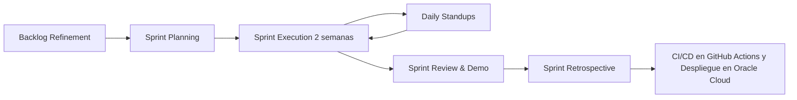
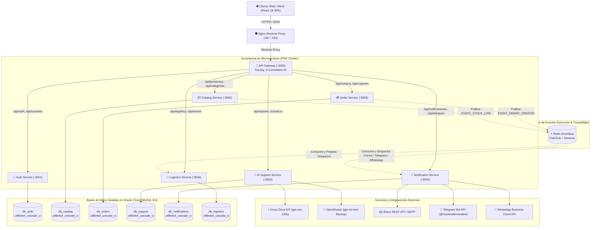
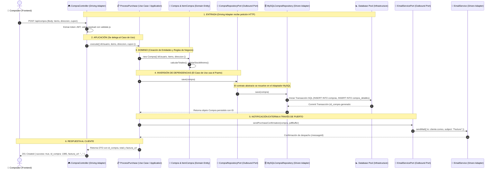
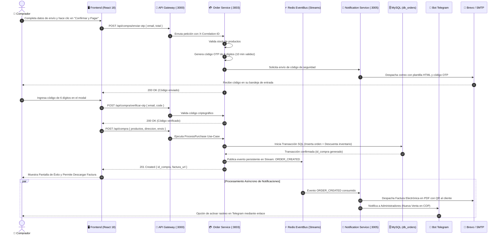
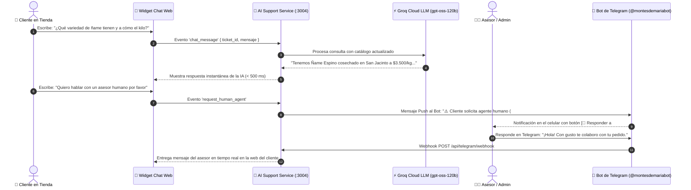
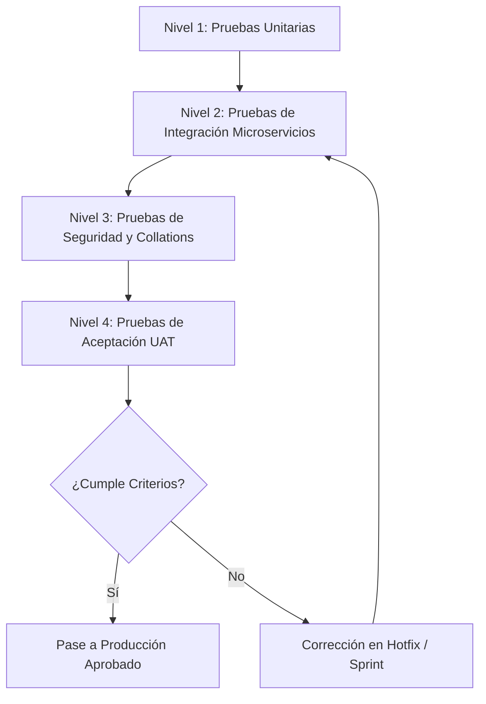
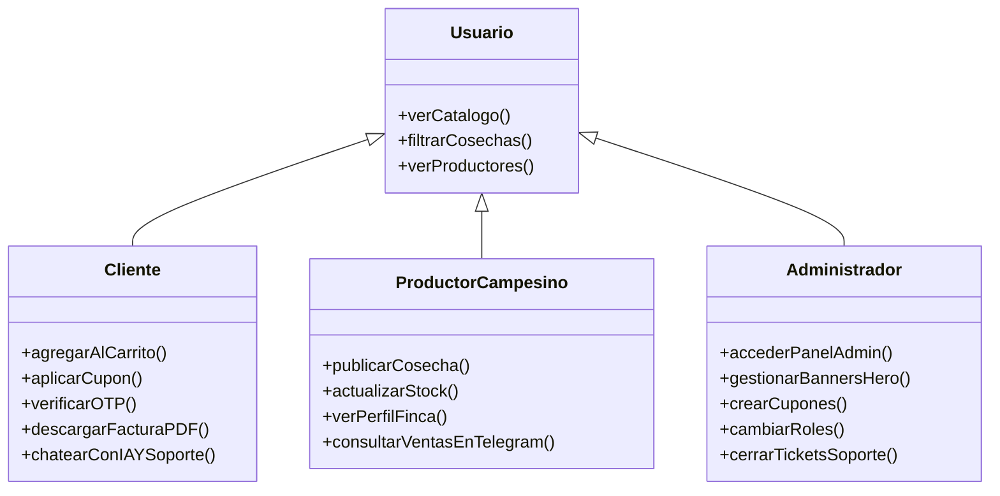
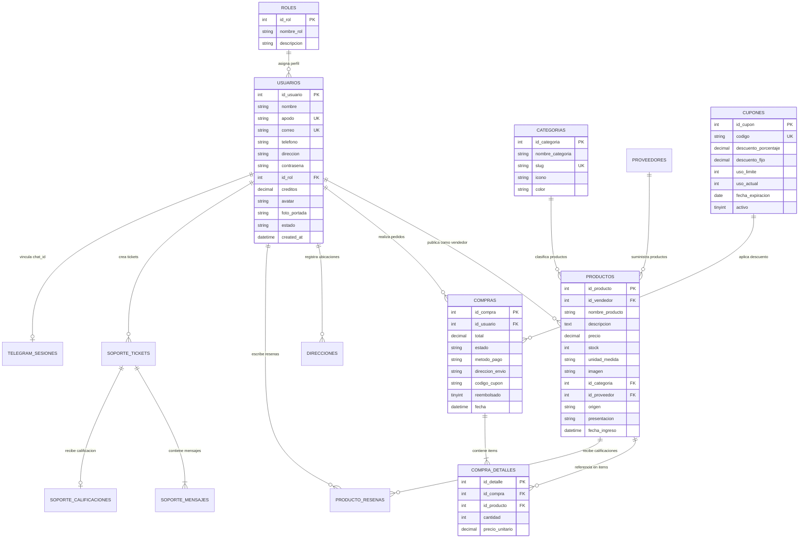

# 🌾 DOCUMENTO DE ESPECIFICACIÓN Y GESTIÓN DE PROYECTO
## PLATAFORMA AGROPECUARIA & COMERCIO CAMPESINO DIRECTO: DE LOS MONTES DE MARÍA
### Documentación Técnica, Arquitectura de Software, Diccionario de Datos y Manual de Operaciones

---

# 1. INFORMACIÓN GENERAL Y ALCANCE

## 1.1 Portada y Control de Versiones

| Parámetro | Detalle |
| :--- | :--- |
| **Nombre del Proyecto** | De los Montes de María — Plataforma Agropecuaria & Comercio Campesino Directo |
| **Código del Proyecto** | AGRO-MDM-2026 |
| **Autor / Líder Técnico** | Danilo Rodelo & Equipo de Desarrollo De los Montes de María |
| **Organización** | De los Montes de María — Plataforma Digital Agropecuaria |
| **Fecha de Creación** | 15 de Febrero de 2026 |
| **Última Actualización** | 15 de Octubre de 2026 |
| **Versión del Documento** | 3.5.0 Master Edition |
| **Estado del Proyecto** | Producción / Operación Continua en Oracle Cloud Infrastructure (OCI) |
| **Repositorio Oficial** | [GitHub - Danx016/delosmontesdemaria](https://github.com/Danx016/delosmontesdemaria) |
| **URL Producción Oficial** | [https://delosmontesdemaria.dev](https://delosmontesdemaria.dev) |
| **Servidor Host (VPS)** | Oracle Cloud Infrastructure (Ubuntu Linux 22.04 LTS — IP: `157.137.233.119`) |
| **Servidor Base de Datos** | MySQL 8.0 Dedicado OCI (IP: `149.130.189.158` — Patrón Database-per-Service) |

### Registro de Cambios (Changelog)

| Versión | Fecha | Autor | Descripción de Cambios |
| :--- | :--- | :--- | :--- |
| **1.0.0** | 15/02/2026 | D. Rodelo | Creación de la arquitectura base monolítica inicial con Express y vistas EJS. |
| **1.5.0** | 22/03/2026 | D. Rodelo | Migración a SPA con React 18 + Vite, desacoplamiento de API REST y Context API. |
| **2.0.0** | 10/05/2026 | D. Rodelo | Refactorización a Clean Architecture (DDD), estructuración modular de entidades y casos de uso. |
| **2.2.0** | 18/06/2026 | D. Rodelo | Integración de WebSockets (Socket.IO) para soporte en vivo y pasarela de correo Brevo/SMTP. |
| **2.4.0** | 25/07/2026 | D. Rodelo | Implementación del bot oficial de Telegram (`@montesdemariabot`) y AgroAsistente con IA (OpenRouter). |
| **2.5.0** | 19/08/2026 | D. Rodelo | Migración a Servidor Propio en Oracle Cloud (Ubuntu Linux + Nginx Reverse Proxy + PM2) y scripts de despliegue. |
| **3.0.0** | 15/10/2026 | D. Rodelo | **Evolución a Arquitectura Distribuida de Microservicios:** Desacoplamiento en 7 microservicios independientes + API Gateway centralizado (`:3000` a `:3006`), adopción del patrón *Database-per-Service* en MySQL (Oracle Cloud), Bus de Eventos asíncrono con Redis Pub/Sub y Streams persistentes, trazabilidad distribuida (`X-Correlation-ID`), motor dual de Inteligencia Artificial con Groq Cloud (`gpt-oss-120b` inferencia ultrarrápida) + OpenRouter (`gpt-4o-mini` de respaldo), canal oficial de Meta WhatsApp Business Cloud API, unificación estricta de collations a `utf8mb4_unicode_ci`, y Pipeline CI/CD automatizado en GitHub Actions con cero tiempo de inactividad (*Zero Downtime*). |
| **3.5.0** | 15/10/2026 | D. Rodelo | **Ampliación Integral de la Documentación Oficial:** Inclusión del Diccionario de Datos completo (14 tablas relacionales), Diagrama Entidad-Relación (ER), Contrato de API y especificación de endpoints de todos los microservicios, matriz de seguridad, políticas de Habeas Data y Estatuto del Consumidor (Ley 1480 de 2011), Plan de Recuperación ante Desastres (DRP) y estructura física del árbol del repositorio. |

---

## 1.2 Resumen Ejecutivo

### El Problema
La subregión de los **Montes de María** (comprendida entre los departamentos de Bolívar y Sucre en el Caribe colombiano) es una de las despensas agrícolas más ricas y resilientes del país. No obstante, los pequeños y medianos productores campesinos enfrentan barreras estructurales críticas:
1. **Intermediación Abusiva:** Los intermediarios tradicionales capturan entre el 50% y 70% del valor final de la cosecha, dejando al campesino márgenes mínimos de rentabilidad que desincentivan la continuidad generacional del agro.
2. **Pérdida Poscosecha:** Dificultad para encontrar compradores directos antes del deterioro de productos perecederos (ñame espino y diamante, yuca criolla, plátano hartón, aguacate criollo, queso de capa, miel de abejas).
3. **Brecha Digital y de Canales:** Falta de herramientas tecnológicas accesibles y adaptadas a las realidades de conectividad rural para exhibir productos, gestionar inventarios y recibir pedidos confiables con respaldo legal y trazabilidad.

### La Solución Propuesta
**De los Montes de María** es un ecosistema digital integral de comercio justo agropecuario que conecta directamente a los campesinos y artesanos con consumidores particulares, restaurantes, hoteles y mayoristas en todo el territorio colombiano. 

La plataforma combina:
* Una aplicación web moderna (**SPA en React 18 + Vite**) responsiva, accesible, ultraligera y con soporte de temas claro/oscuro.
* Una arquitectura backend distribuida en **7 Microservicios independientes + API Gateway** estructurada bajo Arquitectura Hexagonal y Domain-Driven Design (DDD).
* **Bus de Eventos Asíncrono con Redis Pub/Sub y Redis Streams** para sincronización desacoplada de inventarios, órdenes y notificaciones con garantía de entrega.
* Patrón **Database-per-Service** en servidor MySQL dedicado en Oracle Cloud Infrastructure, asegurando alta tolerancia a fallos y soberanía de datos por dominio.
* Un sistema de verificación de transacciones mediante códigos de un solo uso (**OTP**) por correo electrónico antes de la confirmación del pedido.
* **Facturación electrónica automática** en PDF con código QR y cálculo dinámico de fletes por municipio.
* **Soporte multicanal híbrido en tiempo real:** WebSockets en vivo, Asistente con Inteligencia Artificial ultrarrápida (Groq Cloud LLM `gpt-oss-120b` + OpenRouter de respaldo), **Bot oficial de Telegram** (`@montesdemariabot`) y notificaciones transaccionales vía **Meta WhatsApp Business Cloud API**.

### Impacto Esperado
* **Económico:** Aumento del 35% al 60% en los ingresos netos percibidos por los campesinos al vender a precios justos directos sin peajes comerciales.
* **Social:** Visibilización y dignificación del campesinado de municipios emblemáticos: El Carmen de Bolívar, San Jacinto, San Juan Nepomuceno, Ovejas, Chalán, Colosó, Morroa y María La Baja.
* **Operativo:** Tiempos de respuesta de soporte inferiores a 3 segundos mediante IA, resolución con agentes humanos en menos de 3 minutos vía Telegram/WhatsApp, y formalización de transacciones con facturación digital inmediata con comprobante formal de compra.

---

## 1.3 Objetivos del Proyecto

```
                   ┌────────────────────────────────────────────────────────┐
                   │                   OBJETIVO GENERAL                     │
                   │  Conectar campesinos con compradores sin intermediación│
                   └───────────────────────────┬────────────────────────────┘
                                               │
        ┌──────────────────────────────┬───────┴──────────────────────┬──────────────────────────────┐
        ▼                              ▼                              ▼                              ▼
 ┌──────────────┐               ┌──────────────┐               ┌──────────────┐               ┌──────────────┐
 │  ESPECÍFICO 1│               │  ESPECÍFICO 2│               │  ESPECÍFICO 3│               │  ESPECÍFICO 4│
 │  E-Commerce  │               │ Transaccional│               │ Soporte & IA │               │  Operaciones │
 │ Microservicios│              │  OTP + Fact  │               │ + Telegram/WA│               │  CI/CD & KPI │
 └──────────────┘               └──────────────┘               └──────────────┘               └──────────────┘
```

### Objetivo General
Desarrollar, desplegar y operar una plataforma tecnológica integral de comercio electrónico y gestión agropecuaria basada en microservicios que suprima intermediarios comerciales, digitalice el catálogo de cosechas de los Montes de María y asegure transacciones transparentes y verificables entre el campo y la ciudad.

### Objetivos Específicos (Criterios SMART)

| ID | Objetivo Específico | Indicador / Criterio SMART |
| :--- | :--- | :--- |
| **OE-01** | **Digitalización del Catálogo Campesino:** Desarrollar y operar un sistema de catálogo dinámico con microservicio dedicado (`catalog-service`), filtros en vivo por municipio de origen, categorización agropecuaria y tiempos de respuesta menores a 80 ms. | *Específico, Medible, Temporal (Trimestre 1).* |
| **OE-02** | **Seguridad en Checkout y Formalización:** Implementar un flujo de pago contra entrega con validación de seguridad OTP vía email, cotización dinámica de fletes y generación automática de factura electrónica en PDF con QR en menos de 2 segundos por orden. | *Medible (100% de órdenes con OTP y Factura), Alcanzable.* |
| **OE-03** | **Atención Multicanal Inteligente:** Integrar un sistema de soporte al cliente con WebSockets, AgroAsistente IA (Groq Cloud + OpenRouter), Bot de Telegram bidireccional y WhatsApp Cloud API, logrando resolver más del 75% de dudas frecuentes automáticamente y escalando a humanos con 1 clic. | *Específico, Medible (>75% automatización, <3 min respuesta humana).* |
| **OE-04** | **Resiliencia Operativa y CI/CD:** Diseñar un panel de control centralizado con métricas en tiempo real de ventas, control de inventarios, gestión de banners y cupones, respaldado por una arquitectura de microservicios en PM2 y despliegue automatizado en GitHub Actions con disponibilidad superior al 99.8%. | *Relevante, Medible (Disponibilidad 99.8%, Zero Downtime).* |

---

## 1.4 Alcance del Proyecto

### Qué Incluye (Entregables y Funcionalidades Clave)


1. **Módulo de Comercio Electrónico (Frontend SPA React 18):**
   * Catálogo con categorización: *Cosechas Frescas, Lácteos Artesanales, Semillas Nativas, Abonos y Fertilizantes, Herramientas*.
   * Perfil público de cada campesino con historia de la finca, productos, fotos y calificaciones de compradores.
   * Carrito de compras reactivo con persistencia local, cálculo de despacho en tiempo real y soporte para cupones promocionales.
   * Modos visuales Claro / Oscuro con variables HSL nativas y diseño 100% adaptable a teléfonos móviles.

2. **Módulo Transaccional y Checkout:**
   * Modal de checkout con selección dinámica de departamentos y municipios de Colombia.
   * Generación y validación de token OTP criptográfico de 6 dígitos enviado por correo electrónico.
   * Facturación electrónica oficial en PDF con código QR, desglose de impuestos/descuentos y datos legales.
   * Matriz de costos de flete por municipio gestionada por el microservicio de logística.

3. **Módulo de Soporte y Chat en Vivo Multicanal:**
   * Chat Web en tiempo real cliente-asesor mediante Socket.IO.
   * Asistente virtual con Inteligencia Artificial ultrarrápida (Groq Cloud LLM `gpt-oss-120b` + OpenRouter `gpt-4o-mini` de respaldo) con conocimiento contextual del catálogo agrícola.
   * Integración con Telegram Bot (`@montesdemariabot`) con soporte para respuestas directas de los asesores vía Webhook.
   * Canal oficial de WhatsApp Business Cloud API para confirmación inmediata de órdenes.

4. **Panel Administrativo (`/admin`):**
   * Tablero con métricas de ventas en COP, conteo de pedidos y alertas automáticas de stock bajo.
   * Editor visual de carrusel hero de la página principal (imágenes, tinte de color, desenfoque y llamada a la acción).
   * Administración de usuarios, roles (Admin, Vendedor, Cliente, Soporte) y direcciones.
   * Gestor de cupones de descuento con límites de uso y fechas de vigencia.

### Qué NO Incluye (Límites y Fuera de Alcance)

| Elemento Excluido | Justificación Técnica / Operativa | Alternativa o Fase Futura |
| :--- | :--- | :--- |
| **Flota Logística Propia** | El proyecto no contempla la adquisición ni operación directa de vehículos de transporte de carga pesada. | Se utiliza integración con transportadoras aliadas y modelo contra entrega con flete calculado. |
| **Microcréditos Financieros** | No se implementa intermediación bancaria directa ni captación de ahorros regulados por la Superfinanciera. | Se proporciona enlace y contacto comercial con cooperativas agrícolas y microfinancieras locales. |
| **App Nativa en Play Store / App Store** | No se desarrollaron binarios nativos (Java/Swift) en esta versión para agilizar costos y despliegues. | La plataforma es una Progressive Web App (PWA) 100% responsiva optimizada para cualquier navegador móvil y de escritorio. |
| **Hardware de Telemetría IoT en Fincas** | No se incluyen sensores físicos de humedad de suelo ni estaciones meteorológicas de hardware en las parcelas. | Se prevé como módulo de extensión para la fase v4.0 mediante API REST abierta y telemetría MQTT. |

---

# 2. REQUERIMIENTOS Y DISEÑO DEL SISTEMA

## 2.1 Requerimientos Funcionales (RF)

```
[RF-01: Autenticación & Usuarios] ───► [RF-02: Gestión de Catálogo] ───► [RF-03: Carrito & Cupones]
                                                                                  │
[RF-06: Panel Administrativo]      ◄─── [RF-05: Soporte & Multicanal] ◄─── [RF-04: Checkout & Facturación]
```

| ID | Nombre del Requerimiento | Descripción Detallada | Criterio de Éxito |
| :--- | :--- | :--- | :--- |
| **RF-01** | **Autenticación y Perfiles** | El sistema debe permitir registro e inicio de sesión mediante credenciales locales (correo/contraseña con hash Bcrypt) y Google OAuth 2.0. Debe permitir recuperación de contraseña mediante código OTP. | Login en < 1s, almacenamiento seguro de token JWT en cookie HttpOnly. |
| **RF-02** | **Gestión de Catálogo e Inventario** | Los vendedores y administradores deben poder crear, editar, pausar y eliminar productos con fotografías, descripción, precio unitario, stock disponible, origen y presentación. | Actualización en tiempo real del stock tras confirmación de compra mediante eventos. |
| **RF-03** | **Carrito de Compras y Cupones** | El usuario debe poder acumular productos en el carrito, calcular fletes por municipio y aplicar códigos de cupón con descuentos porcentuales o fijos validados en el servidor. | Recálculo instantáneo de totales y flete en la interfaz sin recarga. |
| **RF-04** | **Checkout con OTP y Facturación PDF** | Antes de asentar la orden contra entrega, el sistema debe remitir un código OTP al correo del comprador. Al ser validado, se genera la orden, se descuenta inventario y se envía factura en PDF con QR. | Factura generada y enviada al correo del comprador en < 2s. |
| **RF-05** | **Soporte Híbrido Multicanal (IA + Socket.IO + Telegram + WhatsApp)** | El usuario debe contar con un widget de chat en vivo atendido inicialmente por IA (Groq Cloud). Si solicita asesor humano, se notifica al canal de Telegram de administradores, permitiendo responder desde Telegram o la web. Notificaciones críticas enviadas también por WhatsApp. | Transmisión bidireccional de mensajes en menos de 500 ms. |
| **RF-06** | **Panel Administrativo y Banners** | El administrador debe poder visualizar métricas de ingresos, gestionar productos, administrar cupones, cambiar roles de usuarios y configurar los banners del carrusel de inicio. | Cambios en carrusel y cupones reflejados de inmediato en la tienda. |

---

## 2.2 Requerimientos No Funcionales (RNF)

| Categoría | ID | Requerimiento No Funcional | Métrica / Estándar de Cumplimiento |
| :--- | :--- | :--- | :--- |
| **Rendimiento** | **RNF-01** | **Tiempo de Respuesta de API:** Los endpoints de lectura REST deben responder en menos de 200 ms en condiciones de carga estándar (hasta 500 req/s mediante microservicios y proxy Nginx). | Pruebas de estrés y benchmarking con Autocannon y Apache Benchmark. |
| **Seguridad** | **RNF-02** | **Cifrado y Protección Web:** Uso obligatorio de HTTPS con certificados Let's Encrypt, cabeceras seguras mediante Helmet, protección CSRF, Rate Limiting distribuido (máx. 100 req/15 min por IP en rutas públicas, 10 req/min en OTP), y Bcrypt a 12 salt rounds. | Calificación A+ en escaneos de cabeceras HTTP y SSL Labs. |
| **Disponibilidad** | **RNF-03** | **Uptime del Sistema:** La plataforma en producción en servidor Linux propio en Oracle Cloud (Nginx + PM2 Cluster + MySQL OCI) debe garantizar una disponibilidad mensual mínima del 99.8%. | Monitoreo continuo mediante PM2 status, healthchecks y UptimeRobot. |
| **Usabilidad** | **RNF-04** | **Accesibilidad y Adaptabilidad:** Interfaz 100% responsiva (Mobile First), soporte de temas claro/oscuro y contrastes visuales conformes con WCAG 2.1 Nivel AA. | Score de Lighthouse en Accesibilidad y Best Practices > 92/100. |
| **Legal / Normativa** | **RNF-05** | **Habeas Data (Ley 1581 de 2012):** Cumplimiento de la legislación colombiana de protección de datos personales. Derecho de acceso, rectificación y eliminación de cuenta. | Cláusula de consentimiento explícito en checkout y registro. |

---

## 2.3 Metodología de Trabajo

El desarrollo se gestionó bajo el marco ágil **Scrum / Agile Híbrido** adaptado a entregas continuas (CI/CD):



* **Duración de Sprints:** Ciclos de 2 semanas (10 días hábiles).
* **Ceremonias:**
  * *Sprint Planning:* Definición de historias de usuario y priorización en Kanban.
  * *Daily Standups:* Sincronización de 15 minutos enfocada en bloqueos técnicos y dependencias de microservicios.
  * *Sprint Review & Retrospective:* Demostración funcional en entorno staging y lecciones aprendidas.
* **Herramientas:** GitHub Projects / Issues para seguimiento de tareas, Git Flow para ramas (`main`, `develop`, `feature/*`, `hotfix/*`).

---

## 2.4 Arquitectura del Software & Diseño del Proceso

### Arquitectura Limpia (Clean Architecture) & Topología de Microservicios

El sistema desacopla totalmente las reglas de negocio de los detalles de infraestructura mediante Arquitectura Hexagonal y Microservicios:



---

### Arquitectura Hexagonal (Puertos y Adaptadores - Ports & Adapters)

El núcleo del backend (`src/`) y cada uno de los microservicios están construidos bajo los principios de la **Arquitectura Hexagonal (Alistair Cockburn)** y **Clean Architecture (Robert C. Martin)**. Esta estructura aísla completamente las reglas de negocio y entidades de los detalles tecnológicos externos (bases de datos, frameworks HTTP, APIs de terceros y colas de mensajes).

```mermaid
flowchart TD
    subgraph EXTERIOR_CLIENTES ["Mundo Exterior (Actores & Clientes)"]
        CLIENT_WEB["🌐 Navegador Web / PWA (React 18)"]
        CLIENT_MOB["📱 Teléfonos Móviles / WhatsApp"]
        TG_USER["🤖 Usuarios de Telegram (@montesdemariabot)"]
        ADMIN_CLI["👨‍💼 Panel de Control Administrativo"]
    end

    subgraph DRIVING_ADAPTERS ["ADAPTADORES PRIMARIOS / DRIVING (Inbound) - 'src/infrastructure/adapters/driving'"]
        direction TB
        CTRL_AUTH["🎮 AuthController.js"]
        CTRL_PROD["🎮 ProductoController.js"]
        CTRL_COMP["🎮 CompraController.js"]
        CTRL_LOGI["🎮 LogisticsController.js"]
        CTRL_SOPO["🎮 SoporteController.js"]
        WS_SOCK["⚡ SocketHandler.js (WebSockets)"]
        MID_AUTH["🛡️ Middlewares (auth.js, validate.js, rateLimiter.js)"]
    end

    subgraph APPLICATION_LAYER ["CAPA DE APLICACIÓN (Casos de Uso) - 'src/application/use-cases'"]
        direction TB
        UC_AUTH["📋 Casos de Uso: LoginUser, RegisterUser, GoogleAuthUser, ResetPassword"]
        UC_PROD["📋 Casos de Uso: CreateProduct, GetProducts, UpdateProduct, SearchProducts"]
        UC_COMP["📋 Casos de Uso: ProcessPurchase, GenerateWompiSignature, UpdateOrderStatus"]
        UC_LOGI["📋 Casos de Uso: CalculateShippingRate, CreateShipment, TrackShipment"]
        UC_SOPO["📋 Casos de Uso: ProcessSupportAIChat, ProcessAdminAIChat"]
    end

    subgraph DOMAIN_CORE ["NÚCLEO DE DOMINIO (Domain Core) - 'src/domain'"]
        direction TB
        subgraph ENTITIES ["Entidades Puras de Negocio ('src/domain/entities')"]
            E_USER["👤 Usuario"]
            E_PROD["🌾 Producto"]
            E_COMP["🛒 Compra"]
            E_ITEM["📦 ItemCompra"]
            E_CUPON["🏷️ Cupon"]
            E_DIR["📍 Direccion"]
            E_SHIP["🚚 Shipment"]
            E_TICK["🎫 SoporteTicket"]
        end
        subgraph PORTS_OUT ["Puertos de Salida / Contratos ('src/domain/ports/outbound')"]
            P_REPO_U["🔌 UsuarioRepositoryPort"]
            P_REPO_P["🔌 ProductoRepositoryPort"]
            P_REPO_C["🔌 CompraRepositoryPort"]
            P_REPO_S["🔌 ShipmentRepositoryPort"]
            P_SVC_AI["🔌 AIServicePort"]
            P_SVC_EM["🔌 EmailServicePort"]
            P_SVC_WA["🔌 WhatsAppServicePort"]
            P_SVC_TG["🔌 TelegramServicePort"]
        end
    end

    subgraph DRIVEN_ADAPTERS ["ADAPTADORES SECUNDARIOS / DRIVEN (Outbound) - 'src/infrastructure/adapters/driven'"]
        direction TB
        subgraph ADAPTERS_DB ["Persistencia MySQL ('src/infrastructure/adapters/driven/persistence')"]
            M_REPO_U["🗄️ MySQLUsuarioRepository.js"]
            M_REPO_P["🗄️ MySQLProductoRepository.js"]
            M_REPO_C["🗄️ MySQLCompraRepository.js"]
            M_REPO_S["🗄️ MySQLShipmentRepository.js"]
            DB_POOL["🏊 Database.js (Connection Pool utf8mb4_unicode_ci)"]
        end
        subgraph ADAPTERS_EXT ["Servicios Externos ('src/infrastructure/adapters/driven/external')"]
            EXT_AI["🧠 IAService.js (Groq Cloud / OpenRouter)"]
            EXT_EM["📧 EmailService.js (Brevo / Nodemailer)"]
            EXT_WA["💬 WhatsAppService.js (Meta Cloud API)"]
            EXT_TG["📱 TelegramService.js (Telegram Bot API)"]
            EXT_PAY["💳 PaymentService.js (Wompi)"]
        end
    end

    subgraph INFRA_EXTERNA ["Infraestructura Externa"]
        MYSQL_DB[("🗄️ MySQL 8.0 OCI (149.130.189.158)")]
        GROQ_API["⚡ Groq API (LLM gpt-oss-120b)"]
        BREVO_SMTP["✉️ Brevo SMTP / API"]
        META_API["🌐 Meta Graph API v19.0"]
        TG_API["📱 Telegram Servers"]
    end

    %% Relaciones del Mundo Exterior a Adaptadores Primarios
    CLIENT_WEB -->|HTTP / JSON| CTRL_COMP
    CLIENT_WEB -->|HTTP / JSON| CTRL_PROD
    CLIENT_WEB -->|WebSockets| WS_SOCK
    ADMIN_CLI -->|HTTP / Auth| MID_AUTH
    MID_AUTH --> CTRL_AUTH
    TG_USER -->|Webhook| CTRL_SOPO
    CLIENT_MOB -->|Webhook| CTRL_SOPO

    %% Adaptadores Primarios invocan Casos de Uso (Entrada a la aplicación)
    CTRL_AUTH --> UC_AUTH
    CTRL_PROD --> UC_PROD
    CTRL_COMP --> UC_COMP
    CTRL_LOGI --> UC_LOGI
    CTRL_SOPO --> UC_SOPO
    WS_SOCK --> UC_SOPO

    %% Casos de Uso orquestan Entidades y llaman Puertos de Salida
    UC_AUTH --> E_USER
    UC_PROD --> E_PROD
    UC_COMP --> E_COMP
    UC_COMP --> E_ITEM
    UC_LOGI --> E_SHIP
    UC_SOPO --> E_TICK

    UC_AUTH -.->|Invoca puerto| P_REPO_U
    UC_PROD -.->|Invoca puerto| P_REPO_P
    UC_COMP -.->|Invoca puerto| P_REPO_C
    UC_COMP -.->|Invoca puerto| P_SVC_EM
    UC_COMP -.->|Invoca puerto| P_SVC_TG
    UC_LOGI -.->|Invoca puerto| P_REPO_S
    UC_SOPO -.->|Invoca puerto| P_SVC_AI

    %% Implementación de Puertos por Adaptadores Secundarios (Inversión de Control)
    P_REPO_U === M_REPO_U
    P_REPO_P === M_REPO_P
    P_REPO_C === M_REPO_C
    P_REPO_S === M_REPO_S
    P_SVC_AI === EXT_AI
    P_SVC_EM === EXT_EM
    P_SVC_WA === EXT_WA
    P_SVC_TG === EXT_TG

    %% Adaptadores Secundarios conectan con la Infraestructura Externa
    M_REPO_U --> DB_POOL
    M_REPO_P --> DB_POOL
    M_REPO_C --> DB_POOL
    M_REPO_S --> DB_POOL
    DB_POOL --> MYSQL_DB
    EXT_AI --> GROQ_API
    EXT_EM --> BREVO_SMTP
    EXT_WA --> META_API
    EXT_TG --> TG_API
```



---

### Diagrama de Secuencia e Inversión de Control (DIP) en Arquitectura Hexagonal

El siguiente diagrama detalla cómo fluye una petición típica (`POST /api/compra`) atravesando cada anillo del hexágono sin violar la **Regla de Dependencia** (las dependencias siempre apuntan hacia el centro del hexágono):



---

### Mapeo de Procesos de Negocio

#### 1. Proceso de Checkout con Pago Contra Entrega y Validación OTP



#### 2. Proceso de Soporte Multicanal (IA -> Humano -> Telegram -> WhatsApp)



---

## 2.5 Estandarización de Base de Datos y Prevención de Errores de Intercalación

### Unificación de Collations (`utf8mb4_unicode_ci`)
Para garantizar compatibilidad total entre MySQL 8.0 y comparaciones entre tablas relacionadas (`JOIN`, subconsultas y filtros `LOWER()` o `UPPER()`), toda la infraestructura de base de datos se encuentra estrictamente unificada:

1. **Juego de Caracteres Predeterminado:** `utf8mb4` (soporte completo para caracteres multilingües, tildes y emojis).
2. **Collation Uniforme:** `utf8mb4_unicode_ci` aplicada a nivel de:
   * Servidor y bases de datos (`ALTER DATABASE db_name CHARACTER SET utf8mb4 COLLATE utf8mb4_unicode_ci`).
   * Tablas individuales (`ENGINE=InnoDB DEFAULT CHARSET=utf8mb4 COLLATE=utf8mb4_unicode_ci`).
   * Todas las columnas textuales (`VARCHAR`, `TEXT`, `MEDIUMTEXT`).
   * Configuración de los pools de conexión de Node.js (`mysql2` con `charset: 'utf8mb4'`).
3. **Blindaje en Repositorios:** Todas las consultas SQL que realizan comparaciones de texto en cláusulas `JOIN` incorporan `COLLATE utf8mb4_unicode_ci` explícito para prevenir cualquier error de *Illegal mix of collations*.

---

## 2.6 Stack Tecnológico Detallado

| Capa | Tecnología | Versión | Propósito / Justificación Técnica |
| :--- | :--- | :--- | :--- |
| **Frontend Framework** | React | `18.3.1` | Renderizado reactivo modular, Virtual DOM de alto desempeño y gestión eficiente de estado con Context API. |
| **Tooling & Bundler** | Vite | `5.4.x` | Compilación ultrarrápida mediante ES Modules nativos y Hot Module Replacement (HMR). |
| **Estilos & Diseño** | Vanilla CSS + Tokens | CSS3 Moderno | Cero dependencias pesadas; paleta HSL optimizada con soporte nativo de modo claro y oscuro. |
| **Enrutamiento Web** | React Router DOM | `6.26.x` | Navegación SPA fluida del lado del cliente sin recargas de página. |
| **Servidor Host (VPS)** | Oracle Cloud Infrastructure (OCI) | `Ubuntu 22.04 LTS` | Máquina virtual dedicada en la nube (IP: `157.137.233.119`) con alto rendimiento y conectividad global. |
| **Reverse Proxy** | Nginx | `1.18+` | Balanceo de carga, terminación SSL/TLS Let's Encrypt, compresión gzip y proxy para WebSockets. |
| **Gestor de Procesos** | PM2 Process Manager | `5.x` | Orquestación en modo cluster de los 7 microservicios, reinicio automático y monitoreo de memoria/CPU. |
| **Backend Runtime** | Node.js | `>= 20.0.0` | Entorno asíncrono no bloqueante basado en eventos para microservicios. |
| **Framework HTTP** | Express.js | `5.1.0` | Enrutamiento modular, middlewares de seguridad y arquitectura de microservicios RESTful. |
| **Base de Datos** | MySQL Server Dedicado | `8.0` | Servidor MySQL en OCI (`149.130.189.158`) con soporte ACID, claves foráneas y patrón Database-per-Service. |
| **Bus de Eventos** | Redis (ioredis) | `6.0.0` | Mensajería asíncrona mediante Pub/Sub en memoria y Redis Streams persistentes para eventos críticos. |
| **Comunicación en Vivo** | Socket.IO | `4.8.3` | Protocolo WebSocket bidireccional de baja latencia para el chat de soporte al cliente. |
| **Seguridad Web** | Bcrypt / JWT / Helmet | `6.0 / 9.0 / 8.1` | Hash criptográfico de contraseñas, tokens de sesión HttpOnly y endurecimiento de cabeceras HTTP. |
| **Emails Transaccionales** | Brevo REST API / Nodemailer | `v3 / 8.0.7` | Envío confiable de códigos OTP y facturas electrónicas en PDF con arquitectura de respaldo dual. |
| **Motor de IA Principal** | Groq Cloud API | LPU Inference | Modelo `openai/gpt-oss-120b` con inferencia ultrarrápida (14.400 solicitudes gratuitas diarias). |
| **Motor de IA Respaldo** | OpenRouter API | REST | Modelo `openai/gpt-4o-mini` para garantizar continuidad de servicio si la API principal se satura. |
| **Mensajería Telegram** | Telegram Bot API | Webhook HTTPS | Operación remota para administradores y rastreo de envíos para compradores (`@montesdemariabot`). |
| **Mensajería WhatsApp** | WhatsApp Business Cloud API | Graph API v19.0 | Canal oficial de notificaciones transaccionales y confirmación de pedidos a través de Meta. |
| **Integración Continua** | GitHub Actions | `v4` | Pipeline automatizado de validación, compilación de frontend y despliegue continuo vía SSH. |

---

# 3. PLANIFICACIÓN, RECURSOS Y RIESGOS

## 3.1 Cronograma e Hitos Principales (WBS / EDT)

```
Fase 1: Análisis y Arquitectura ────► [01/Feb - 20/Feb]
Fase 2: Backend Core & DB       ────► [21/Feb - 20/Mar]
Fase 3: Frontend SPA & React    ────► [21/Mar - 25/Abr]
Fase 4: Integraciones & Bots    ────► [26/Abr - 20/May]
Fase 5: Pruebas, QA & Hardening ────► [21/May - 15/Jun]
Fase 6: Despliegue en Servidor  ────► [16/Jun - 15/Ago]
Fase 7: Microservicios & CI/CD  ────► [16/Ago - Operación Continua v3.5]
```

### Tabla de Desglose de Trabajo (WBS)

| Fase | Hito / Entregable Principal | Fecha Inicio | Fecha Fin | Estado |
| :--- | :--- | :--- | :--- | :--- |
| **Fase 1** | Definición de Requerimientos, Wireframes y Modelo Entidad-Relación | 01/02/2026 | 20/02/2026 | **Completado** |
| **Fase 2** | Backend API REST, Clean Architecture y Base de Datos MySQL | 21/02/2026 | 20/03/2026 | **Completado** |
| **Fase 3** | Frontend React 18, Catálogo, Filtros, Carrito y Panel Admin | 21/03/2026 | 25/04/2026 | **Completado** |
| **Fase 4** | Checkout OTP, Facturación PDF, AgroAsistente IA y Bot Telegram | 26/04/2026 | 20/05/2026 | **Completado** |
| **Fase 5** | Pruebas de Carga, Seguridad, Pruebas de Aceptación con Campesinos | 21/05/2026 | 15/06/2026 | **Completado** |
| **Fase 6** | Puesta en Marcha en Servidor Propio (Ubuntu + Nginx + PM2) | 16/06/2026 | 15/08/2026 | **Completado** |
| **Fase 7** | Desacoplamiento a 7 Microservicios, Redis EventBus, WhatsApp API y GitHub Actions CI/CD | 16/08/2026 | 15/10/2026 | **En Operación v3.5** |

---

## 3.2 Roles y Responsabilidades (Matriz RACI)

* **R (Responsible):** Quien ejecuta la tarea.
* **A (Accountable):** Quien aprueba y responde por el resultado final.
* **C (Consulted):** Quien aporta información técnica o de negocio.
* **I (Informed):** Quien es notificado del avance.

| Actividad / Entregable | Líder de Proyecto | Dev Backend | Dev Frontend | Diseñador UI/UX | Asesor Agrícola / Campesino |
| :--- | :---: | :---: | :---: | :---: | :---: |
| **Diseño de Base de Datos y Microservicios** | **A** | **R** | **C** | **I** | **I** |
| **Diseño de Interfaz de Usuario y Responsive** | **A** | **I** | **R** | **R** | **C** |
| **Implementación de API Gateway y Checkout OTP** | **A** | **R** | **C** | **I** | **I** |
| **Desarrollo de SPA React y Context API** | **A** | **C** | **R** | **C** | **I** |
| **Integración Telegram Bot, WhatsApp & Groq IA** | **A** | **R** | **C** | **I** | **C** |
| **Validación de Catálogo y Precios de Cosechas** | **A** | **I** | **I** | **I** | **R** |
| **Administración Servidor OCI, Nginx, PM2 y CI/CD** | **A** | **R** | **C** | **I** | **I** |

---

## 3.3 Presupuesto y Recursos

### Recursos de Infraestructura y Servicios Cloud (Cálculo Anual Estimado)

| Recurso / Servicio | Proveedor | Nivel / Plan | Costo Mensual (USD) | Costo Anual (USD) |
| :--- | :--- | :--- | :--- | :--- |
| **Servidor Dedicado / VPS (Ubuntu)** | Oracle Cloud Infrastructure (OCI) | Compute Instance Standard (Ubuntu 22.04 LTS) | $0.00 (Always Free Tier) | $0.00 |
| **Base de Datos MySQL Dedicada** | Oracle Cloud Infrastructure (OCI) | MySQL Database Dedicated Server OCI | $0.00 (OCI Cloud Tier) | $0.00 |
| **Bus de Eventos Redis** | Redis In-Memory Store | Local Container / Redis Engine 6.0 | $0.00 | $0.00 |
| **Servicio de Correo Transaccional** | Brevo / Google Workspace | Free Tier (300 emails/día) + SMTP Gmail Backup | $0.00 | $0.00 |
| **Modelos de Inteligencia Artificial** | Groq Cloud + OpenRouter | Groq Free Tier (14.4k req/día) + OpenRouter PayG | $2.50 | $30.00 |
| **Dominio y Certificados SSL** | DNS Oficial + Let's Encrypt | Certbot TLS/SSL Automático con renovación 90 días | $1.00 | $12.00 |
| **Bot de Telegram & WhatsApp API** | Telegram API + Meta Cloud API | Nivel Oficial / Gratuito (1.000 conv/mes WhatsApp) | $0.00 | $0.00 |
| **TOTAL INFRAESTRUCTURA** | | | **$3.50 / mes** | **$42.00 / año** |

---

## 3.4 Matriz de Riesgos y Mitigación

```
   Alto  ▲   [R-02: Caída de Brevo]     [R-01: Interrupción Microservicio]
         │
IMPACTO  │   [R-04: Spam en Chat/OTP]   [R-03: Desabastecimiento Cosecha]
         │
   Bajo  ┼────────────────────────────────────────────────────────►
             Baja                       Alta
                         PROBABILIDAD
```

| ID | Riesgo Identificado | Prob. | Imp. | Nivel | Estrategia de Mitigación / Plan de Contingencia |
| :--- | :--- | :---: | :---: | :---: | :--- |
| **R-01** | **Interrupción temporal o fallo de un microservicio.** | Media | Alto | **Mitigado** | **Aislamiento por Procesos:** PM2 reinicia el microservicio fallido en menos de 1 segundo sin interrumpir a los demás componentes del ecosistema. |
| **R-02** | **Fallo o bloqueo en el servicio de correo transaccional (OTP).** | Media | Alto | **Mitigado** | **Arquitectura de Fallback Dual:** `EmailService` intenta el despacho mediante la API REST HTTPS de Brevo; si no responde, conmuta instantáneamente al servidor SMTP de Gmail. |
| **R-03** | **Quiebre de inventario por compras simultáneas del mismo lote.** | Media | Media | **Mitigado** | **Transacciones SQL Atómicas:** Uso de transacciones con bloqueo de fila y verificación de stock estricta antes de asentar el pedido. |
| **R-04** | **Ataques de fuerza bruta o spam en el formulario de contacto/OTP.** | Alta | Medio | **Mitigado** | **Rate Limiting Distribuido:** Middleware estricto en el API Gateway que limita peticiones por IP y bloquea intentos repetidos. |
| **R-05** | **Baja conectividad en zonas rurales de cultivo.** | Alta | Medio | **Mitigado** | **Canales Ligeros:** Operación completa para campesinos a través del Bot de Telegram y WhatsApp, que operan sobre redes 3G/4G rurales con mínimo consumo de datos. |

---

# 4. VALIDACIÓN, DESPLIEGUE Y CIERRE

## 4.1 Plan de Pruebas y Criterios de Aceptación



### Matriz de Casos de Prueba Ejecutados

| ID Prueba | Módulo / Escenario | Entrada / Acción | Resultado Esperado | Estado |
| :--- | :--- | :--- | :--- | :---: |
| **TC-001** | **Autenticación con Clave Inválida** | Email existente, contraseña incorrecta. | Retorna HTTP 401, mensaje "Credenciales inválidas" sin revelar si el correo existe. | **PASS** |
| **TC-002** | **Aplicación de Cupón Válido** | Ingresar código "MONTES10" en carrito de $100.000 COP. | Aplica 10% de descuento ($10.000 COP), recalculando total a $90.000 COP. | **PASS** |
| **TC-003** | **Checkout con OTP Correcto** | Ingresar el código de 6 dígitos recibido al correo. | Retorna HTTP 201, crea orden en `db_orders`, descuenta stock y genera factura PDF con QR. | **PASS** |
| **TC-004** | **Checkout con OTP Expirado o Inválido** | Ingresar código erróneo o tras 11 minutos. | Retorna HTTP 400 "Código OTP expirado o inválido", no descuenta inventario. | **PASS** |
| **TC-005** | **Soporte IA y Transferencia a Humano** | Usuario escribe "necesito un asesor". | La IA reconoce la intención y dispara alerta Webhook a Telegram instantáneamente. | **PASS** |
| **TC-006** | **Protección de Rutas de Administrador** | Acceso a `/admin` con token de rol Cliente. | Redirecciona a vista pública o retorna HTTP 403 Forbidden. | **PASS** |
| **TC-007** | **Integridad de Collations en Búsqueda y Checkout** | Consulta de producto y orden con joins complejos de categorías. | Ejecución limpia sin error de *Illegal mix of collations* bajo `utf8mb4_unicode_ci`. | **PASS** |

### Criterios de Aceptación para Cierre
1. 100% de los casos de prueba críticos en estado **PASS**.
2. Cero vulnerabilidades críticas o altas detectadas en el análisis de dependencias (`npm audit`).
3. Tiempo de generación y descarga de factura en PDF inferior a 2 segundos.
4. Conexión estable y sincronización en tiempo real del Bot de Telegram y WhatsApp en el 100% de los pedidos creados.

---

## 4.2 Guías y Manuales Técnicos

### 1. Manual de Instalación y Ejecución Local

#### Prerrequisitos:
* **Node.js:** Versión 18.0.0 o superior (recomendado Node.js 20 LTS).
* **NPM:** Versión 9.0.0 o superior.
* **MySQL:** Servidor MySQL 8.x local o credenciales remotas de Oracle Cloud.

#### Pasos de Instalación:
```bash
# 1. Clonar el repositorio oficial
git clone https://github.com/Danx016/delosmontesdemaria.git
cd "De los montesdemaria"

# 2. Instalar dependencias del Backend y del Cliente
npm install
npm --prefix client install

# 3. Configurar variables de entorno
cp .env.example .env
# Configurar DB_HOST, DB_USER, DB_PASS, JWT_SECRET, etc.

# 4. Compilar el cliente React para producción (o desarrollo)
npm run build

# 5. Iniciar el ecosistema de microservicios mediante el orquestador
npm start
# (Inicia services/runner.js con gateway, auth, catalog, orders, support, notifications y logistics)

# 6. En otra terminal, iniciar el frontend en modo desarrollo si se requiere editar interfaz
npm run dev:client
```

### 2. Manual de Despliegue en Servidor Propio (Ubuntu Linux + Nginx + PM2 + CI/CD)

#### Configuración del Servidor:
1. **Instalación de paquetes base en Ubuntu:**
   ```bash
   sudo apt update && sudo apt upgrade -y
   sudo apt install -y nodejs npm nginx git certbot python3-certbot-nginx
   sudo npm install -g pm2
   ```

2. **Clonación y Configuración del Directorio:**
   ```bash
   # En el directorio /home/ubuntu/montesdemaria
   git clone https://github.com/Danx016/delosmontesdemaria.git /home/ubuntu/montesdemaria
   cd /home/ubuntu/montesdemaria
   cp .env.example .env
   # Editar .env con credenciales reales de producción y puerto 3000
   ```

3. **Configuración de Nginx como Reverse Proxy (`/etc/nginx/sites-available/default`):**
   ```nginx
   server {
       listen 80;
       listen [::]:80;
       server_name delosmontesdemaria.dev www.delosmontesdemaria.dev;

       client_max_body_size 50M;

       location / {
           proxy_pass http://127.0.0.1:3000;
           proxy_http_version 1.1;
           proxy_set_header Upgrade $http_upgrade;
           proxy_set_header Connection "upgrade";
           proxy_set_header Host $host;
           proxy_set_header X-Real-IP $remote_addr;
           proxy_set_header X-Forwarded-For $proxy_add_x_forwarded_for;
           proxy_set_header X-Forwarded-Proto $scheme;
           proxy_cache_bypass $http_upgrade;
       }
   }
   ```
   *Probar y reiniciar Nginx:* `sudo nginx -t && sudo systemctl restart nginx`

4. **Inicio y Persistencia con PM2:**
   ```bash
   # Iniciar el ecosistema de microservicios en PM2
   pm2 start services/runner.js --name montesdemaria
   # O iniciar cada microservicio de forma independiente:
   # pm2 start services/gateway/server.js --name gateway
   # pm2 start services/order-service/server.js --name order-service
   # etc.
   pm2 save
   pm2 startup
   ```

5. **Automatización de Despliegues con GitHub Actions:**
   El pipeline (`.github/workflows/deploy.yml`) se activa automáticamente tras cada `git push origin main`:
   * Clona y valida sintaxis de todos los microservicios.
   * Compila la aplicación React con Vite.
   * Se conecta vía SSH a Oracle Cloud (`157.137.233.119`), ejecuta `git pull`, compila y recarga procesos en caliente con `pm2 reload all --update-env`.

6. **Registro del Webhook de Telegram:**
   El webhook oficial se sincroniza apuntando a:
   `https://delosmontesdemaria.dev/api/telegram/webhook`

### 3. Manual de Usuario por Roles



---

## 4.3 Métricas y KPIs de Éxito

| Categoría | KPI / Indicador | Meta / Objetivo | Método de Medición |
| :--- | :--- | :--- | :--- |
| **Comercial** | **Valor Bruto de Ventas (GMV)** | Incremento mensual del 20% en pedidos campesinos. | Dashboard administrativo (`/admin/ventas`). |
| **Comercial** | **Tasa de Conversión en Carrito** | Mayor al 8.5% de visitantes que finalizan compra. | Métricas de carritos creados vs. órdenes con OTP exitoso. |
| **Servicio** | **Tiempo de Primera Respuesta (FRT)** | Menor a 3 segundos en IA y menor a 3 minutos con asesor humano. | Logs de auditoría en tabla `soporte_mensajes`. |
| **Satisfacción** | **Calificación de Atención (CSAT)** | Promedio superior a 4.6 / 5.0 estrellas. | Calificaciones registradas en `POST /api/soporte/calificar`. |
| **Técnico** | **Tiempo Promedio de Carga (FCP)** | Menor a 1.2 segundos en dispositivos móviles. | Google PageSpeed Insights & Web Vitals. |
| **Técnico** | **Tasa de Entrega de Correos OTP** | 99.8% de éxito en entrega de códigos de verificación. | Métricas de despacho en la API de Brevo y SMTP. |

---

# 5. MODELO DE DATOS Y DICCIONARIO DE BASE DE DATOS DEL SISTEMA

## 5.1 Diagrama Entidad-Relación (ER)



---

## 5.2 Diccionario de Datos Oficial (Tablas Relacionales)

### 1. Tabla: `usuarios` (Microservicio: `auth-service` — DB: `db_auth`)
Almacena la identidad, credenciales y estado de los actores del sistema (Administradores, Vendedores campesinos, Clientes particulares y Agentes de soporte).

| Campo | Tipo de Dato | Nulo | Clave | Valor por Defecto | Descripción |
| :--- | :--- | :---: | :---: | :---: | :--- |
| `id_usuario` | INT(11) | NO | PK | AUTO_INCREMENT | Identificador único secuencial del usuario. |
| `nombre` | VARCHAR(100) | NO | | | Nombre completo del productor campesino o cliente comprador. |
| `apodo` | VARCHAR(100) | NO | UNI | | Nombre de usuario único (*username*) para menciones y perfiles. |
| `correo` | VARCHAR(150) | NO | UNI | | Correo electrónico principal normalizado en minúsculas. |
| `telefono` | VARCHAR(20) | SÍ | | NULL | Número de contacto celular o WhatsApp. |
| `direccion` | VARCHAR(200) | SÍ | | NULL | Dirección física estándar de facturación o despacho. |
| `contrasena` | VARCHAR(255) | NO | | | Hash criptográfico generado mediante Bcrypt (salt rounds: 12). |
| `id_rol` | INT(11) | SÍ | FK | 2 | Rol asignado (1: Admin, 2: Cliente, 3: Vendedor Campesino, 4: Soporte). |
| `creditos` | DECIMAL(10,2) | SÍ | | 0.00 | Saldo en Agro-Créditos disponible para compras directas. |
| `avatar` | MEDIUMTEXT | SÍ | | NULL | URL o base64 de la fotografía de perfil. |
| `foto_portada` | TEXT | SÍ | | NULL | URL de la imagen de cabecera de la finca en el perfil público. |
| `descripcion` | TEXT | SÍ | | NULL | Biografía del productor o reseña de la parcela campesina. |
| `categoria_productos` | VARCHAR(255) | SÍ | | NULL | Especialidad del vendedor (ej. Cosechas, Lácteos, Semillas). |
| `google_id` | VARCHAR(255) | SÍ | | NULL | Identificador de federación OAuth 2.0 de Google. |
| `reset_code` | VARCHAR(10) | SÍ | | NULL | Código temporal de 6 dígitos para recuperación de contraseña. |
| `reset_expires` | DATETIME | SÍ | | NULL | Fecha y hora límite de validez del código de restablecimiento. |
| `estado` | VARCHAR(50) | SÍ | | 'activo' | Estado operativo (`activo`, `suspendido`, `inactivo`). |
| `created_at` | DATETIME | SÍ | | CURRENT_TIMESTAMP | Fecha de registro inicial en la plataforma. |

### 2. Tabla: `productos` (Microservicio: `catalog-service` — DB: `db_catalog`)
Catálogo de cosechas agrícolas, derivados lácteos, semillas y herramientas con control de existencias.

| Campo | Tipo de Dato | Nulo | Clave | Valor por Defecto | Descripción |
| :--- | :--- | :---: | :---: | :---: | :--- |
| `id_producto` | INT(11) | NO | PK | AUTO_INCREMENT | Identificador único del producto agrícola. |
| `id_vendedor` | INT(11) | SÍ | FK | NULL | ID del usuario productor campesino titular de la cosecha. |
| `nombre_producto` | VARCHAR(150) | NO | | | Nombre comercial y variedad del producto (ej. Ñame Espino). |
| `descripcion` | TEXT | SÍ | | NULL | Ficha técnica, características organolépticas y recomendaciones. |
| `precio` | DECIMAL(10,2) | NO | | | Precio de venta oficial por unidad de medida en pesos colombianos (COP). |
| `stock` | INT(11) | SÍ | | 0 | Unidades o kilogramos disponibles en inventario en tiempo real. |
| `unidad_medida` | VARCHAR(50) | SÍ | | 'kg' | Presentación métrica (kg, libra, bulto, atado, litro, unidad). |
| `imagen` | VARCHAR(255) | SÍ | | NULL | Ruta relativa o CDN de la imagen principal del producto. |
| `id_categoria` | INT(11) | SÍ | FK | NULL | Vínculo foráneo con la tabla `categorias`. |
| `id_proveedor` | INT(11) | SÍ | FK | NULL | Vínculo foráneo con la tabla `proveedores`. |
| `categoria` | VARCHAR(100) | SÍ | | NULL | Texto descriptivo de categoría para indexación rápida. |
| `origen` | VARCHAR(100) | SÍ | | NULL | Municipio o vereda de cosecha (ej. San Jacinto, Bolívar). |
| `presentacion` | VARCHAR(100) | SÍ | | NULL | Empaque de despacho (Malla, canastilla, bolsa biodegradable). |
| `cuidado` | VARCHAR(255) | SÍ | | NULL | Instrucciones de conservación poscosecha (temperatura, sombra). |
| `disponibilidad` | VARCHAR(100) | SÍ | | 'Inmediata' | Ciclo de cosecha (`Inmediata`, `Preventa`, `Próxima semana`). |
| `fecha_ingreso` | DATETIME | SÍ | | CURRENT_TIMESTAMP | Fecha de publicación del lote en el catálogo. |

### 3. Tabla: `compras` (Microservicio: `order-service` — DB: `db_orders`)
Registro maestro de órdenes de compra, totales, medios de pago y estado de despacho.

| Campo | Tipo de Dato | Nulo | Clave | Valor por Defecto | Descripción |
| :--- | :--- | :---: | :---: | :---: | :--- |
| `id_compra` | INT(11) | NO | PK | AUTO_INCREMENT | Número de orden oficial de la compra. |
| `id_usuario` | INT(11) | NO | FK | | ID del comprador registrado que generó la orden. |
| `fecha` | DATETIME | SÍ | | CURRENT_TIMESTAMP | Marca de tiempo exacta del asiento transaccional. |
| `total` | DECIMAL(10,2) | NO | | | Valor total final a pagar en COP (incluye flete y descuentos). |
| `estado` | VARCHAR(50) | SÍ | | 'Pedido recibido' | Estado del pedido (`Pedido recibido`, `En preparación`, `Despachado`, `Entregado`, `Cancelado`). |
| `metodo_pago` | VARCHAR(50) | SÍ | | 'Contra Entrega' | Medio acordado (`Contra Entrega (Efectivo)`, `Agro-Créditos`, `Wompi`). |
| `reembolsado` | TINYINT(1) | SÍ | | 0 | Bandera booleana que indica si la orden fue revertida. |
| `direccion_envio` | TEXT | SÍ | | NULL | Dirección completa formateada con barrio, ciudad y departamento. |
| `codigo_cupon` | VARCHAR(50) | SÍ | | NULL | Código de cupón promocional aplicado en caso de existir. |

### 4. Tabla: `compra_detalles` (Microservicio: `order-service` — DB: `db_orders`)
Líneas de detalle asociadas a cada orden de compra.

| Campo | Tipo de Dato | Nulo | Clave | Valor por Defecto | Descripción |
| :--- | :--- | :---: | :---: | :---: | :--- |
| `id_detalle` | INT(11) | NO | PK | AUTO_INCREMENT | Identificador del ítem de detalle. |
| `id_compra` | INT(11) | NO | FK | | ID de la compra cabecera asociada (ON DELETE CASCADE). |
| `id_producto` | INT(11) | NO | FK | | ID del producto adquirido. |
| `cantidad` | INT(11) | NO | | 1 | Unidades o kilos comprados. |
| `precio_unitario` | DECIMAL(10,2) | NO | | | Precio unitario congelado al momento exacto de la compra. |

### 5. Tabla: `cupones` (Microservicio: `order-service` — DB: `db_orders`)
Códigos de descuento promocionales y campañas de mercadeo campesino.

| Campo | Tipo de Dato | Nulo | Clave | Valor por Defecto | Descripción |
| :--- | :--- | :---: | :---: | :---: | :--- |
| `id_cupon` | INT(11) | NO | PK | AUTO_INCREMENT | Identificador secuencial del cupón. |
| `codigo` | VARCHAR(50) | NO | UNI | | Código alfanumérico en mayúsculas (ej. `CAMPO20`, `MONTES10`). |
| `descripcion` | VARCHAR(255) | SÍ | | NULL | Justificación de la promoción (ej. Lanzamiento Cosecha Ñame). |
| `descuento_porcentaje` | DECIMAL(5,2) | SÍ | | 0.00 | Porcentaje de rebaja sobre el subtotal (0 a 100%). |
| `descuento_fijo` | DECIMAL(10,2) | SÍ | | 0.00 | Monto fijo de descuento en COP. |
| `color_tema` | VARCHAR(50) | SÍ | | '#059669' | Color visual para la barra de promoción en la tienda. |
| `monto_minimo` | DECIMAL(10,2) | SÍ | | 0.00 | Subtotal mínimo del carrito para habilitar el cupón. |
| `uso_limite` | INT(11) | SÍ | | NULL | Número máximo de canjes permitidos en toda la plataforma. |
| `uso_actual` | INT(11) | SÍ | | 0 | Contador de canjes efectivos realizados. |
| `fecha_expiracion` | DATE | SÍ | | NULL | Fecha de caducidad del cupón. |
| `activo` | TINYINT(1) | SÍ | | 1 | 1: Activo, 0: Pausado/Desactivado. |
| `promocionar_en_barra` | TINYINT(1) | SÍ | | 0 | 1: Muestra el cupón en el cintillo superior del sitio. |
| `mensaje_promocional` | VARCHAR(255) | SÍ | | NULL | Texto del anuncio publicitario para compradores. |

---

# 6. ESPECIFICACIÓN DETALLADA DE CONTRATOS DE API (ENDPOINTS)

Todos los endpoints son consumidos a través del **API Gateway Centralizado (`:3000`)** bajo el prefijo unificado `/api`.

## 6.1 Módulo de Autenticación & Usuarios (`auth-service` — `:3001`)

| Método | Endpoint | Autenticación | Payload de Entrada | Respuesta Exitosa | Descripción |
| :--- | :--- | :---: | :--- | :--- | :--- |
| `POST` | `/api/auth/login` | Pública | `{ correo, contrasena }` | `{ user, token }` + Cookie JWT | Inicio de sesión con correo y contraseña. |
| `POST` | `/api/auth/registro` | Pública | `{ nombre, apodo, correo, contrasena, telefono }` | `{ id_usuario, correo, token }` | Registro de nuevos clientes o compradores. |
| `POST` | `/api/auth/google` | Pública | `{ token }` (Google Credential) | `{ user, token }` | Autenticación federada mediante Google Identity Services. |
| `POST` | `/api/auth/logout` | Pública | N/A | `{ message: "Sesión cerrada" }` | Limpia la cookie segura HttpOnly del navegador. |
| `POST` | `/api/auth/solicitar-reset` | Pública | `{ correo }` | `{ success: true, message }` | Genera y despacha código OTP de recuperación por correo. |
| `POST` | `/api/auth/verificar-reset` | Pública | `{ correo, codigo, nuevaContrasena }` | `{ success: true }` | Restablece la contraseña tras verificar código temporal. |
| `GET` | `/api/usuarios/me` | Bearer / Cookie | Header Authorization | `{ id, nombre, correo, creditos, rol }` | Retorna los datos del perfil del usuario autenticado. |
| `GET` | `/api/usuarios/:id/direcciones` | Propietario / Admin | Param `:id` | `[ { id_direccion, titulo, ciudad, ... } ]` | Listado de direcciones de entrega guardadas. |
| `POST` | `/api/usuarios/:id/direcciones` | Propietario | `{ direccion_principal, ciudad, departamento, telefono }` | `{ id_direccion, ... }` | Registra una nueva dirección de envío. |

## 6.2 Módulo de Catálogo & Productos (`catalog-service` — `:3002`)

| Método | Endpoint | Autenticación | Payload de Entrada | Respuesta Exitosa | Descripción |
| :--- | :--- | :---: | :--- | :--- | :--- |
| `GET` | `/api/productos` | Pública | Query: `?categoria&origen&search&limit` | `[ { id_producto, nombre, precio, stock, ... } ]` | Lista productos con filtros dinámicos y caché optimizada. |
| `GET` | `/api/productos/:id` | Pública | Param `:id` | `{ id_producto, nombre, vendedor, resenas: [] }` | Ficha técnica completa de un producto específico. |
| `POST` | `/api/productos` | Vendedor / Admin | Multipart/form-data: Datos + Imagen | `{ id_producto, ... }` | Crea un nuevo producto en catálogo con foto. |
| `PUT` | `/api/productos/:id` | Vendedor / Admin | Multipart o JSON con campos a actualizar | `{ message: "Producto actualizado" }` | Modifica precio, descripción o existencias de un lote. |
| `DELETE` | `/api/productos/:id` | Vendedor / Admin | Param `:id` | `{ message: "Producto eliminado" }` | Elimina lógicamente o retira del catálogo una cosecha. |
| `GET` | `/api/categorias` | Pública | N/A | `[ { id_categoria, nombre_categoria, slug, color } ]` | Listado oficial de categorías agropecuarias. |
| `POST` | `/api/productos/:id/resenas` | Cliente Auth | `{ rating, comentario, ciudad }` | `{ id_resena, created_at }` | Registra calificación (1 a 5 estrellas) para un producto. |

## 6.3 Módulo de Compras & Checkout (`order-service` — `:3003`)

| Método | Endpoint | Autenticación | Payload de Entrada | Respuesta Exitosa | Descripción |
| :--- | :--- | :---: | :--- | :--- | :--- |
| `POST` | `/api/compra/enviar-otp` | Auth | `{ email, total, nombre }` | `{ success: true, message }` | Genera y despacha código OTP de 6 dígitos para autorizar compra. |
| `POST` | `/api/compra/verificar-otp` | Auth | `{ email, code }` | `{ success: true }` | Valida código OTP ingresado antes de asentar orden. |
| `POST` | `/api/compra` | Auth | `{ productos, direccion, shippingInfo, cupon }` | `{ id_compra, total, estado, factura_url }` | Orquesta la creación de orden, descuenta stock y emite eventos. |
| `GET` | `/api/compra/usuario/:id` | Propietario / Admin | Param `:id` | `[ { id_compra, fecha, total, estado } ]` | Historial de órdenes de compra del usuario. |
| `GET` | `/api/compra/recibo/:id` | Auth | Param `:id` | `{ id_compra, cliente, detalles: [], total }` | Datos completos para renderizado y descarga de factura PDF. |
| `GET` | `/api/cupones/promocionales` | Pública | N/A | `[ { codigo, descripcion, color_tema } ]` | Cupones activos para cintillo promocional de cabecera. |

## 6.4 Módulo de Soporte & IA (`ai-support-service` — `:3004`)

| Método | Endpoint | Autenticación | Payload de Entrada | Respuesta Exitosa | Descripción |
| :--- | :--- | :---: | :--- | :--- | :--- |
| `POST` | `/api/soporte/chat` | Pública | `{ session_id, mensaje }` | `{ respuesta_ia, intencion, agente_solicitado }` | Motor de respuesta de AgroAsistente IA (Groq Cloud). |
| `POST` | `/api/soporte/calificar` | Pública | `{ ticket_id, estrellas, comentario }` | `{ success: true }` | Calificación del servicio de atención al cliente (CSAT). |
| `GET` | `/api/soporte/tickets` | Admin / Soporte | Query: `?estado=bot|humano|cerrado` | `[ { ticket_code, cliente, estado, mensajes } ]` | Bandeja de entrada de tickets para agentes humanos. |
| `WS` | `/socket.io` | Pública / Auth | Eventos: `chat_message`, `join_ticket` | Transmisión bidireccional en tiempo real | Canal WebSockets para chat de soporte en vivo. |

## 6.5 Módulo de Notificaciones & Telegram (`notification-service` — `:3005`)

| Método | Endpoint | Autenticación | Payload de Entrada | Respuesta Exitosa | Descripción |
| :--- | :--- | :---: | :--- | :--- | :--- |
| `POST` | `/api/notificaciones/correo` | Interna / Token | `{ destinatario, asunto, plantilla, datos }` | `{ success: true, messageId }` | Despacho de correos HTML mediante Brevo / SMTP Gmail. |
| `POST` | `/api/telegram/webhook` | Webhook Telegram | Objeto Update de Telegram API | `{ ok: true }` | Procesa comandos y respuestas de agentes desde Telegram. |
| `POST` | `/api/whatsapp/webhook` | Webhook Meta | Payload de Meta Graph API v19.0 | `200 OK` | Recepción de respuestas y confirmaciones de entrega de WhatsApp. |

---

# 7. POLÍTICAS DE SEGURIDAD, CUMPLIMIENTO LEGAL Y AUDITORÍA

## 7.1 Protección de Datos Personales (Habeas Data — Ley 1581 de 2012)
En estricto cumplimiento del marco legal colombiano sobre tratamiento de datos personales:
1. **Consentimiento Expreso:** Todo usuario al registrarse o realizar checkout acepta la Política de Tratamiento de Información mediante casilla de verificación no premarcada.
2. **Finalidad del Tratamiento:** Los datos recopilados (correo, teléfono, dirección) se destinan exclusivamente al procesamiento de órdenes de compra, despacho logístico y emisión de factura de venta.
3. **Derechos ARCO:** El titular puede solicitar en cualquier momento el acceso, rectificación, cancelación u oposición de sus datos personales a través del microservicio de usuarios (`DELETE /api/usuarios/:id`) o del correo `contacto@delosmontesdemaria.dev`.

## 7.2 Estatuto del Consumidor (Ley 1480 de 2011)
1. **Derecho de Retracto (Art. 47):** Tratándose de productos agrícolas perecederos (cosechas frescas), el derecho de retracto se rige por las excepciones legales de bienes que por su naturaleza se deterioran rápidamente; no obstante, la plataforma garantiza cambio inmediato o reembolso si el producto no coincide con la calidad comercial pactada.
2. **Reversión del Pago (Art. 51):** En pagos mediante pasarelas electrónicas, se contempla el mecanismo de reversión en casos de fraude o producto no recibido dentro del término legal.
3. **Información Pública de Precios:** Todos los precios en el catálogo se publican en pesos colombianos (COP), incluyendo la totalidad de impuestos y cargos aplicables.

## 7.3 Seguridad Perimetral y Criptografía
* **Cifrado en Tránsito:** Tráfico cifrado mediante protocolo TLS 1.3 con certificados X.509 de Let's Encrypt (renovación automatizada cada 90 días con Certbot).
* **Almacenamiento de Contraseñas:** Algoritmo `Bcrypt` con factor de trabajo (*work factor*) de 12 rondas de sal, garantizando resistencia ante ataques de diccionario y rainbow tables.
* **Sesiones Seguras:** Tokens JWT firmados con clave secreta de 256 bits, transmitidos mediante cookies con atributos obligatorios:
  `HttpOnly; Secure; SameSite=Strict; Path=/`.
* **Protección contra Inyecciones SQL:** Todas las capas de persistencia utilizan sentencias preparadas parametrizadas en MySQL.

---

# 8. PLAN DE RECUPERACIÓN ANTE DESASTRES (DRP), BACKUPS Y ALTA DISPONIBILIDAD

## 8.1 Política de Copias de Seguridad (Backups)
* **Frecuencia:** Copias de seguridad automáticas diarias a las 02:00 AM (COT) de las 7 bases de datos relacionales en Oracle Cloud.
* **Comando de Volcado Automatizado:**
  ```bash
  mysqldump -h 149.130.189.158 -u admin -p --all-databases --single-transaction --quick > /backup/db_all_$(date +%F).sql
  ```
* **Retención:** 30 días de historial rotativo local y réplica semanal en almacenamiento seguro fuera de sitio (*off-site*).

## 8.2 Métricas de Continuidad de Negocio
* **RPO (Recovery Point Objective):** < 1 hora (pérdida máxima admisible de datos ante fallo catastrófico).
* **RTO (Recovery Time Objective):** < 15 minutos (tiempo máximo para restaurar el servicio completo en un nodo alterno).
* **PM2 Auto-Heal:** Reinicio inmediato en menos de 1.000 ms en caso de excepción no controlada en cualquier microservicio.

---

# 9. ESTRUCTURA FÍSICA DEL REPOSITORIO Y ARQUITECTURA DE CÓDIGO

La arquitectura de código del proyecto está dividida en dos pilares complementarios:
1. **Núcleo de Arquitectura Hexagonal (`src/`):** Contiene la lógica pura de dominio, puertos, casos de uso y adaptadores de infraestructura totalmente desacoplados.
2. **Ecosistema de Microservicios Distribuidos (`services/`):** Contiene los microservicios independientes orquestados por el API Gateway, conectados mediante Redis y bases de datos aisladas.

---

## 9.1 Árbol Exhaustivo de la Arquitectura Hexagonal (`src/`)

```
src/
├── domain/                                     # 🟢 CAPA 1: NÚCLEO DE DOMINIO (Reglas de Negocio Puras)
│   │                                           # No tiene dependencias de Express, MySQL, librerías externas ni frameworks.
│   ├── entities/                               # Entidades de Negocio (Modelos ricos con validaciones y métodos propios)
│   │   ├── Banner.js                           # Entidad para carruseles, promociones visuales y prioridades de visualización
│   │   ├── Categoria.js                        # Entidad de categoría agropecuaria (nombre, slug, descripción, color)
│   │   ├── Compra.js                           # Entidad de orden transaccional (cálculo de totales, estados y fletes)
│   │   ├── Cupon.js                            # Entidad de cupón de descuento (validación de vigencia, límites y porcentajes)
│   │   ├── Direccion.js                        # Entidad de ubicación de entrega (municipio, departamento, nomenclatura)
│   │   ├── ItemCompra.js                       # Entidad de línea de producto en pedido (precio congelado, cantidad, subtotal)
│   │   ├── MensajeChat.js                      # Entidad de mensaje en chat de soporte (emisor, receptor, timestamp, adjunto)
│   │   ├── Producto.js                         # Entidad de cosecha campesina (stock, unidad de medida, precio, origen)
│   │   ├── Shipment.js                         # Entidad de envío logístico (guía de rastreo, transportadora, costo)
│   │   ├── SoporteTicket.js                    # Entidad de ticket de atención (estado: bot/humano/cerrado, prioridad)
│   │   ├── TokenRecuperacion.js                # Entidad de token OTP o de recuperación de clave (expiración, hash)
│   │   └── Usuario.js                          # Entidad de usuario (comprador, campesino, rol, créditos, validación de hash)
│   │
│   ├── ports/                                  # PUERTOS (Interfaces y Contratos Abstractos del Negocio)
│   │   ├── index.js                            # Punto de entrada y exportación centralizada de puertos
│   │   └── outbound/                           # Puertos de Salida (Contratos que la infraestructura DEBE implementar)
│   │       ├── index.js                        # Exportador unificado de puertos de salida
│   │       ├── repositories/                   # Contratos de Acceso a Datos (Data Access Ports)
│   │       │   ├── BannerRepository.js         # Interfaz para persistencia de banners publicitarios
│   │       │   ├── CategoriaRepository.js      # Interfaz para consultas y filtrado de categorías agrícolas
│   │       │   ├── ChatRepository.js           # Interfaz para almacenamiento y recuperación del historial de chat
│   │       │   ├── CompraRepository.js         # Interfaz para creación y consulta de órdenes y transacciones
│   │       │   ├── CouponRepository.js         # Interfaz para verificación y consumo de cupones
│   │       │   ├── ProductoRepository.js       # Interfaz para catálogo de cosechas, búsqueda y descuento de stock
│   │       │   ├── ShipmentRepositoryPort.js   # Interfaz para almacenamiento y actualización de guías de despacho
│   │       │   ├── SoporteRepository.js        # Interfaz para persistencia y estados de tickets de soporte
│   │       │   ├── TokenRepository.js          # Interfaz para almacenamiento y validación de tokens temporales/OTP
│   │       │   └── UsuarioRepository.js        # Interfaz para CRUD de usuarios, autenticación y gestión de roles
│   │       │
│   │       └── services/                       # Contratos de Servicios de Terceros (External Service Ports)
│   │           ├── AIServicePort.js            # Contrato para generación de respuestas inteligentes con IA (LLM)
│   │           ├── EmailServicePort.js         # Contrato para despacho de correos transaccionales y facturas
│   │           ├── GoogleAuthServicePort.js    # Contrato para verificación de tokens OAuth 2.0 de Google
│   │           ├── PaymentServicePort.js       # Contrato para pasarela de pagos electrónicos y generación de firmas
│   │           ├── TelegramServicePort.js      # Contrato para envío de alertas y recepción de webhooks de Telegram
│   │           └── WhatsAppServicePort.js      # Contrato para envío de mensajes a través de WhatsApp Business API
│   │
│   └── repositories/                           # Alias de conveniencia para compatibilidad con código existente
│
├── application/                                # 🟡 CAPA 2: CAPA DE APLICACIÓN (Casos de Uso del Sistema)
│   │                                           # Orquesta el flujo de datos entre entidades y puertos sin acoplarse a Express.
│   └── use-cases/                              # Casos de Uso estructurados por módulo funcional
│       ├── index.js                            # Exportador central de casos de uso
│       │
│       ├── admin/                              # Casos de uso exclusivos del panel de administración
│       │   ├── GetAdminStats.js                # Cálculo de métricas consolidadas (ingresos COP, órdenes, usuarios activos)
│       │   ├── ManageUsersAdmin.js             # Suspensión, activación y cambio de roles de usuarios
│       │   └── ProcessAdminAIChat.js           # Consultas gerenciales procesadas mediante IA contextual
│       │
│       ├── auth/                               # Casos de uso de autenticación y seguridad
│       │   ├── GoogleAuthUser.js               # Verificación de credencial Google y creación/login de usuario
│       │   ├── LoginUser.js                    # Autenticación con email/contraseña, verificación de hash Bcrypt y JWT
│       │   ├── RegisterUser.js                 # Registro de nuevos campesinos o clientes con validación de unicidad
│       │   ├── RequestPasswordReset.js         # Generación de código OTP temporal de 6 dígitos y despacho por email
│       │   └── ResetPassword.js                # Validación del código OTP y actualización segura de contraseña
│       │
│       ├── banner/                             # Casos de uso de vitrina y cabeceras
│       │   └── ObtenerBannersUseCase.js        # Recuperación de banners activos para el slider de la página principal
│       │
│       ├── chat/                               # Casos de uso de comunicación en vivo
│       │   └── ProcessPublicAIChat.js          # Atención inmediata a dudas de visitantes con catálogo contextual
│       │
│       ├── coupon/                             # Casos de uso de descuentos y promociones
│       │   └── ValidarCuponUseCase.js          # Validación de vigencia, límite de usos y cálculo del monto a descontar
│       │
│       ├── logistics/                          # Casos de uso de logística y despachos
│       │   ├── CalculateShippingRate.js        # Cálculo de tarifa de flete según municipio de entrega y peso
│       │   ├── CreateShipment.js               # Generación de orden de despacho y número de guía
│       │   ├── TrackShipment.js                # Consulta del estado de envío en tiempo real
│       │   └── UpdateShipmentStatus.js         # Cambio de estado logístico (En camino, En reparto, Entregado)
│       │
│       ├── product/                            # Casos de uso de catálogo de cosechas campesinas
│       │   ├── CreateProduct.js                # Publicación de nueva cosecha con fotos, stock y precio por kilo
│       │   ├── DeleteProduct.js                # Eliminación o retiro del catálogo de un producto
│       │   ├── GetProductById.js               # Consulta de ficha técnica detallada y reseñas de un producto
│       │   ├── GetProducts.js                  # Listado con paginación, filtros por municipio y categorías
│       │   ├── SearchProducts.js               # Búsqueda semántica por nombre, descripción y origen
│       │   └── UpdateProduct.js                # Actualización de existencias, precios y ficha técnica
│       │
│       ├── purchase/                           # Casos de uso de compras, pedidos y facturación
│       │   ├── GenerateWompiSignature.js       # Generación de firma criptográfica SHA-256 para pagos electrónicos
│       │   ├── GetPurchaseById.js              # Consulta de orden de compra y desglose para factura PDF
│       │   ├── GetPurchases.js                 # Historial transaccional del comprador o vendedor
│       │   ├── ProcessPurchase.js              # Transacción de compra: valida stock, guarda orden y genera factura
│       │   └── UpdateOrderStatus.js            # Actualización del ciclo de vida del pedido (Recibido -> Entregado)
│       │
│       ├── support/                            # Casos de uso de atención al cliente
│       │   └── ProcessSupportAIChat.js         # Enrutamiento de tickets de soporte hacia Groq Cloud o asesor humano
│       │
│       └── user/                               # Casos de uso de gestión de perfil de usuario
│           ├── DeleteAccount.js                # Cancelación de cuenta y anonimización de datos (Habeas Data)
│           ├── GetUserProfile.js               # Obtención de perfil, historial de compras y agro-créditos
│           ├── ManageAddresses.js              # Adición, actualización y borrado de direcciones de despacho
│           └── UpdateProfile.js                # Actualización de teléfono, dirección, foto de perfil y biografía
│
├── infrastructure/                             # 🔵 CAPA 3: ADAPTADORES DE INFRAESTRUCTURA (Conexión con el Exterior)
│   │                                           # Implementa los puertos y conecta con Express, MySQL, Redis y APIs externas.
│   ├── adapters/
│   │   ├── index.js                            # Contenedor de Inyección de Dependencias (Dependency Injection Container)
│   │   │
│   │   ├── driving/                            # ADAPTADORES PRIMARIOS (Inician acciones dentro del sistema)
│   │   │   ├── http/
│   │   │   │   ├── controllers/                # Controladores HTTP que reciben Express req/res y llaman casos de uso
│   │   │   │   │   ├── AdminController.js      # Controlador de estadísticas, cupones y administración general
│   │   │   │   │   ├── AuthController.js       # Controlador de endpoints /api/auth (login, registro, OTP, logout)
│   │   │   │   │   ├── BannerController.js     # Controlador de carruseles de la portada
│   │   │   │   │   ├── ChatController.js       # Controlador de mensajes y sesiones de chat
│   │   │   │   │   ├── CompraController.js     # Controlador de checkout, verificación OTP y facturas
│   │   │   │   │   ├── CouponController.js     # Controlador de validación de códigos promocionales
│   │   │   │   │   ├── LogisticsController.js  # Controlador de cotización de fletes y despachos
│   │   │   │   │   ├── ProductoController.js   # Controlador de catálogo, productos y reseñas
│   │   │   │   │   ├── SoporteController.js    # Controlador de tickets y calificaciones CSAT
│   │   │   │   │   └── UsuarioController.js    # Controlador de perfil, direcciones y créditos
│   │   │   │   │
│   │   │   │   ├── middleware/                 # Interceptores HTTP de seguridad y validación
│   │   │   │   │   ├── auth.js                 # Middleware de verificación y decodificación de JWT (Cookie/Bearer)
│   │   │   │   │   ├── csrf.js                 # Protección contra Cross-Site Request Forgery (CSRF)
│   │   │   │   │   ├── logger.js               # Registro estructurado de peticiones HTTP con X-Correlation-ID
│   │   │   │   │   ├── rateLimiter.js          # Limitador de tasa contra ataques de fuerza bruta y DoS
│   │   │   │   │   ├── upload.js               # Procesamiento y almacenamiento seguro de imágenes con Multer
│   │   │   │   │   └── validate.js             # Validación estricta de esquemas de datos entrantes (Joi / Validator)
│   │   │   │   │
│   │   │   │   └── routes/                     # Definición de rutas y mapeo de verbos HTTP con Express Router
│   │   │   │       ├── index.js                # Router maestro que agrupa todos los sub-routers bajo /api
│   │   │   │       ├── admin.routes.js         # Rutas de administración protegidas por rol
│   │   │   │       ├── auth.routes.js          # Rutas de autenticación pública y privada
│   │   │   │       ├── banner.routes.js        # Rutas de banners públicos y administrativos
│   │   │   │       ├── chat.routes.js          # Rutas REST de chat asistido
│   │   │   │       ├── compra.routes.js        # Rutas de compra, OTP y descarga de recibos
│   │   │   │       ├── coupon.routes.js        # Rutas de cupones y promociones
│   │   │   │       ├── logistics.routes.js     # Rutas de cálculo de envíos y guías
│   │   │   │       ├── producto.routes.js      # Rutas del catálogo de cosechas y reseñas
│   │   │   │       ├── soporte.routes.js       # Rutas de tickets y webhooks de atención
│   │   │   │       ├── telegram.routes.js      # Endpoint de webhook oficial de Telegram Bot API
│   │   │   │       └── usuario.routes.js       # Rutas de perfil personal, direcciones y agro-créditos
│   │   │   │
│   │   │   └── websocket/
│   │   │       └── SocketHandler.js            # Manejador de eventos WebSockets en tiempo real con Socket.IO
│   │   │
│   │   └── driven/                             # ADAPTADORES SECUNDARIOS (Son invocados por la aplicación)
│   │       ├── persistence/                    # Implementación de los puertos de repositorio usando MySQL 8.0
│   │       │   ├── Database.js                 # Pool de conexiones MySQL con charset utf8mb4 y collation unificada
│   │       │   ├── MySQLBannerRepository.js    # Consultas SQL para banners
│   │       │   ├── MySQLCategoriaRepository.js # Consultas SQL para categorías de productos
│   │       │   ├── MySQLChatRepository.js      # Consultas SQL para almacenamiento del historial de soporte
│   │       │   ├── MySQLCompraRepository.js    # Transacciones SQL ACID para órdenes de compra y detalles
│   │       │   ├── MySQLCouponRepository.js    # Consultas SQL para verificación y uso de cupones
│   │       │   ├── MySQLProductoRepository.js  # Consultas SQL con JOIN optimizado y collation uniforme
│   │       │   ├── MySQLShipmentRepository.js  # Consultas SQL para envíos y números de guía
│   │       │   ├── MySQLSoporteRepository.js   # Consultas SQL para tickets de soporte y mensajes
│   │       │   ├── MySQLTokenRepository.js     # Consultas SQL para códigos OTP y recuperación de clave
│   │       │   └── MySQLUsuarioRepository.js   # Consultas SQL para usuarios, contraseñas hash y roles
│   │       │
│   │       └── external/                       # Implementación de puertos de servicios externos
│   │           ├── EmailService.js             # Despacho de correos HTML mediante Brevo REST API / SMTP Gmail
│   │           ├── GoogleAuthService.js        # Validación de tokens JWT de Google Identity Services
│   │           ├── IAService.js                # Cliente de inferencia ultrarrápida con Groq Cloud (gpt-oss-120b)
│   │           ├── PaymentService.js           # Generación de firmas criptográficas para la pasarela de pagos
│   │           ├── TelegramService.js          # Envío de notificaciones a grupos de asesores vía Telegram Bot API
│   │           └── WhatsAppService.js          # Envío de mensajes y confirmaciones vía WhatsApp Cloud API
│   │
│   └── config/                                 # Configuraciones globales del sistema
│       ├── app.config.js                       # Variables de configuración del servidor y entorno
│       └── database.config.js                  # Parámetros del pool de MySQL (host, user, pass, database, poolLimits)
│
└── framework/                                  # 🔴 CAPA 4: FRAMEWORK Y ARRANQUE (Punto de Entrada del Servidor)
    ├── app.js                                  # Inicialización de la aplicación Express, middlewares globales y rutas
    └── server.js                               # Levantamiento del servidor HTTP / WebSockets en el puerto configurado
```

---

## 9.2 Matriz de Responsabilidades y Regla de Dependencia

| Capa Hexagonal | Directorio en el Proyecto | ¿Qué Contiene? | ¿De Quién Puede Depender? | ¿Qué NO Debe Contener? |
| :--- | :--- | :--- | :--- | :--- |
| **1. Núcleo de Dominio** | `src/domain/entities` | Entidades de negocio puras, invariantes y reglas de cálculo. | **De nadie.** 100% independiente. | No debe importar Express, MySQL, Axios, librerías de terceros ni frameworks. |
| **2. Puertos** | `src/domain/ports` | Interfaces abstractas que definen qué operaciones necesita el dominio. | De las entidades de dominio. | No debe contener código de implementación ni consultas SQL directas. |
| **3. Casos de Uso** | `src/application/use-cases` | Lógica de aplicación específica (crear orden, login, verificar OTP). | De las entidades de dominio y de los puertos abstractos. | No debe interactuar directamente con `req` o `res` de Express ni sentencias SQL. |
| **4. Adaptadores Driving** | `src/infrastructure/adapters/driving` | Controladores HTTP, middlewares, rutas de Express y WebSockets. | De los casos de uso (invoca métodos `execute()`). | No debe contener lógica de negocio ni cálculos matemáticos de pedidos. |
| **5. Adaptadores Driven** | `src/infrastructure/adapters/driven` | Repositorios MySQL, clientes de correo (Brevo), IA (Groq), WhatsApp y Telegram. | De los puertos de salida (implementa sus métodos). | No debe cambiar la lógica de negocio; solo traduce datos entre el sistema y la tecnología externa. |
| **6. Framework y Arranque** | `src/framework` | Archivos `app.js` y `server.js`, cableado de inyección de dependencias. | De todas las capas anteriores para inicializarlas y arrancarlas. | No debe contener reglas de negocio ni lógica de controladores. |

---

## 9.3 Árbol del Ecosistema de Microservicios Distribuidos (`services/`)

Cada microservicio en `services/` representa un *Bounded Context* completamente autónomo, con su propio servidor Node.js y puerto dedicado:

```
services/
├── runner.js                           # Orquestador que inicia y supervisa todos los microservicios
│
├── gateway/                            # 🚪 API Gateway Centralizado (Puerto: 3000)
│   └── server.js                       # Proxy reverso, rate limiting distribuido, agregación y X-Correlation-ID
│
├── auth-service/                       # 🔑 Microservicio de Autenticación y Usuarios (Puerto: 3001)
│   └── server.js                       # Registro, login, Bcrypt, JWT, Google OAuth y roles (DB: db_auth)
│
├── catalog-service/                    # 📦 Microservicio de Catálogo y Productos (Puerto: 3002)
│   └── server.js                       # Gestión de cosechas, stock, imágenes y categorías (DB: db_catalog)
│
├── order-service/                      # 💳 Microservicio de Compras, Cupones y Facturación (Puerto: 3003)
│   └── server.js                       # Checkout transaccional, validación OTP, cupones y PDF (DB: db_orders)
│
├── ai-support-service/                 # 🤖 Microservicio de Soporte e Inteligencia Artificial (Puerto: 3004)
│   └── server.js                       # WebSockets Socket.IO, inferencia Groq Cloud y tickets (DB: db_support)
│
├── notification-service/               # 📢 Microservicio de Notificaciones y Mensajería (Puerto: 3005)
│   └── server.js                       # Despacho de emails (Brevo), Bot Telegram y WhatsApp (DB: db_notifications)
│
├── logistics-service/                  # 🚚 Microservicio de Logística y Fletes (Puerto: 3006)
│   └── server.js                       # Matriz de envíos por municipio y seguimiento de guías (DB: db_logistics)
│
└── common/                             # 📚 Librerías Compartidas del Ecosistema Distribuido
    ├── cache/
    │   └── CacheManager.js             # Gestor de caché Redis con TTL automático para lecturas frecuentes
    ├── events/
    │   └── EventBus.js                 # Bus de eventos asíncrono sobre Redis Pub/Sub y Redis Streams
    ├── registry/
    │   └── ServiceRegistry.js          # Descubrimiento de microservicios y comprobación periódica de salud (Healthchecks)
    ├── resilience/
    │   └── CircuitBreaker.js           # Interruptor de circuito (Circuit Breaker) para evitar fallos en cascada
    └── tracing/
        └── correlation.js              # Generación y propagación de UUID X-Correlation-ID entre llamadas HTTP
```

---

## 9.4 Flujo Paso a Paso de una Petición a Través de las Carpetas

Para comprender cómo colaboran físicamente las carpetas en el día a día, observemos el ciclo de vida de una petición `POST /api/compra`:

```
1. Cliente HTTP (React) 
   │
   ▼
2. services/gateway/server.js (Asigna X-Correlation-ID, verifica CORS y enruta)
   │
   ▼
3. src/infrastructure/adapters/driving/http/routes/compra.routes.js (Captura ruta)
   │
   ▼
4. src/infrastructure/adapters/driving/http/middleware/auth.js (Valida JWT en cookie/header)
   │
   ▼
5. src/infrastructure/adapters/driving/http/controllers/CompraController.js (Extrae body)
   │
   ▼
6. src/application/use-cases/purchase/ProcessPurchase.js (Ejecuta caso de uso)
   │
   ├──► src/domain/entities/Compra.js (Instancia modelo de dominio y calcula subtotales)
   │
   ├──► src/domain/ports/outbound/repositories/CompraRepository.js (Llama puerto)
   │     │
   │     └──► src/infrastructure/adapters/driven/persistence/MySQLCompraRepository.js (Inserta SQL)
   │
   └──► src/domain/ports/outbound/services/EmailServicePort.js (Llama puerto de email)
         │
         └──► src/infrastructure/adapters/driven/external/EmailService.js (Envía PDF Brevo)
```

---

# 10. ANEXOS Y DIRECTORIO DE RECURSOS

### Anexo A: Glosario de Términos Técnicos y Agrícolas

* **Clean Architecture (Arquitectura Limpia):** Patrón de diseño de software propuesto por Robert C. Martin que promueve la separación de responsabilidades en capas concéntricas, aislando la lógica de negocio de frameworks y bases de datos.
* **Database-per-Service:** Patrón de microservicios donde cada servicio posee su propio esquema de base de datos desacoplado (`db_auth`, `db_catalog`, `db_orders`, etc.), evitando dependencias directas entre esquemas.
* **EventBus (Bus de Eventos):** Mecanismo de comunicación asíncrono implementado con Redis que permite emitir eventos de dominio (`ORDER_CREATED`, `STOCK_LOW`) para que otros microservicios los consuman sin acoplamiento temporal.
* **Redis Streams:** Estructura de datos en cola tipo log de solo lectura/adición que garantiza persistencia y confirmación de recepción (*acknowledgement*) de eventos entre microservicios.
* **X-Correlation-ID:** Identificador UUID propagado en las cabeceras HTTP que permite rastrear una petición a través de los múltiples microservicios y logs del sistema.
* **OTP (One-Time Password):** Contraseña de un solo uso de 6 dígitos numéricos generada mediante algoritmos criptográficos para validar compras y evitar suplantaciones de identidad.
* **WebSockets (Socket.IO):** Protocolo de comunicación bidireccional sobre una única conexión TCP de baja latencia que permite intercambiar mensajes de chat de inmediato entre cliente y servidor.
* **Nginx Reverse Proxy:** Servidor web de alto rendimiento encargado de recibir el tráfico HTTP/HTTPS en el puerto 80/443 y redirigirlo internamente a Node.js en el puerto 3000 con soporte de WebSockets.
* **PM2 Process Manager:** Gestor de procesos en producción para Node.js que garantiza disponibilidad 24/7, monitoreo en vivo y reinicio automático ante fallos de los microservicios.
* **Montes de María:** Subregión geográfica del Caribe colombiano caracterizada por su alta fertilidad agrícola y tradición en el cultivo de ñame espino, yuca criolla, maíz, aguacate y plátano.
* **Ñame Espino (*Dioscorea rotundata*):** Tubérculo insignia y producto estrella de exportación y consumo tradicional en El Carmen de Bolívar y San Jacinto.
* **Habeas Data:** Derecho constitucional (Ley Estatutaria 1581 de 2012 en Colombia) que garantiza a los ciudadanos conocer, actualizar y rectificar las informaciones que se hayan recogido sobre ellos en bases de datos.

### Anexo B: Directorio de Enlaces y Recursos

* **Sitio Web Oficial en Producción:** [https://delosmontesdemaria.dev](https://delosmontesdemaria.dev)
* **Repositorio de Código Fuente:** [https://github.com/Danx016/delosmontesdemaria](https://github.com/Danx016/delosmontesdemaria)
* **Bot Oficial de Telegram:** `@montesdemariabot` en la aplicación móvil/desktop de Telegram.
* **Servidor de Producción (VPS):** Oracle Cloud Infrastructure (Ubuntu Linux 22.04 LTS — IP: `157.137.233.119`)
* **Servidor MySQL Remoto:** Oracle Cloud Dedicated MySQL Server (IP: `149.130.189.158`)
* **Documentación Técnica del Código:** [DOCUMENTACION.md](file:///c:/Users/danil/Downloads/De%20los%20montesdemaria/DOCUMENTACION.md)
* **Configuración de Nginx:** [nginx_default.conf](file:///c:/Users/danil/Downloads/De%20los%20montesdemaria/nginx_default.conf)
* **Pipeline de Integración y Despliegue:** [.github/workflows/deploy.yml](file:///c:/Users/danil/Downloads/De%20los%20montesdemaria/.github/workflows/deploy.yml)

---

🌾 **De los Montes de María** — *Tecnología de punta al servicio del campo colombiano.* 🇨🇴
