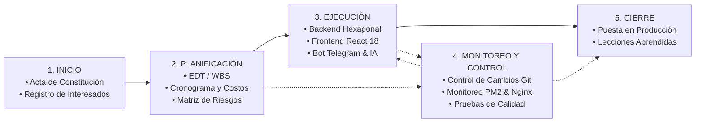

# 📑 GESTIÓN DE PROYECTOS DE SOFTWARE BAJO EL ESTÁNDAR PMBOK®
## Caso de Aplicación: Plataforma Agropecuaria "De los Montes de María"

---

## 1. Generalidades de los Proyectos de Software y su Gestión

### 1.1 Naturaleza y Complejidad del Software
Un proyecto de software es un esfuerzo temporal y multidisciplinario orientado a concebir, diseñar, construir, probar y desplegar un producto lógico intangible. A diferencia de proyectos de ingeniería civil o manufactura física, el software posee características únicas que condicionan su gestión:
* **Intangibilidad:** Los avances no se evidencian físicamente; se evalúan mediante artefactos de código, interfaces funcionales y pruebas de ejecución.
* **Alta tasa de cambio (Maleabilidad):** Los requerimientos del cliente, el entorno del mercado y las dependencias tecnológicas mutan rápidamente durante el ciclo de vida.
* **Complejidad algorítmica y arquitectural:** La integración de bases de datos, APIs de terceros, protocolos en tiempo real (WebSockets) e inteligencia artificial incrementa el riesgo de acoplamiento y fallos no lineales.
* **Dependencia del talento humano:** La productividad y la calidad están directamente ligadas al criterio arquitectural, experiencia y sinergia del equipo de ingeniería.

### 1.2 La Gestión de Proyectos de Software
La gestión de proyectos de software es la disciplina de planificar, organizar, dirigir y controlar los recursos, actividades y riesgos para cumplir con los objetivos trazados bajo restricciones de **alcance, tiempo, costo, calidad, recursos y satisfacción de los interesados** (la Triple Restricción Ampliada).

Una gestión adecuada evita los problemas endémicos del sector tecnológico:
* Corrimiento del alcance (*Scope Creep*).
* Sobrecostos de infraestructura y desarrollo.
* Deuda técnica por falta de diseño arquitectónico.
* Entregables disfuncionales que no resuelven la necesidad real de los usuarios finales.

### 1.3 Contexto del Proyecto: "De los Montes de María"
* **Nombre:** De los Montes de María — Plataforma Agropecuaria & Comercio Campesino Directo.
* **Propósito:** Eliminar los intermediarios abusivos en la comercialización de productos agrícolas y artesanales en la subregión de los Montes de María (El Carmen de Bolívar, San Jacinto, Ovejas, San Juan Nepomuceno, etc.), conectando a los campesinos directamente con compradores urbanos de toda Colombia.
* **Componentes Clave:**
  - Tienda virtual SPA con React 18 y Vite.
  - Backend modular con Arquitectura Hexagonal (DDD) sobre Node.js y Express.
  - Base de datos relacional MySQL 8.0.
  - Checkout con validación OTP por correo y modalidad Pago Contra Entrega (*Cash on Delivery*).
  - Bot oficial de Telegram (`@montesdemariabot`) para notificaciones en vivo y atención de soporte.
  - AgroAsistente con Inteligencia Artificial.
  - Servidor propio en Ubuntu Linux orquestado con Nginx y PM2 ([delosmontesdemaria.dev](https://delosmontesdemaria.dev)).

---

## 2. Estándares para la Gestión de Proyectos de Software

Para asegurar previsibilidad, orden y calidad en la entrega, existen diversos estándares y modelos de referencia internacionales:

| Estándar / Modelo | Organización | Enfoque Principal | Aplicabilidad en el Proyecto |
| :--- | :--- | :--- | :--- |
| **PMBOK® Guide (6ª y 7ª Edición)** | Project Management Institute (PMI) | Marco integral estructurado en Grupos de Procesos, Áreas de Conocimiento y Principios de Entrega de Valor. | **Estándar Rector:** Define el ciclo de vida del proyecto, gobernanza, gestión de interesados, riesgos y aseguramiento de entregables. |
| **ISO/IEC/IEEE 12207** | ISO / IEC / IEEE | Procesos del ciclo de vida del software (adquisición, suministro, desarrollo, operación y mantenimiento). | Define las fases de ingeniería: análisis de requerimientos, diseño arquitectónico, pruebas y despliegue. |
| **ISO 21500 / ISO 21502** | ISO | Guía directiva para la gobernanza y dirección de proyectos organizacionales. | Alineación estratégica con la misión de impacto socioeconómico en los Montes de María. |
| **CMMI-DEV** | CMMI Institute | Niveles de madurez y mejora continua de procesos de ingeniería de software. | Buenas prácticas en control de versiones (Git), refactorización y auditoría continua de código. |
| **Marcos Ágiles (Scrum / Kanban)** | Agile Alliance | Enfoque adaptativo, iterativo e incremental basado en sprints, ceremonias y entrega continua. | Gestión operativa diaria del equipo de desarrollo, priorización del backlog y refinamiento de funcionalidades. |

### Enfoque Híbrido Adoptado
El proyecto adopta un **enfoque híbrido**:
1. **Marco Predictivo/Gobernanza (PMBOK®):** Establece el Acta de Constitución, la identificación formal de interesados, la línea base del alcance (EDT/WBS), la gestión rigurosa de riesgos y el proceso formal de cierre y lecciones aprendidas.
2. **Marco Adaptativo (Ágil / Scrum-Kanban):** Permite el desarrollo iterativo por componentes (Frontend, Backend, Bot, IA), entregas continuas y rápida adaptación ante retroalimentación de los productores rurales.

---

## 3. Procesos de Gestión bajo PMBOK®

El estándar PMBOK® estructura la dirección de proyectos a través de dos dimensiones fundamentales:

```
                           MATRIZ PMBOK®
 ┌───────────────────────────┬────────────────────────────────────────────────────────┐
 │   ÁREAS DE CONOCIMIENTO   │                   GRUPOS DE PROCESOS                   │
 │                           │ Inicio │ Planificación │ Ejecución │ Monitoreo │ Cierre│
 ├───────────────────────────┼────────┼───────────────┼───────────┼───────────┼───────┤
 │ 1. Gestión de Integración │   X    │       X       │     X     │     X     │   X   │
 │ 2. Gestión del Alcance    │        │       X       │           │     X     │       │
 │ 3. Gestión del Cronograma │        │       X       │           │     X     │       │
 │ 4. Gestión de Costos      │        │       X       │           │     X     │       │
 │ 5. Gestión de Calidad     │        │       X       │     X     │     X     │       │
 │ 6. Gestión de Recursos    │        │       X       │     X     │     X     │       │
 │ 7. Comunicaciones         │        │       X       │     X     │     X     │       │
 │ 8. Gestión de Riesgos     │        │       X       │           │     X     │       │
 │ 9. Adquisiciones          │        │       X       │     X     │     X     │   X   │
 │ 10. Interesados           │   X    │       X       │     X     │     X     │       │
 └───────────────────────────┴────────┴───────────────┴───────────┴───────────┴───────┘
```

---

## 4. Grupos de Procesos PMBOK® Aplicados a "De los Montes de María"

A continuación se desarrolla de forma integral y detallada cómo se gestionó y ejecutó el proyecto en cada uno de los 5 grupos de procesos:



---

### 4.1 GRUPO DE PROCESOS DE INICIO

El propósito de este grupo es definir el nuevo proyecto o fase al obtener la autorización formal para comenzar y alinear las expectativas de los interesados.

#### A. Acta de Constitución del Proyecto (Project Charter)
* **Título del Proyecto:** Plataforma E-commerce y Ecosistema Digital "De los Montes de María".
* **Patrocinador / Líder del Proyecto:** Equipo Gestor de Desarrollo & Comunidad Agrícola Montes de María.
* **Justificación del Negocio:** Los campesinos de la subregión enfrentan una brecha de intermediación donde los acopiadores retienen hasta el 60% del margen comercial. Adicionalmente, carecen de canales digitales accesibles para visibilizar sus cosechas tradicionales (ñame espino, yuca, plátano hartón, miel, artesanías). La plataforma provee un canal directo con pago contra entrega e intermediación tecnológica cero costo.
* **Objetivos del Proyecto (Criterios SMART):**
  - **S (Específico):** Desarrollar y desplegar una plataforma web con catálogo de productos, carrito persistente, perfiles de campesinos, bot de Telegram de soporte y panel administrativo.
  - **M (Medible):** Tiempo de carga < 2.0s, disponibilidad de servicio > 99.5%, cobertura de 100% de los flujos de compra sin errores críticos.
  - **A (Alcanzable):** Uso de tecnologías probadas (React, Node.js, MySQL, Nginx, PM2 sobre VPS Ubuntu).
  - **R (Relevante):** Conexión socioeconómica directa de productores de Bolívar y Sucre con consumidores nacionales.
  - **T (Temporal):** Diseñado, desarrollado, validado y desplegado en producción en un plazo de 16 semanas.
* **Límites Preliminares del Alcance:**
  - *Incluye:* Tienda web SPA, backend API REST, panel `/admin`, bot Telegram, asistente IA, facturación PDF con QR, despliegue en servidor propio con SSL.
  - *Excluye:* Procesamiento de tarjetas de crédito complejas en primera fase (se prioriza Pago Contra Entrega por confianza rural) y logística física de camiones propia (se apoya en transportadoras aliadas).
* **Supuestos y Restricciones:**
  - *Supuesto:* Los productores o líderes de vereda cuentan con al menos un teléfono inteligente con acceso a Telegram/correo.
  - *Restricción:* Presupuesto optimizado con uso de servidor propio VPS y stack Open Source sin licencias comerciales costosas.

#### B. Identificación y Matriz de Interesados (Stakeholder Management)

| Interesado / Rol | Expectativa Principal | Nivel de Poder | Nivel de Interés | Estrategia de Gestión |
| :--- | :--- | :--- | :--- | :--- |
| **Productores Campesinos** | Vender cosechas a precio justo, facilidad para publicar inventario. | Alto | Alto | **Gestionar de cerca:** Interfaz intuitiva, perfiles públicos personalizados y soporte por Telegram. |
| **Compradores / Consumidores** | Productos frescos, precios accesibles, pago seguro contra entrega, factura clara. | Medio | Alto | **Mantener satisfecho:** Catálogo veloz, cálculo de flete en tiempo real, validación OTP. |
| **Administradores de la Plataforma** | Gestión ágil de inventario, cupones, banners, soporte en tiempo real y métricas financieras. | Alto | Alto | **Gestionar de cerca:** Panel `/admin` integral con dashboard y vinculación bidireccional a Telegram. |
| **Equipo de Desarrollo e Infraestructura** | Código modular y desacoplado, mantenibilidad, despliegues automáticos sin caídas. | Alto | Alto | **Colaboración activa:** Arquitectura Hexagonal, Git, CI/CD básico y PM2. |
| **Proveedores Externos (APIs / Infra)** | Telegram API, Brevo/Gmail SMTP, servicio de IA, VPS Ubuntu. | Bajo | Medio | **Monitorear:** Monitoreo de cuotas, límites de tasa (*rate limits*) y latencias. |

---

### 4.2 GRUPO DE PROCESOS DE PLANIFICACIÓN

En esta etapa se establece el alcance total del esfuerzo, se definen los objetivos y se desarrolla la línea de acción requerida para alcanzarlos.

#### A. Gestión del Alcance y Estructura de Desglose del Trabajo (EDT / WBS)
Se construyó una EDT orientada a entregables técnicos y de negocio:

```mermaid
graph TD
    Root["🌾 1.0 Plataforma De los Montes de María"]

    subgraph Backend["🔷 1.1 Backend & API (Arquitectura Hexagonal)"]
        B1["1.1.1 Capa de Dominio (Entidades: User, Product, Purchase)"]
        B2["1.1.2 Capa de Aplicación (Casos de Uso)"]
        B3["1.1.3 Capa de Infraestructura (MySQL, EmailService, IAService)"]
        B4["1.1.4 Puertos HTTP & WebSockets (Controladores REST & Socket.io)"]
    end

    subgraph Frontend["⚛️ 1.2 Frontend Web SPA (React 18 + Vite)"]
        F1["1.2.1 Catálogo Dinámico, Filtros y Perfil de Campesinos"]
        F2["1.2.2 Carrito Persistente & Módulo de Cupones"]
        F3["1.2.3 Checkout con OTP & Facturación PDF con QR"]
        F4["1.2.4 Widget AgroAsistente con Inteligencia Artificial"]
        F5["1.2.5 Panel Administrativo /admin & Carrusel Hero"]
    end

    subgraph Canales["📱 1.3 Canales Externos & Tiempo Real"]
        C1["1.3.1 Bot Oficial de Telegram (@montesdemariabot)"]
        C2["1.3.2 Sistema de Notificaciones por Correo (OTP & Factura)"]
        C3["1.3.3 Chat de Soporte en Tiempo Real (Socket.io)"]
    end

    subgraph DevOps["⚙️ 1.4 Infraestructura, DevOps & Seguridad"]
        D1["1.4.1 Servidor Ubuntu Linux, Nginx Proxy & SSL Let's Encrypt"]
        D2["1.4.2 Orquestación PM2 & Base de Datos MySQL 8.0"]
        D3["1.4.3 Seguridad Perimetral (Helmet, CORS, Rate Limiters, bcrypt)"]
    end

    subgraph Calidad["✅ 1.5 Calidad, Auditoría & Producción"]
        Q1["1.5.1 Suite de Pruebas Automatizadas (test_runner.js)"]
        Q2["1.5.2 Auditoría de Usabilidad y Microservicios"]
        Q3["1.5.3 Despliegue en Producción (delosmontesdemaria.dev)"]
    end

    Root --> Backend
    Root --> Frontend
    Root --> Canales
    Root --> DevOps
    Root --> Calidad

    Backend --> B1
    Backend --> B2
    Backend --> B3
    Backend --> B4

    Frontend --> F1
    Frontend --> F2
    Frontend --> F3
    Frontend --> F4
    Frontend --> F5

    Canales --> C1
    Canales --> C2
    Canales --> C3

    DevOps --> D1
    DevOps --> D2
    DevOps --> D3

    Calidad --> Q1
    Calidad --> Q2
    Calidad --> Q3
```



#### B. Gestión del Cronograma (Línea Base del Tiempo)
El proyecto se organizó en 5 Fases / Sprints de ejecución:
1. **Fase 1 (Semanas 1-3):** Arquitectura base, modelado relacional en MySQL (`backup_dbmontesdm.sql`) y configuración del Composition Root backend.
2. **Fase 2 (Semanas 4-7):** Casos de uso de autenticación, productos, campesinos y desarrollo del catálogo frontend en React.
3. **Fase 3 (Semanas 8-11):** Flujo de compras, carrito persistente, checkout contra entrega, verificación OTP y generación de facturas en PDF.
4. **Fase 4 (Semanas 12-14):** Integración del Bot de Telegram, widget de AgroAsistente con IA, WebSockets para chat y panel `/admin`.
5. **Fase 5 (Semanas 15-16):** Pruebas integrales, endurecimiento de seguridad, aprovisionamiento del servidor Ubuntu, Nginx, SSL y despliegue final.

#### C. Gestión de Costos (Presupuesto)
* **Costos de Infraestructura y Servicios:**
  - Servidor Cloud VPS (Ubuntu 22.04 LTS, 4 vCPU, 8GB RAM, SSD NVMe): Presupuestado anualmente.
  - Dominio oficial `.dev` (`delosmontesdemaria.dev`): Registro y renovación anual.
  - Certificados SSL/TLS: Gratuitos y autorrenovables vía Let's Encrypt / Certbot ($0 COP).
  - Proveedor SMTP (Brevo / Gmail API transaccional): Plan gratuito inicial ($0 COP).
  - Telegram Bot API: Gratuito e ilimitado ($0 COP).
* **Costos de Ingeniería y Desarrollo:** Estimado en horas hombre por módulos (Frontend, Backend, DevOps, QA).
* **Reserva de Contingencia:** 15% del presupuesto para mitigar fluctuaciones de tráfico o ampliación de almacenamiento de medios en `/public/uploads`.

#### D. Gestión de la Calidad
* **Estándares de Código:** Clean Architecture, Domain-Driven Design (DDD), principios SOLID.
* **Métricas de Aceptación:**
  - Cobertura de pruebas unitarias e integración en endpoints críticos (`/api/auth`, `/api/purchases`, `/api/admin`).
  - Tiempo de respuesta de endpoints REST: < 250 ms en percentil 95.
  - Compatibilidad 100% responsiva (móviles, tablets y pantallas de escritorio).

#### E. Gestión de Riesgos (Matriz de Riesgos y Respuesta)

| Código | Riesgo Identificado | Probabilidad | Impacto | Nivel | Estrategia de Mitigación / Plan de Contingencia |
| :--- | :--- | :--- | :--- | :--- | :--- |
| **R-01** | Baja alfabetización digital o desconfianza de productores rurales. | Media | Alto | **Alto** | Interfaz simplificada con fotos reales, soporte bidireccional por Telegram y checkout sin requerir tarjetas bancarias. |
| **R-02** | Caídas en el servicio de correo para envío de códigos OTP. | Baja | Alto | **Medio** | Soporte de fallback con doble transportador SMTP (Brevo + Gmail) y registro de auditoría en base de datos. |
| **R-03** | Latencia o indisponibilidad en la API externa de Inteligencia Artificial. | Media | Bajo | **Bajo** | Patrón de degradación elegante (*Graceful Degradation*): si la IA no responde, el widget ofrece catálogo directo y botón a Telegram. |
| **R-04** | Vulnerabilidades por inyección SQL o ataques XSS/CSRF. | Baja | Crítico | **Alto** | Consultas parametrizadas en repositorio MySQL, validación en controladores, cabeceras seguras con Helmet y hashing de contraseñas con bcrypt. |
| **R-05** | Caída inesperada del proceso de Node.js por excepciones no controladas. | Baja | Alto | **Medio** | Uso de PM2 con reinicio automático de procesos (`ecosystem.config.js`), ErrorBoundary en React y logs estructurados en `/logs`. |

---

### 4.3 GRUPO DE PROCESOS DE EJECUCIÓN

Consiste en coordinar personas y recursos, gestionar las expectativas de los interesados e integrar y realizar las actividades del proyecto conforme al plan de gestión.

#### A. Dirección y Gestión del Trabajo del Proyecto
Durante la ejecución se materializaron los entregables de software:
1. **Backend con Arquitectura Hexagonal:**
   - **Dominio:** Entidades puras libres de dependencias (`User.js`, `Product.js`, `Purchase.js`, `Coupon.js`, `Banner.js`).
   - **Aplicación:** Casos de uso desacoplados que orquestan las operaciones de negocio.
   - **Infraestructura:** Adaptadores de base de datos MySQL, controladores HTTP Express, adaptadores para Telegram y servicios de correo transaccional.
2. **Frontend Moderno e Interactivo:**
   - SPA construida con React 18 y Vite, optimizada para velocidad de carga.
   - Implementación de `HeroSlideRenderer.jsx` con efectos visuales dinámicos, desenfoque (blur) y filtros de tinte personalizados desde el panel administrativo.
   - Carrito persistente en `localStorage` con validación en caliente de cupones y cobertura por municipio.
3. **Módulo de Soporte Multicanal & WebSockets:**
   - Canal de chat en tiempo real cliente-servidor usando Socket.io.
   - Enlace con el Bot de Telegram `@montesdemariabot`: cualquier mensaje o ticket generado en la web notifica a los administradores en su móvil, permitiendo responder directamente desde Telegram al chat del cliente.
4. **AgroAsistente con Inteligencia Artificial:**
   - Integración contextualizada para guiar a los compradores sobre variedades de tubérculos (ñame diamante, yuca costeña, plátano verde), recetas típicas de los Montes de María y uso de abonos orgánicos.

#### B. Gestión del Conocimiento del Proyecto
- Creación de documentación viva en el repositorio:
  - `DOCUMENTACION_OFICIAL_PROYECTO.md`
  - `AUDITORIA_MICROSERVICIOS.md`
  - `USABILIDAD_IMPLEMENTADA.md`
  - `ecosystem.config.js` y `deploy.sh`

---

### 4.4 GRUPO DE PROCESOS DE MONITOREO Y CONTROL

Asegura que los objetivos del proyecto se cumplan mediante el seguimiento, revisión y regulación del progreso y desempeño, identificando variaciones y tomando acciones correctivas.

#### A. Control Integrado de Cambios
* Se utilizó **Git** como sistema de control de versiones con flujo de ramas para nuevas funcionalidades (feature branches), asegurando que el código en `main` esté siempre listo para producción.
* Todo cambio en la estructura de base de datos requirió script de migración y actualización en `backup_dbmontesdm.sql`.

#### B. Control de Calidad y Pruebas
* **Ejecución de Suites de Validación:** Uso de `test_runner.js` para certificar la integridad de los endpoints, autenticación, cálculo de subtotales y creación de compras.
* **Auditoría de Usabilidad y Microservicios:** Evaluaciones documentadas en `AUDITORIA_MICROSERVICIOS.md` y `USABILIDAD_IMPLEMENTADA.md` para garantizar tiempos de respuesta rápidos y accesibilidad para usuarios rurales.

#### C. Monitoreo de Infraestructura y Rendimiento
* **Monitoreo con PM2:** Control en tiempo real del uso de CPU y memoria de los procesos de backend, con reinicio automático en caso de saturación o error.
* **Monitoreo de Nginx:** Registro de accesos y errores en `/var/log/nginx/` para auditar solicitudes sospechosas y rendimiento del proxy inverso.
* **CORS y Rate Limiting:** Verificación activa para impedir ataques de fuerza bruta en los endpoints de autenticación y checkout OTP.

---

### 4.5 GRUPO DE PROCESOS DE CIERRE

Formaliza la finalización de todas las actividades a través de todos los grupos de procesos para cerrar formalmente el proyecto o una fase específica.

#### A. Cierre Técnico y Entrega de la Solución
* **Puesta en Producción Exitosa:** La plataforma se encuentra desplegada y operativa en su dominio oficial seguro: **[https://delosmontesdemaria.dev](https://delosmontesdemaria.dev)**.
* **Entrega de Artefactos:**
  - Código fuente completo y auditado en GitHub: `https://github.com/Danx016/delosmontesdemaria`.
  - Base de datos relacional inicializada con datos reales de productores campesinos y productos típicos de la región.
  - Script de despliegue automatizado `deploy.sh` y configuración de servidor Nginx (`nginx_default.conf`).

#### B. Lecciones Aprendidas (Registro OPA - Activos de los Procesos de la Organización)
1. **Adaptación a la Realidad Rural:** Obligar a campesinos o clientes locales a registrar tarjetas de crédito generaba una tasa de abandono muy alta; la decisión de implementar **Pago Contra Entrega con validación OTP por correo** resultó el factor crítico de éxito comercial.
2. **Eficiencia en Comunicación (Telegram):** Integrar un bot de Telegram para los administradores y campesinos eliminó la necesidad de mantener abierta una pantalla de administración todo el día, ya que gestionan pedidos y soporte directamente desde su teléfono inteligente.
3. **Arquitectura Hexagonal como Acelerador:** Separar la lógica de negocio del framework permitió realizar ajustes de base de datos y de servicios externos (correo, IA) sin romper la lógica del carrito de compras ni los cálculos de facturación.
4. **Infraestructura Propia vs. Servicios en la Nube Complejos:** El uso de un servidor Linux Ubuntu con Nginx y PM2 redujo los costos operativos a una fracción de los servicios PaaS tradicionales, permitiendo máxima sostenibilidad para un proyecto con vocación comunitaria y social.

---

## 5. Matriz de Trazabilidad de Requerimientos vs. Entregables PMBOK®

| Requerimiento del Negocio | Caso de Uso / Componente Desarrollado | Artefacto de Código / Evidencia | Estado PMBOK® |
| :--- | :--- | :--- | :--- |
| Conectar campesinos y compradores sin intermediarios | Catálogo, perfiles de productores y carrito persistente | `client/src/pages/`, `ProductController.js`, `ProductRepository.js` | **Entregado y Verificado** |
| Compra confiable para zonas con baja bancarización | Checkout contra entrega con OTP y Factura Electrónica PDF | `PurchaseController.js`, `EmailService.js`, `client/src/pages/Checkout.jsx` | **Entregado y Verificado** |
| Notificación y soporte ágil para administradores en campo | Bot bidireccional de Telegram y WebSockets | `TelegramBotService.js`, `socket.js`, `SupportTicket.js` | **Entregado y Verificado** |
| Asesoría en cosechas y siembra para compradores | AgroAsistente con Inteligencia Artificial | `IAService.js`, `client/src/components/AIAssistant.jsx` | **Entregado y Verificado** |
| Autonomía administrativa y publicitaria | Panel `/admin`, gestor de cupones y banners dinámicos | `AdminController.js`, `BannerController.js`, `HeroSlideRenderer.jsx` | **Entregado y Verificado** |
| Despliegue en producción de alta disponibilidad | Servidor Ubuntu Linux, Nginx, PM2, SSL Let's Encrypt | `deploy.sh`, `ecosystem.config.js`, `delosmontesdemaria.dev` | **Entregado y Verificado** |

---
*Documento elaborado bajo los lineamientos del Project Management Institute (PMI) - PMBOK® Guide para la dirección y aseguramiento de proyectos de software.*
